# 35B 导入流水线 · 预览数学渲染问题审计（2026-07-04）

> 持续改进底账：问题截图 + 落盘证据 + root cause + 修复方案。
> 修复动手前以本文档为准；每修一项，更新「状态」列并补 golden 用例。

## 数据源

| 项 | 值 |
|----|----|
| MinIO job | `7b33d74bc3d042a0b9836116f8cc3bdf` |
| DB job id | `de6bd85c-8eef-4126-8953-cfadd80abb55` |
| Prompt | `layout_blueprint_v5`，30 页，无 repair |
| 落盘本地副本 | `.pageaudit/latest/`（`pNNNN_raw_model.json` / `pNNNN_blueprint.json` / `pNNNN.html`） |
| 截图 | 本目录 `img/pNN.png`（用户红框标注，2026-07-04） |

---

## 一、根因分层（已验证）

### L1 — 前端 MathJax 缺 AMS/cases 包注册（影响面最大）

`exam-ocr-server/studio-ui/src/util/mathjax-core.ts` 与 `frontend/src/mathjax-core.ts`
在 `new TeX({ packages: [... "ams", "cases" ...] })` 里**声明**了包名，但没有做
side-effect import。mathjax-full 的 ESM 用法里，包必须 import 其
`*Configuration.js` 模块才会注册宏表——服务端桥
`learning-buddy-api/app/math/mathjax_render.mjs` 此前踩过同一个坑，已修；前端两份没修。

**复现证据**（用 studio-ui 的 node_modules、与前端完全相同的配置、不加 import）：

```text
a \leqslant x \leqslant b                  ERR
\varnothing \subseteq A                    ERR
\complement_U A                            ERR
\begin{cases} 2x=4, \\ x+y=8 \end{cases}   ERR
A \subseteq B                              OK   (base 包)
x > 1                                      OK
```

同一批 LaTeX 在服务端桥（含 import）全部 valid。因此**落盘 HTML 正确、服务端校验通过、
预览失败**三者并存。

失败路径：`typesetTextbookMath()`（`studio-ui/src/util/math-render.ts`）在
`renderLatexToHtml` 报错时执行 `el.textContent = latex`——把原始 LaTeX 静默打到页面上，
这就是截图里大量 `\leqslant`、`\varnothing` 原文的直接来源。

**关键推论**：一个表达式里只要有一个 AMS 符号失败，**整个表达式**报错回退。所以
`\{x \mid 1 \leqslant x < 2\}` 里 base 包支持的 `\{`、`\mid` 也一起显示为原文——
不要误判为「`\{`/`\mid` 不支持」。

**修复**：
1. 两份 `mathjax-core.ts` 补与服务端桥完全相同的 6 个 side-effect import
   （Base/Ams/Newcommand/Configmacros/Boldsymbol/Cases Configuration）。
2. 失败分支不再静默：`console.warn` + 保留 `.math-error` 样式（红色下划线等），
   预览面板汇总失败计数，QA 一眼可见。
3. Harness：新增「服务端 ↔ 前端 MathJax 平价测试」——同一 LaTeX 语料分别过
   `mathjax_render.mjs` 与前端配置的 Node harness，结果必须一致（防止两端再漂移）。

### L2 — vLLM guided JSON decoding × JSON 转义的交互破坏（比原判断更深）

原判断是「模型 JSON 单反斜杠转义」。深挖后机制更精确，分三种命运：

| LaTeX 命令首字母 | JSON 单反斜杠形态 | 结果 |
|---|---|---|
| `b f`（`\beta` `\bar` `\frac` `\forall`） | `\b` `\f` 是**合法** JSON 转义 | **静默破坏**为控制字符：`\x08eta`、`\x0crac` |
| `n r t`（`\notin` `\neq` `\rightarrow` `\rightleftharpoons` `\text` `\times` `\triangle` `\theta`） | `\n` `\r` `\t` 合法 | **静默破坏**为换行/回车/制表符 + 残词（`otin`、`ight...`、`ext{`） |
| 其他（`\alpha` `\leqslant` `\varnothing` `\subseteq`…） | `\a` `\l` 等**非法** JSON 转义 | guided 语法**禁止**单反斜杠 → 模型被迫输出 `\\`，反而全部存活 |

这解释了为什么全书 `\leqslant` 都完好、而 `\beta`/`\frac`/`\text`/`\notin` 恰好全军覆没。

**更深一层（α→β 变形的假说）**：p21/p26 里所有希腊字母（应有 α 和 β）都成了 `\beta`，
而 p25 却有正确的 `\\alpha`。机制推测：模型想输出 `\alpha` 时，guided 语法在 `\` 之后
mask 掉 `a`（非法转义），可选 token 只剩 `\ b f n r t u " /`——采样器选了 `b`，模型顺势
续写 `eta`，`\alpha` 就**在生成期被语法逼成了 `\beta`**。即 guided decoding 不止在解析期
破坏，还会在**生成期扭曲**模型输出。这一点决定了修复策略：

1. **后处理确定性修复**（必做，解析后立即执行）：扫描字符串中的
   `\x08/\x0c/\n/\r/\t` + 紧跟的字母残词，按已知 LaTeX 命令白名单还原
   （`\x08eta→\beta`、`\x0crac→\frac`、`\n otin→\notin`、`\t ext{→\text{` 等）。
   只在残词能拼出白名单命令时才替换，天然安全。
2. **Prompt 强化**（必做）：v5 → 明确「JSON 字符串中所有 LaTeX 反斜杠一律写 `\\`」+
   few-shot 含 `\\alpha` `\\beta` `\\frac` 的示例，降低生成期被 mask 逼歪的概率。
3. **校验门**（必做）：normalize 后任何 math 段含控制字符 → 该段标 invalid，
   走 fallback 而非把坏 HTML 打出去（p20_b7 的 `<br>otin` 结构性破坏就该被这道门拦住）。
4. 注意：`\x08eta` 可还原为 `\beta`，但**被生成期逼歪的 `\alpha`→`\beta` 无法由后处理还原**，
   只能靠 prompt few-shot + golden 回归观察（p21/p26 为观察样本）。

### L3 — 编译器 / 模型结构问题（三个独立点）

1. **`_render_table()` 不解析行内公式**（`page_compiler.py`）：单元格只
   `escape(str(cell))`，`$x \leqslant 1$` 原样进 `<td>`。→ 表格 cell 走与正文相同的
   `$...$` 分段渲染管线。
2. **running_header 吞块**（`page_compiler.compile_page_html` L233–247）：
   `role=running_header` 的块全部 `continue`，且 `running_header = running_header or ...`
   只留第一块文本。p3 版权页 6 块全被模型标成 `running_header` → 5 块内容（含表格、ISBN、
   版权声明）**整页丢失**。→ 双管齐下：
   - 编译器：只信 `zone=="running"` / `kind=="running"`；`role=running_header` 但
     zone=main 的块（尤其 kind=table、多段长文本）视为可疑，回归 main 渲染；
     页眉文本加长度上限。
   - Prompt：版权/扉页明确禁止 `running_header` 角色。
3. **残缺 cases 环境**（p14_b8）：模型输出 `\begin{cases} x=4, \\ y=0.` 缺
   `\end{cases}`，校验 invalid → `math--fallback` 显示剥壳文本「cases x=4, \ y=0.」。
   → 确定性结构修复：`\begin{cases}` 无配对 `\end{cases}` 时自动补齐再校验；
   仍失败才 fallback，且 fallback 用 blueprint 的 `fallback_text`（"2x=4, x+y=8 或 …"）
   而不是剥壳残渣。Prompt 同时要求 cases 必须闭合。

### L4 — 侧栏注释被裁成 figure，图文重复（p24）

p24_f1/f2 是 figure 块，`alt` 与 `<figcaption>` 都是注释全文，预览呈现
「注释截图 + 同样文字的图注」双写。根因在模型分类（把侧栏放大镜注释当成插图）。
→ Prompt：侧栏文字注释 → `note`/callout，不允许 figure+全文 caption；
编译器兜底：aside 区 figure 若 caption 超长且无图形内容特征，降级为 callout 文本。

---

## 二、对上一轮分析的核验结论

| 上轮结论 | 核验结果 |
|---|---|
| L1 前端缺 AMS 导致预览失败 | ✅ 已用同配置 Node 复现（见上），成立 |
| L2 = 「模型 JSON 单反斜杠」 | ⚠️ 部分正确，**已修正**：guided decoding 强制非法转义写 `\\`，只有 `b/f/n/r/t` 开头命令被静默破坏；且存在生成期 `\alpha`→`\beta` 扭曲假说 |
| p21 「模型把 α 写成 β」是模型语义错误 | ⚠️ 更可能是 guided 语法 mask 所致（生成期扭曲），非纯模型错误；raw_model.json 中的 `\beta` 实为 `\x08eta` 的 JSON 再编码显示 |
| p13 `\{`/`\mid` 不渲染 | ✅ 修正表述：它们本身 base 可渲染，是整表达式因 `\leqslant` 失败而整体回退 |
| p3/p14/p24 的 L3 判断 | ✅ 成立，落盘证据齐全 |
| 服务端校验全部 valid | ✅ 复跑 `_call_bridge` 确认 `\leqslant`/`\varnothing`/`\complement_U A`/整段集合式均 valid |

---

## 三、逐页问题台账

> 「层」= 上文根因层级。全部「待修复」，等待拍板。

### 第 3 页 — 版权页整页丢失（L3-2）


| 项 | 内容 |
|---|---|
| 红框 | 仅编委会一行可见，版权/ISBN/图片来源等全部消失 |
| 落盘 | `p0003_blueprint.json`：6 块全 `role=running_header`（p3_b1 文本、p3_b4 表格…）；`p0003.html`：仅 p3_b1 进 `<header>`，main 为空 |
| 根因 | 模型误标 + 编译器把 running_header 全部 skip、只取第一块 |
| 修复 | L3-2（prompt 禁标 + 编译器只信 zone、可疑块回 main） |

### 第 9 页 — `2x+1 \leqslant 0` 原文（L1）

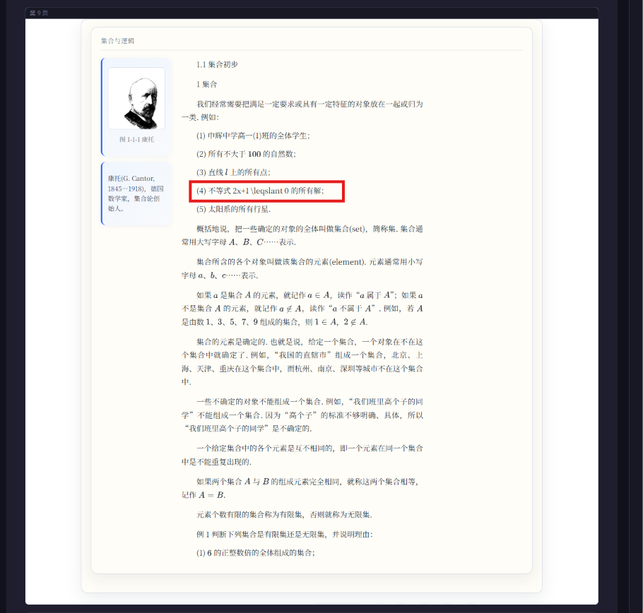

| 项 | 内容 |
|---|---|
| 红框 | 例(4)「不等式 2x+1 \leqslant 0 的所有解」 |
| 落盘 | `p0009.html` p9_b1：`data-latex="2x+1 \leqslant 0"` ✓，服务端 valid |
| 根因 | L1：前端无 AMS，`\leqslant` 失败 → textContent 回退 |
| 修复 | L1 import；改前端后**无需重导**即可验证 |

### 第 12 页 — 闭区间定义 `a \leqslant x \leqslant b`（L1）

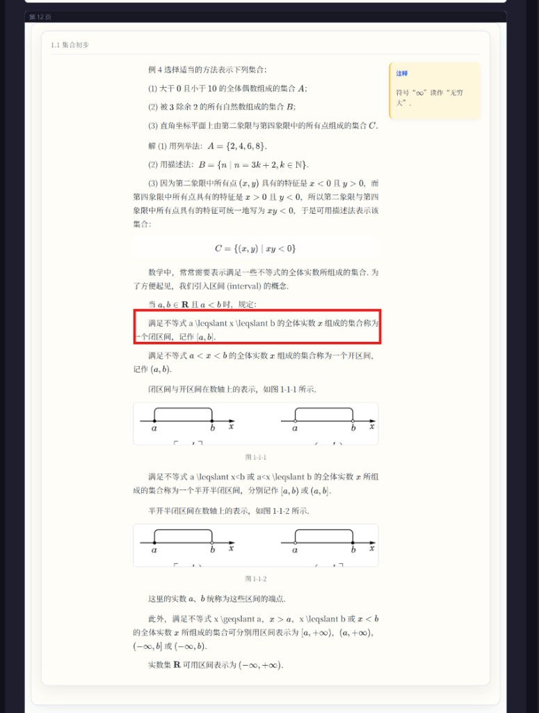

| 项 | 内容 |
|---|---|
| 红框 | 闭区间定义段；下文半开区间 `a \leqslant x<b` / `a<x \leqslant b`、数轴下方 `x \geqslant a` 同病 |
| 落盘 | `p0012.html`：`data-latex="a \leqslant x \leqslant b"` 等 4 处 span 齐全 ✓ |
| 根因 | L1（开区间 `a < x < b` 只用 base 符号所以正常，形成同页反差） |
| 修复 | L1 |

### 第 13 页 — 例 5 / 练习 3 / 空集性质（L1）

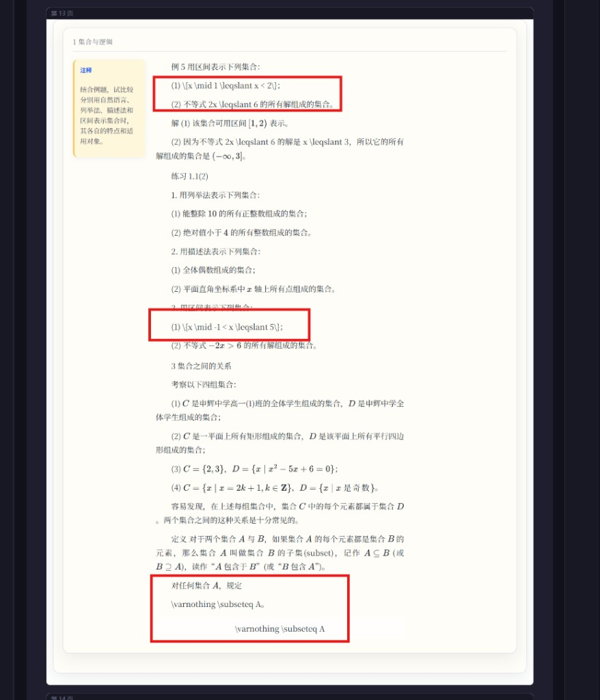

| 项 | 内容 |
|---|---|
| 红框 1 | 例 5 `\{x \mid 1 \leqslant x < 2\}`：span ✓，整式因 `\leqslant` 回退（`\{`/`\mid` 是连坐） |
| 红框 2 | 练习 3(1) `\{x \mid -1 < x \leqslant 5\}`：span ✓ |
| 红框 3 | `\varnothing \subseteq A`：正文 p13_b4 行内 + p13_eq1 display 两处 span ✓；`\varnothing` 属 AMS |
| 根因 | 全部 L1 |
| 修复 | L1 |

### 第 14 页 — 侧栏注释 / 例 6 方程组 / 空集（L1 + L3-3）

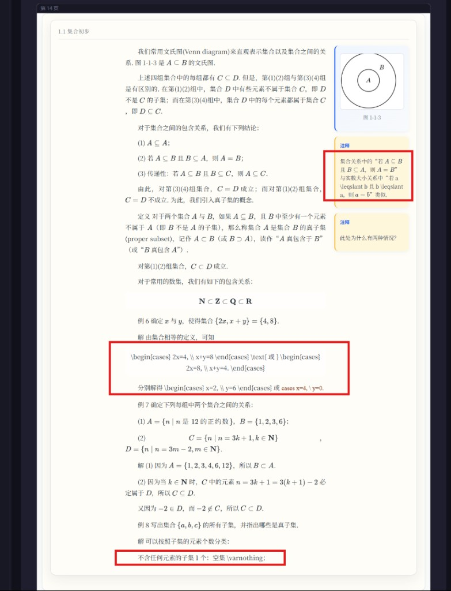

| 项 | 内容 |
|---|---|
| 红框 1（侧栏） | p14_b3 `a \leqslant b` 等 span ✓ → L1 |
| 红框 2（例 6） | 第一组 cases span ✓（预览失败为 L1，cases 环境未注册）；第二组模型输出缺 `\end{cases}` → invalid → `math--fallback` 显示「cases x=4, \ y=0.」→ L3-3 |
| 红框 3 | `\varnothing` span ✓ → L1 |
| 修复 | L1 + L3-3（自动补 `\end{cases}` + fallback 用 fallback_text + prompt 要求闭合） |

### 第 17 页 — 同句 `\overline{A}` 正常、`\complement_U A` 原文（L1）

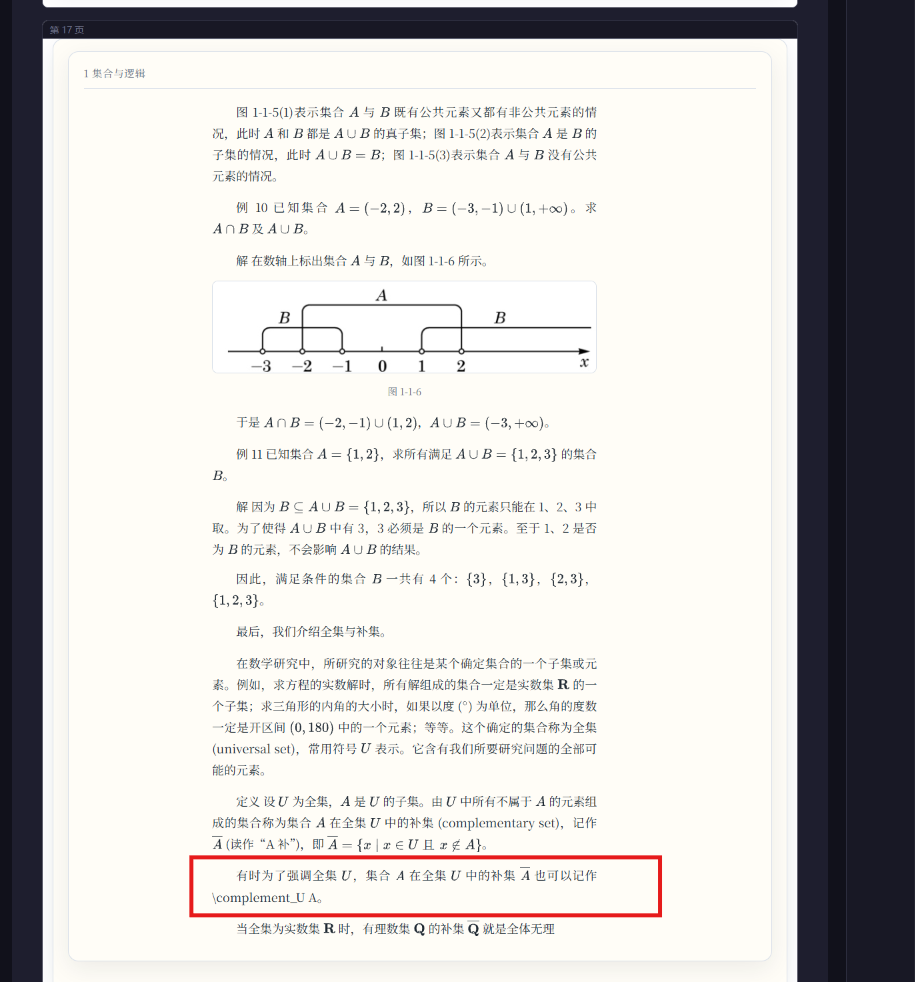

| 项 | 内容 |
|---|---|
| 红框 | 「…补集 Ā 也可以记作 \complement_U A」 |
| 落盘 | 两个 span 均正确 ✓；`\overline` 是 base（渲染成功）、`\complement` 是 AMS（失败），同句反差即证据 |
| 修复 | L1 |

### 第 18 页 — 练习 2 与 A 组 1(2)（L1）

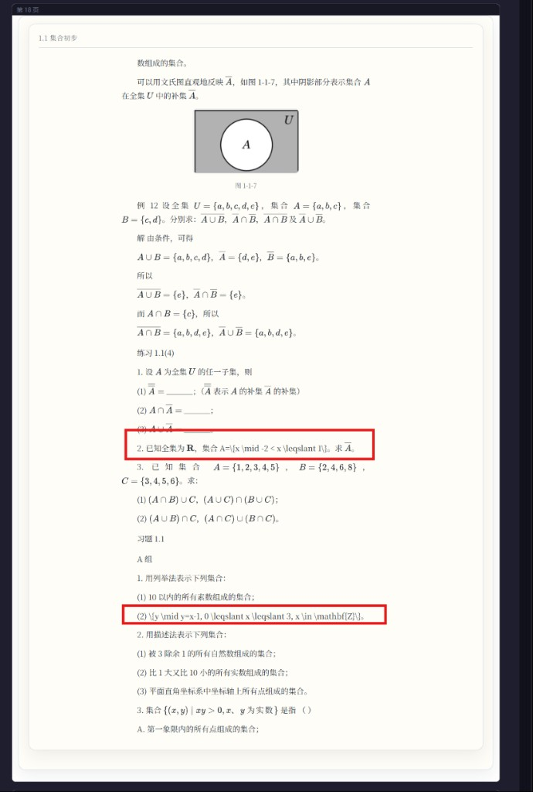

| 项 | 内容 |
|---|---|
| 红框 1 | 练习 2「已知全集为 R，A=\{x \mid -2 < x \leqslant 1\}」：拆分 span 齐全 ✓ |
| 红框 2 | A 组 1(2) `\{y \mid y=x-1, 0 \leqslant x \leqslant 3, x \in \mathbf{Z}\}`：p18_b5 完整 span ✓ |
| 根因 | L1（`\leqslant` 连坐整式） |
| 修复 | L1 |

### 第 20 页 — `\notin`/`\text` 被 JSON 转义吃掉（L2）

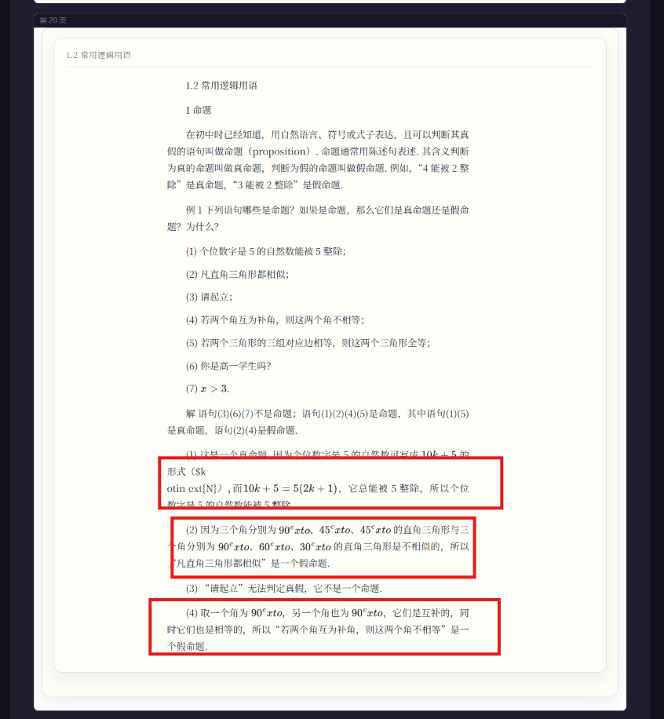

| 项 | 内容 |
|---|---|
| 红框 1 | p20_b7：`$k \notin \text{N}$` → `\n` 变换行、`\t` 变 tab，HTML 已结构性损坏：`（$k <br>otin 	ext{N}<span data-latex="） , 而">` |
| 红框 2/3 | p20_b8/b10：`90^\text{o}` → `data-latex="90^ ext{o}"`（tab 吃掉 `\t`） |
| 根因 | L2 静默破坏（`n`/`t` 开头命令）；p20_b7 还暴露 tokenizer 把 math 段内换行转 `<br>` 的次生问题 |
| 修复 | L2 后处理还原 + 控制字符校验门 + prompt 规范 `^\circ`、`\mathbb{N}` |

### 第 21 页 — 全页 α/β 损坏、`\Rightarrow` 命题链（L2）

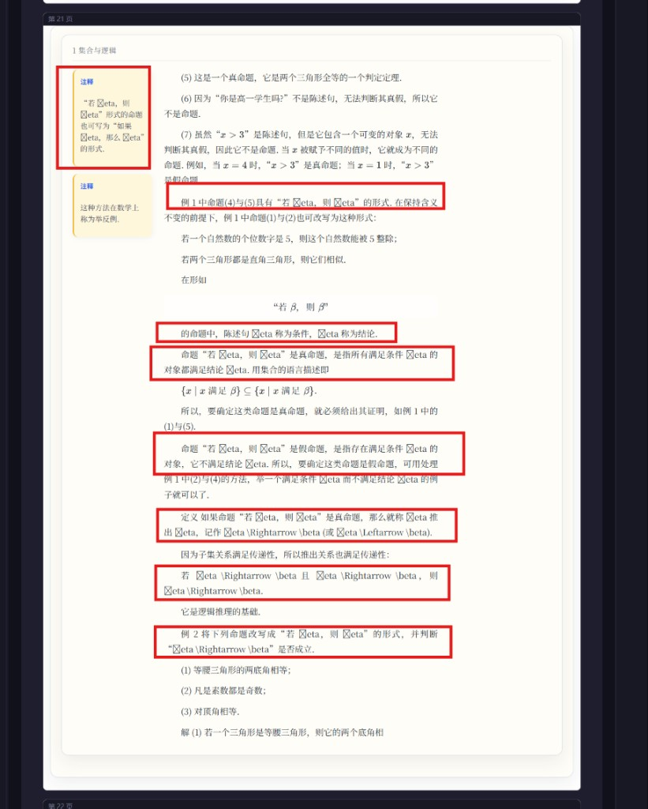

| 项 | 内容 |
|---|---|
| 红框 | 侧栏注释、「若 β 则 β」定义、推出符号定义、传递性、例 2 等 9 处 |
| 落盘 | raw_model 所有希腊字母均为 `\b`+`eta`（JSON 合法转义 → 解析成 `\x08eta`）；`\\Rightarrow` 因 `\R` 非法被 guided 强制双写而存活 |
| 根因 | L2；α 消失疑为生成期被语法 mask 逼成 β（见 L2 深挖），后处理无法还原语义，需 prompt few-shot + golden 观察 |
| 修复 | L2 全套 |

### 第 24 页 — 侧栏注释双写 + 表 1-2 无公式（L4 + L3-1）

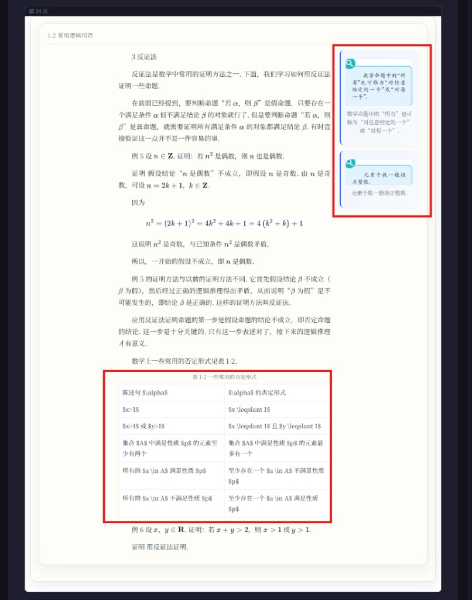

| 项 | 内容 |
|---|---|
| 红框 1（侧栏） | p24_f1/f2 被模型当 figure，`alt`=`figcaption`=注释全文 → 截图+文字双写 → L4 |
| 红框 2（表 1-2） | `p24_t1`：`<td>$x \leqslant 1$</td>` 裸 `$`，无 `data-latex` → `_render_table` 不走公式管线 → L3-1 |
| 修复 | L3-1（表格 cell 公式化）+ L4（prompt 分类 + 编译器降级兜底） |

### 第 25 页 — 反证法假设行 `\leqslant`（L1）

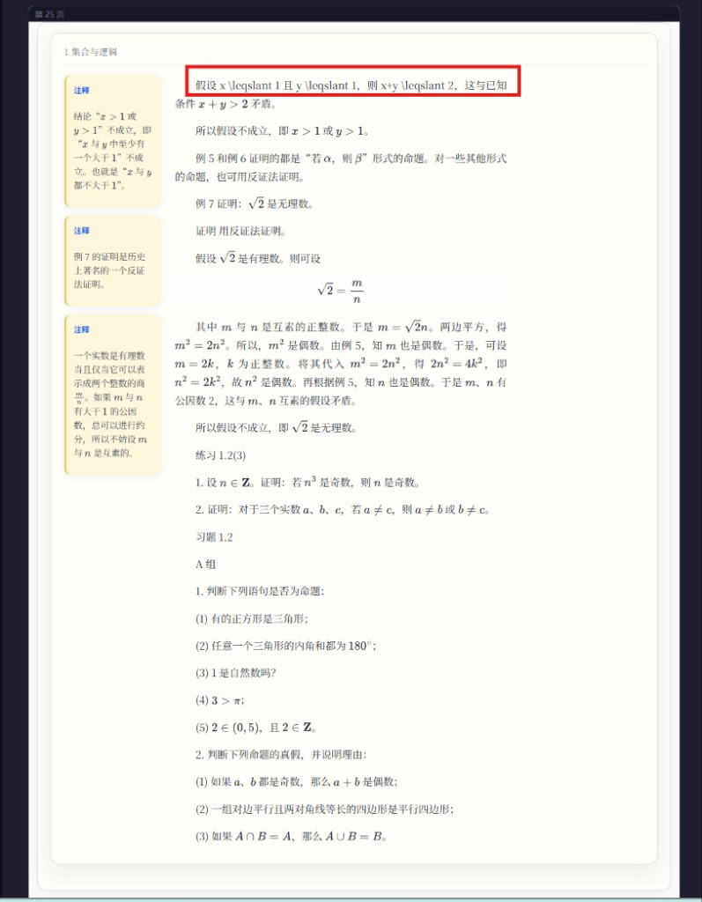

| 项 | 内容 |
|---|---|
| 红框 | 「假设 x \leqslant 1 且 y \leqslant 1，则 x+y \leqslant 2」 |
| 落盘 | p25_b4 四个 span ✓；同页 `\sqrt{2}`、`\frac{m}{n}` 正常（base 包），只有 AMS 符号倒下 |
| 修复 | L1 |

### 第 26 页 — 逻辑符号全面损坏（L2，最重灾页）

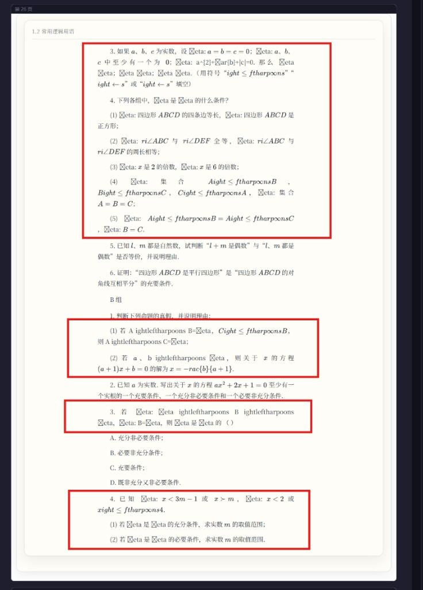

| 项 | 内容 |
|---|---|
| 红框 | 题 3/4、B 组 1/3/4：`☒eta`（backspace+eta）、`ightleftharpoons`（`\r` 变回车）、`rac{b}{a+1}`（`\f` 变换页符）、`a^{2}+ar{b}+|c|`（`\b` 吃掉 `\bar`） |
| 落盘 | raw_model 与 blueprint 中控制字符齐全，是 L2 三类破坏的完整样本页 |
| 修复 | L2 全套；本页选为 L2 golden 主样本 |

### 第 28 页 — 题 9 D、B 组 4/5（L1）

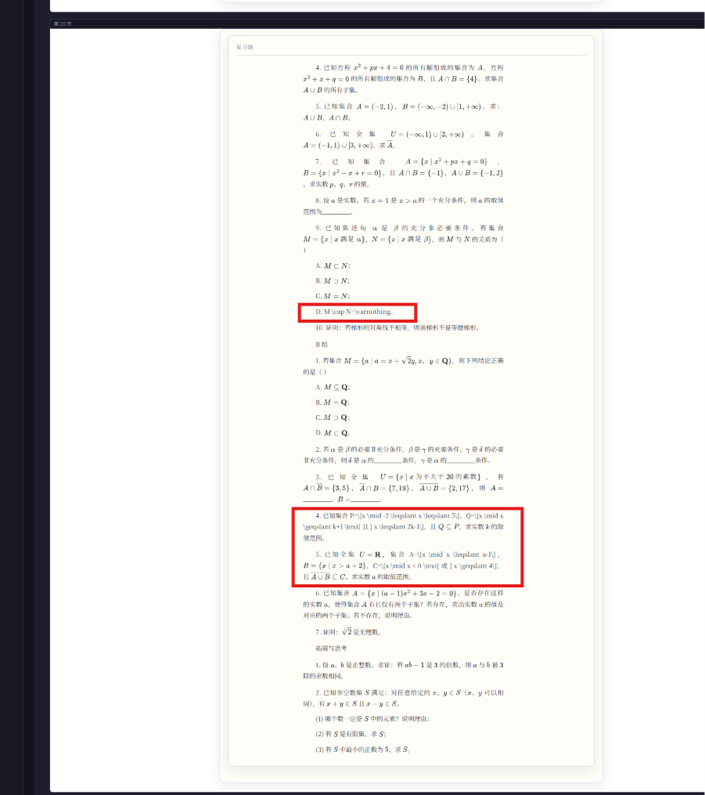

| 项 | 内容 |
|---|---|
| 红框 | 题 9 D `M \cap N=\varnothing`；B 组 4 `P=\{x \mid -2 \leqslant x \leqslant 5\}`…；B 组 5 全集/补集式 |
| 落盘 | p28_b6/b12/b13 全部 span 正确 ✓，服务端 valid |
| 根因 | L1（`\varnothing`、`\leqslant`、`\geqslant` 连坐长式） |
| 修复 | L1 |

---

## 四、v4 架构：自愈型确定性编译（最终版，吸收 v1 补丁清单与 v2 四组件）

> 核心诊断：L1–L4 表面各异，架构病因只有一个——**信任边界放错了位置**。
> pipeline 隐含了两个不成立的假设：「模型输出可信」（L2/L3/L4）与
> 「每个客户端都会用正确配置再渲染一遍」（L1）。

### 4.0 设计公理

1. **模型输出不可信**：唯一信任边界是防腐层，下游永远假设数据干净
2. **渲染只发生一次**：落盘产物自包含，正确性不外包给任何客户端
3. **确定性优先**：LLM/Agent 只出现在「怀疑」和「提议」的位置，从不出现在「执行」的位置
4. **只进不退**：每次改进过评估门；golden、规则、判例三库只增不减（规则可降级但过门）
5. **人是唯一立法者**：Agent 提议、Harness 验证、人批准

### 4.1 五平面全景

```text
┌ 生成面（冻结区）──────────────────────────────────────────────┐
│ 35B vLLM + prompt v5（冻结）+ guided schema                    │
└──────────┬────────────────────────────────────────────────────┘
           ▼ raw_model.json（不可变落盘）
┌ 净化面（唯一信任边界）─────────────────────────────────────────┐
│ 防腐层 model_boundary：JSON 损伤还原（repair_rules 白名单）     │
│ → normalize（含环境自动闭合）→ 桥校验 → 控制字符门              │
└──────────┬────────────────────────────────────────────────────┘
           ▼ 干净 blueprint
┌ 编译面（确定性）───────────────────────────────────────────────┐
│ 统一富文本管线（段落/表格/caption/callout 同一路径）            │
│ → SSR：MathJax 桥批量渲染 SVG 烧入 page.html（自包含）          │
│ → override 叠加层（用户修正，可重放可撤销）                     │
└──────────┬────────────────────────────────────────────────────┘
           ▼
┌ 校验面 ────────────────────────────────────────────────────────┐
│ T1 确定性规则（同步）：控制字符/环境配对/role-zone/覆盖率/渲染失败│
│ T2 Agent 视觉比对（异步，仅产疑点，预留）                       │
│ → findings（候选诊断选项 + 优先级）→ review_items 落库          │
└──────────┬────────────────────────────────────────────────────┘
           ▼
┌ 反馈面（HITL）─────────────────────────────────────────────────┐
│ B35 面板：审核队列 + 原位高亮 + 确认卡片                        │
│ 裁决三出口：override 修数据 · suppression 消误报 · 规则提议修系统│
└────────────────────────────────────────────────────────────────┘
```

### 4.2 两速记忆与晋级治理

| 层 | 形态 | 语义 |
|---|---|---|
| **规则库（成文法）** | `repair_rules` 白名单 + 不变量阈值（数据文件/表） | 精确匹配、零幻觉、编译热路径同步执行 |
| **判例库（判例法，预留）** | 误判库 + 方案库（向量，复用既有 RAG 栈、独立 collection） | 模糊检索只降权/猜选项，永不静默抑制 |
| **golden 集（棘轮）** | `data/eval/` JSONL | 任何改动不得让旧 case 回退 |

晋级门（判例 → 规则）：**Agent 提议、Harness 验证（历史回放免 GPU + golden 全绿）、
人批准**——人是唯一有规则库写权限的角色。晋级硬标准：复现 ≥N、修复 100% 一致、
可形式化、回放零破坏、无冲突裁决。规则可降级，同样过门。

误报收敛三档：仅此处 / 同指纹 / 规则太严（第三档只生成提议，不允许一键生效）；
**无「整类关闭」选项**。

### 4.3 消灭问题类的对应关系

| 组件 | 消灭的问题类 | 本次台账页 |
|---|---|---|
| 防腐层 JSON 还原 + 控制字符门 | L2 转义损伤 | p20,21,26 |
| 统一富文本管线 | L3-1 表格/caption 无公式 | p24 |
| running_header 只信 zone | L3-2 吞块 | p3 |
| 环境自动闭合 | L3-3 残缺 cases | p14 |
| SSR 自包含 | L1 前端渲染失败整类 | p9,12,13,14,17,18,25,28 |
| T1 校验 + HITL | L4 及一切未知类（转为疑点走人审） | p24 侧栏等 |

guided decoding 生成期扭曲（`\alpha`→`\beta`）无法后处理还原——prompt 保持 v5
冻结，未来调整须以积累案例为依据过 golden 门（p21/p26 为观察样本）。

### 4.4 隔离性自检（对照 full-isolation 基线）

- ✅ 全部改动落在 `learning-buddy-api/app/import_35b/` + 复用既有 `app/math` 桥、
  既有 import35b admin 路由前缀、既有 `import35b/` MinIO 前缀；新表用
  `import35b_` 前缀落 35B 自有表空间
- ✅ MinerU 线零触碰（`MinerUPipelinePanel`、`api/corpus.ts`、默认队列均不动）
- ✅ SSR 后 span 无 `data-latex`，共享的 `typesetTextbookMath` 天然跳过——
  **35B 线对共享前端渲染工具的依赖被切断**，隔离性优于现状
- ⚠️ 唯一可选的共享改动：`mathjax-core.ts` 补 AMS side-effect import 属共享 util
  卫生修复（MinerU 面板与 NoteEditor 也受益）；35B 正确性不再依赖它，单独排期

### 4.5 交付边界

一次交付：净化面 + 编译面 + T1 校验 + HITL 最小闭环 + golden/回放 harness，
重建 buddy-api/worker 镜像、重导 30 页对照台账验收。

~~预留不实现（激活条件 = 已确认案例 > 100 条）：T2 Agent 视觉比对、判例向量库、
离线归纳 Agent 与晋级门自动化。~~ → **已实现（2026-07-06），默认全关，见 §4.7**。

原则：不加 LLM repair 层；还原是确定性白名单，隔离是降级不是修补；
正确性由架构保证，prompt 只做质量优化。

## 4.6 v4 落地验收记录（2026-07-04，job `3a11df5d`）

30 页重导 + 台账逐页对照 + HITL 闭环演练，全部通过：

| 验收项 | 结果 |
|---|---|
| p3 吞块 | ✅ main 6 块（版权/编者悉数回归），T1 出 ROLE_ZONE_MISMATCH 疑点走人审 |
| p14 残缺 cases | ✅ 3 个 cases 全部配对（防腐层自动闭合） |
| p20/21/26 转义损伤 | ✅ 白名单还原 10/30/55 处，`\notin` `\text` `\beta` `\frac` 全部复原，零控制字符残留 |
| p24 表格公式 | ✅ 表格 20 个公式 span，裸 `$` 归零 |
| L1 前端渲染类（p9/12/13/17/18/25/28 等） | ✅ SSR 内联 SVG（如 p28 95 个），`data-latex` 残留 0，前端 MathJax 依赖切断 |
| math--error / math--fallback | ✅ 30 页均为 0 |
| 审核队列 | ✅ 12 条 finding 落库（均带候选诊断+指纹） |
| 误报裁决 | ✅ false_positive(exact) → 抑制表落行，重导不再报 |
| 用户报告 + 修正回流 | ✅ p20 `90^\text{o}`→`90^\circ`：report → correct → override 落表 → 该页确定性重编译，仅命中目标块 p20_b14，p20_b16 不受影响 |
| 回放棘轮 | ✅ 30 页历史 raw_model 重放：0 硬违约、0 error、0 fallback |
| pytest | ✅ 52 passed（v4 架构 22 + v5 golden + math normalize；含修复此前就红的 `fig_caption_body_text`） |

唯一残留观察：p29 空白页 main 为空属预期（blank-skip 路径不产 finding）。

## 4.7 判例治理落地（2026-07-06，原 §4.5 预留项）

把「两速记忆」的慢速层（判例法）+ T2 异步校验面 + 晋级门补齐。**全部默认关闭**，
未激活时降级为 no-op，零行为变更；激活门槛沿用「已确认案例 > 100」
（`settings.import35b_caselaw_min_cases`）。

| 组件 | 落点 | 语义 |
|---|---|---|
| **T2 Agent 视觉比对** | `validation/agent_checker.py` | VLM 比对原图 vs 提取文本，仅产 `detector=agent` 疑点走 HITL，**永不改数据**；`import35b_agent_check_enabled` 默认 False |
| **判例向量库** | `caselaw/store.py` | 独立 Milvus collection `import35b_caselaw` + 独立最小 schema；复用共享 `embedder` + pymilvus 连接；无 Milvus 全程降级 no-op |
| **判例 canonical** | `db/models.Import35bCaseLaw` | 35B 自有表；误判库（false_positive 裁决）+ 方案库（correct 裁决）唯一事实来源 |
| **富化** | `caselaw/service.enrich_findings` | 命中误判库→降一档 severity + 补「疑似历史误报」候选；命中方案库→补历史修正候选；**永不静默抑制** |
| **离线归纳 + 晋级门** | `caselaw/induction.py` + `scripts/induct-caselaw.py` | 聚合判例出提议文件（suppression/repair_rule），过硬标准（复现≥N/100%一致/可形式化/无冲突）+ golden 全绿回放；**只出提议，人是唯一立法者，绝不自动改规则** |

接线（全部 guarded，失败不阻断主流程）：裁决 `verdict` → `record_case`；
导入 T1/T2 finding 与重编译 finding → `enrich_findings`。

验收：`tests/test_import_35b_caselaw.py` 15 passed；`scripts/acceptance-import35b-caselaw.sh`
全绿（含默认关闭自检 + 晋级门 golden 17 例 + 无 Milvus 降级）；v4/v5 旧 golden 40 passed 无回退。

### 隔离性自检（对照 full-isolation 基线）

- ✅ 新增代码全在 `app/import_35b/`（caselaw 子包 + validation/agent_checker）；仅复用
  **共享基础设施** `app.rag.embedder.embed_texts` + pymilvus 连接（同 mathjax 桥的纯 util 性质）
- ✅ 判例向量落**独立 collection** `import35b_caselaw`，绝不写语料库 `lb_corpus`，不使用
  `CorpusDocument`/kp_id/published 语料语义；canonical 落 35B 自有表 `import35b_caselaw`
- ✅ MinerU 线零触碰；T2 仅复用 35B 自己的 vLLM 客户端，不新增服务
- ✅ 全部开关默认 False，激活门槛守住——未开启时 findings/HTML/裁决行为与实现前逐字节一致

### 同步性自检（宿主机 ↔ 容器）

- ✅ 代码打进镜像：已 `docker compose build buddy-api buddy-worker && up -d`
- ✅ 容器抽查：worker/api 均含 `caselaw/*.py`，`Import35bCaseLaw` 表 create_all 生成，
  开关默认 False，`golden_gate` 容器内 PASS 17 例

## 五、经验教训（写给下次审计）

1. `data-latex="x &lt; 0"` 类实体转义**不是 bug**——浏览器 `getAttribute` 自动解码；审计脚本必须先 `html.unescape` 再校验。
2. 服务端校验通过 ≠ 前端能渲染：mathjax-full ESM 两端配置必须字面一致，用平价测试锁死。
3. guided JSON decoding 会**在生成期**扭曲单反斜杠 LaTeX（非法转义被 mask → 采样跑偏），排查时 raw_model.json 里显示的 `\beta` 可能实为 backspace+`eta` 的再编码。
4. 一个表达式内单个符号失败会导致整式回退，不要按「显示为原文的每个符号」逐一立案。
5. 审计一律用最新 MinIO job 落盘（`.pageaudit/latest/`），旧 `pages.json` 已废弃。
6. case-by-case 补丁清单是坏味道：多类问题共享同一架构病因（信任边界错位）时，
   应收敛为防腐层 + 单一渲染权威 + 契约不变量，而不是逐点修。
7. 落盘产物应当自包含：凡是「需要消费端再解释一遍才正确」的中间格式
   （如 `data-latex` 依赖客户端 MathJax），都会随消费端数量增长而复现漂移 bug。
