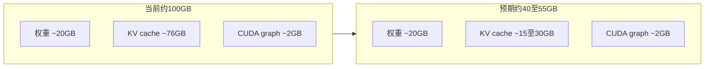

# vLLM 显存优化方案

## 背景

当前 [`learning-buddy-c2/docker-compose.yml`](learning-buddy-c2/docker-compose.yml) 中 vLLM 占用约 **102GB**（权重 ~20GB + KV cache 预占 ~76GB）。根因是：

- `--max-model-len 65536`：按 64K 上下文预分配 KV cache
- `--gpu-memory-utilization 0.85`：主动占满 85% 统一内存
- 未设置 `--max-num-seqs`：使用 vLLM 默认并发上限

**不改变**：模型路径、NVFP4 量化、`--kv-cache-dtype fp8`、Marlin 环境变量、`c2-gateway` 服务。

## 目标参数

| 参数 | 当前 | 改为 | 说明 |
|------|------|------|------|
| `max-model-len` | 65536 | **16384** | 单页 OCR + Vision token 足够；质量不变 |
| `gpu-memory-utilization` | 0.85 | **0.55** | 减少 KV 预占；**不影响推理精度** |
| `max-num-seqs` | （默认） | **2** | 匹配平板单路/低并发 OCR |

预期效果（来自当前启动日志推算）：



## 代码改动（单文件）

修改 [`learning-buddy-c2/docker-compose.yml`](learning-buddy-c2/docker-compose.yml) 第 39–42 行：

**Before:**
```yaml
      - --max-model-len
      - "65536"
      - --gpu-memory-utilization
      - "0.85"
```

**After:**
```yaml
      - --max-model-len
      - "16384"
      - --max-num-seqs
      - "2"
      - --gpu-memory-utilization
      - "0.55"
```

可选（非必须）：将三项写入 [`.env`](learning-buddy-c2/.env) 并通过 compose 变量引用，便于日后调参；本次保持改动最小，直接写死在 `command` 即可。

## 部署步骤

在 Spark 上执行（**仅重建 vLLM**，gateway 可保持运行；vLLM 重启期间 gateway 会短暂 `vllm_reachable: false`）：

```bash
cd ~/MyLearningBuddy_Model_Workspace/learning-buddy-c2
```

```bash
docker compose up -d vllm --force-recreate
```

等待健康检查通过（`start_period` 最长 10 分钟，模型加载约 2–3 分钟）：

```bash
docker compose ps vllm
```

```bash
docker logs vllm-qwen36-35b 2>&1 | grep -iE 'KV cache|Model loading|gpu_memory'
```

## 验收清单

**1. 显存/内存下降**

```bash
nvidia-smi --query-compute-apps=pid,process_name,used_memory --format=csv
```

```bash
free -h
```

关注 `VLLM::EngineCore` 应从 ~102492 MiB 降至约 **40k–55k MiB**；系统 `available` 应明显增加。

**2. vLLM 日志关键行**

确认无 OOM / KV cache 不足错误，并看到类似：

- `Model loading took ~20 GiB`
- `Available KV cache memory:` 显著小于之前的 76.64 GiB
- `GPU KV cache size:` token 数大幅下降

**3. 功能回归**

```bash
C2_BASE_URL=http://192.168.3.200:8000 ./scripts/acceptance-c2.sh
```

通过即表示 OCR / 切题 / companion 链路正常。

## 风险与回滚

| 风险 | 概率 | 处理 |
|------|------|------|
| 极长卷面超出 16K token | 低 | 将 `max-model-len` 提到 24576 或 32768 |
| `0.55` + `max-num-seqs=2` 仍 OOM | 很低 | 略提 `gpu-memory-utilization` 至 0.60 |
| 启动失败 | 低 | 恢复原 compose 值后 `docker compose up -d vllm --force-recreate` |

回滚即恢复 `65536` / `0.85` 并删除 `--max-num-seqs` 两行。

## 不涉及的范围

- 不修改 [`exam-ocr-server`](exam-ocr-server) gateway 代码或 prompt
- 不更换模型或 vLLM 镜像
- 不更新 roadmap 文档（纯运维调参）
