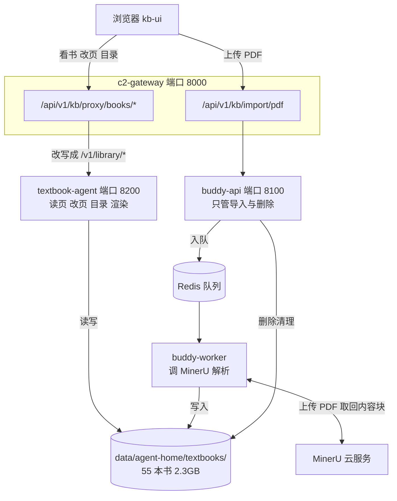
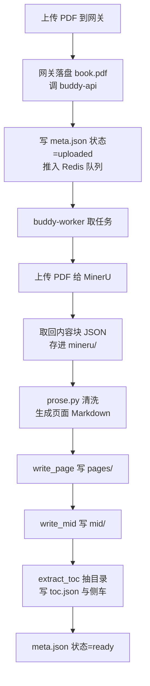
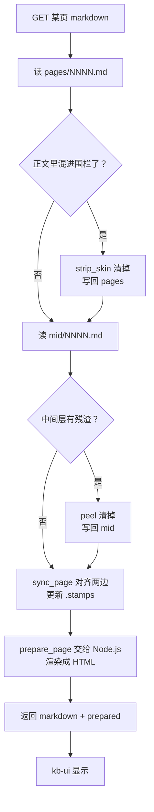
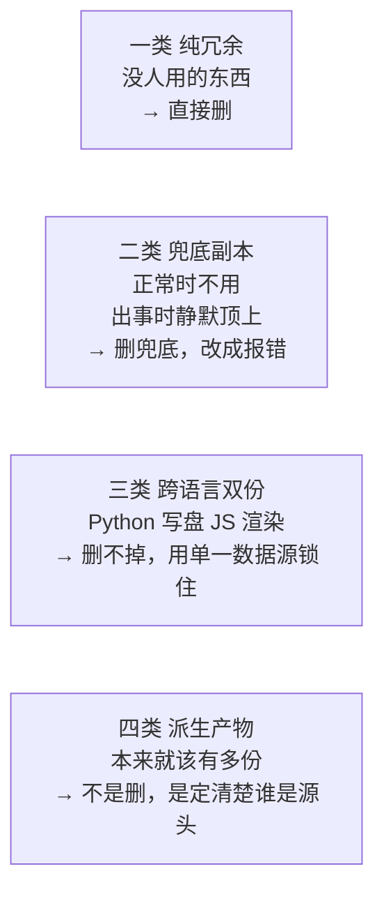
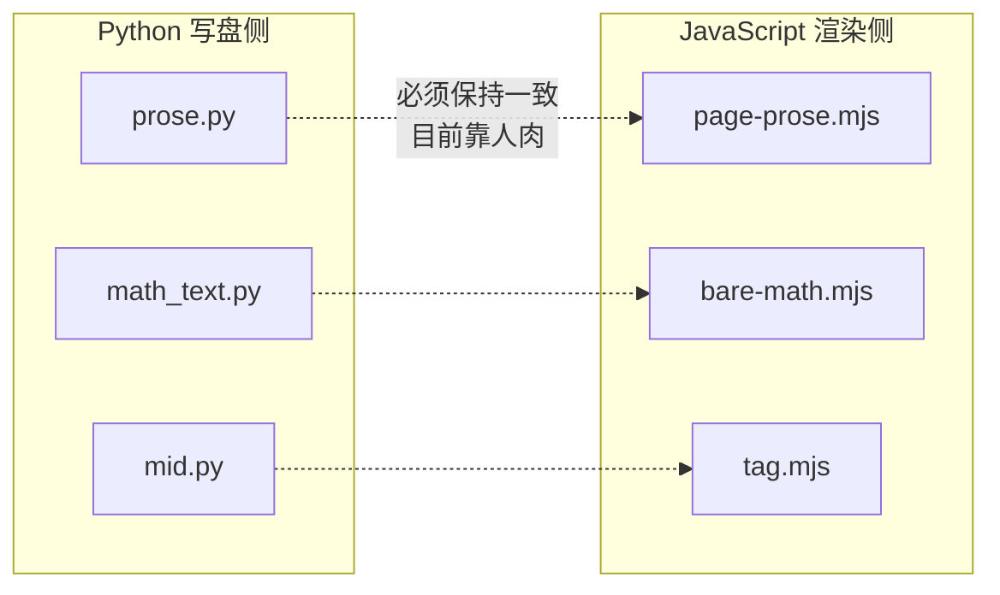
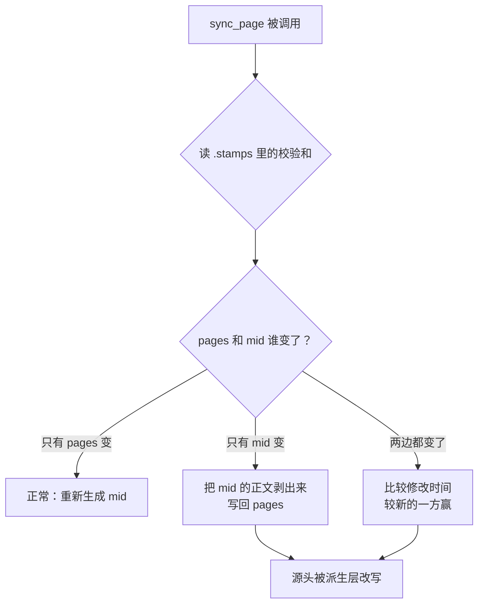
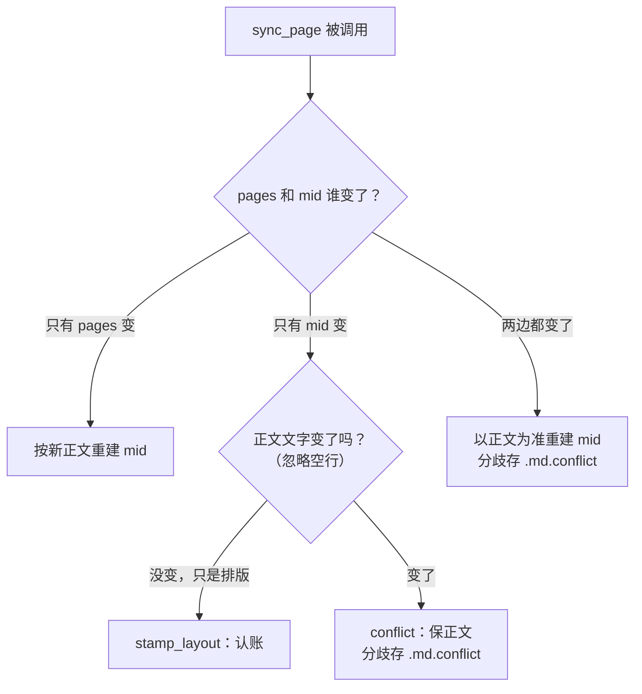

# 知识库平台：结构拓扑与问题清单

> 本文只讲**知识库平台**这一条线（教材 PDF 进来 → 变成可读可改的页面 → 在网页上显示）。
> 语料库 MinerU 线、Edition 方案包、35B 导入线**不在本文范围**，它们是另外几条独立的线。
>
> 术语约定：首次出现的缩写都写全称。
> - **PDF**：便携文档格式，就是教材原件。
> - **Markdown**：一种纯文本排版格式，本文里指页面正文的存储形式。
> - **MinerU**：一个把 PDF 解析成结构化内容块的云服务。
> - **围栏（fence）**：写在 Markdown 里的 `::: kb-center` … `:::` 这种标记，用来告诉渲染器"这段居中显示"。
> - **surface（表层）**：textbook-agent 里负责"把 Markdown 变成 HTML"的一小段可替换的 JavaScript 代码。

---

## 0. 读页线（先读这节）

> **2026-09-12 起**：新稿（v2md）与官方稿活路径已拔掉。读页只剩**老线**（冻结参照）和**中间表示**（IR, Intermediate Representation）。
> `GET /v1/library/…/markdown?src=v2md|official` 返回 410。`v2md/` 文件留盘作考古。

本文正文（§3 起）描述的是**老线**。中间表示走独立入口 `/v1/ir/`。

| 线 | 入口 | 正文从哪来 | 渲染插槽 | 生成工具 | 状态 |
|---|---|---|---|---|---|
| **老线** | `?src=old`（默认） | `pages/NNNN.md` + `mid/NNNN.md`，`page_sync` 对齐（§3.2、§4.2） | `page-body` | 导入流水线 `prose.py` 等 | **已冻结** |
| **中间表示** | `GET /v1/ir/{书}/pages/{页}/markdown` | `ir/pages/NNNN.json` + `ir/notes` | `page-ir` | `ingest_layout`（layout 主源 + model/v1/v2）+ `ir_bands`（给块写 `slot`，树不写盘；画页走墨稿） | **唯一新线** |

对照只剩：旧稿 | 中间表示、中间表示 | 原图、旧稿 | 原图。
两条线不许借对方的文件或定位词。老线的人工订正不会流进中间表示（注解另写 `ir/notes`）。

本节说的读页线是**知识库平台内部**的，与开头排除的「语料库 MinerU 线、Edition 方案包、35B 导入线」不是一回事。

Agent 侧边界写在 `.cursor/skills/kb-three-lines/SKILL.md`。`v2md-pipeline` / `official-pipeline` 技能已标退役。

---

## 1. 平台由什么组成

四个软件部件，一个共享磁盘目录。

| 部件 | 在哪 | 干什么 | 规模 |
|---|---|---|---|
| **kb-ui**（网页前端） | `exam-ocr-server/kb-ui/` | 你在浏览器里看到的知识库界面：书列表、左栏目录树、页面正文 | TypeScript |
| **c2-gateway**（网关） | `exam-ocr-server/app/kb/routes.py` | 只做转发和上传落盘，自己不存业务数据 | 端口 8000 |
| **textbook-agent**（教材 Agent） | `agents/textbook-agent/` | 平台的**主力**：读页、改页、目录、渲染成 HTML | 46 个模块，端口 8200 |
| **buddy-api / buddy-worker** | `learning-buddy-api/app/kb/` | 只管**导入**（调 MinerU 解析 PDF）和**删除清理** | 23 个模块，端口 8100 |
| **共享磁盘目录** | `data/agent-home/` | 所有事实都存在这里 | textbooks 占 2.3 GB |

**一句话概括**：`data/agent-home/textbooks/` 这个目录就是知识库的全部家当，三个容器同时挂载它、同时读写它。

---

## 2. 拓扑图：一次请求怎么走

这里有个容易搞错的地方——**看书和改书走的是 textbook-agent，不是 buddy-api**。网关路径里虽然写着 `/proxy`，但它转发的目标是 Agent。



转发的改写规则在这里：

```325:330:exam-ocr-server/app/kb/routes.py
@router.api_route("/proxy/{path:path}", methods=["GET", "PUT", "POST", "DELETE", "PATCH"])
async def proxy_kb(path: str, request: Request) -> Response:
    if path == "books" or path.startswith("books/") or path.startswith("books?"):
        rest = path[5:].lstrip("/")
        agent_path = f"library/{rest}" if rest else "library"
```

**为什么这点重要**：因为 Agent 和 buddy-worker 是**两个互不知情的进程在写同一批文件**，这是后面一大半问题的根源。

---

## 3. 磁盘上到底存了什么

### 3.1 顶层

```
data/agent-home/
├── textbooks/     20293 个文件, 2.3GB   ← 全部书籍内容，本文主角
├── traces/          688 个文件           Agent 执行轨迹日志
├── memory/          233 个文件           Agent 长期记忆
├── surfaces/        189 个文件           渲染代码（Markdown → HTML）
├── tools/            56 个文件           Agent 可调用的 Python 工具
├── inbox/            62 个文件           待处理投递
├── logs/             42 个文件
├── prompts/          11 个文件           提示词
├── configs/           1 个文件           目录词法表 toc_lexicon.yaml
├── tasks/             2 个文件
└── lex.json                              ← 孤儿文件，见问题 A3
```

### 3.2 一本书长什么样

以一本 188 页的教材为例：

```
textbooks/21e0d2c5ec094ee19621385129a60078/
├── book.pdf              10 MB     原件，唯一的真正源头
├── meta.json            591 B      书名 状态 页数 是否默认
├── toc.json              54 KB     目录（权威）
│
├── pages/                          官方正文，188 个 .md
│   ├── 0001.md                     干净 Markdown，不含围栏
│   └── ...
├── mid/                            中间层，188 个 .md
│   ├── 0001.md                     同一份正文 + ::: kb-* 围栏
│   ├── ...
│   └── .stamps/                    188 个 .json，存三个校验和
│       └── 0001.json               source_sha / mid_sha / body_sha
├── images/               188 张    整页截图 JPEG
├── mineru/                         MinerU 返回的原始内容块 JSON
│
├── mineru_toc.json      287 B      ┐
├── toc_agent.json        69 B      ├ 目录的三个"侧车"副本
├── toc_extract.json     242 B      ┘
└── identify_preview.md  3.8 KB     前三页预览
```

### 3.3 全平台实际数量

| 项 | 数量 | 说明 |
|---|---|---|
| 书 | 55 本 | |
| `pages/*.md` | 4913 | 官方正文 |
| `mid/*.md` | 4913 | **和 pages 严格一对一** |
| `mid/.stamps/*.json` | 4913 | 也是一对一 |
| `toc.json` | 55 | 每本一份 |
| `mineru_toc.json` | 46 | 侧车 |
| `toc_agent.json` | 44 | 侧车 |
| `toc_extract.json` | 44 | 侧车 |
| `toc_printed.json` | 5 | 侧车 |

**同一段正文在磁盘上至少存了两份**（pages 一份、mid 一份），加上校验和一共三个文件。4913 页 × 3 = 14739 个文件在描述同一批内容。

### 3.4 pages 和 mid 差在哪

同一页，两种形态：

`pages/0001.md`（官方，给人读和给人改的）：
```
函数的单调性
设函数 f(x) 的定义域为 I
```

`mid/0001.md`（中间层，给渲染器读的）：
```
::: kb-title
函数的单调性
:::
::: kb-lead
设函数 f(x) 的定义域为 I
:::
```

内容一样，区别只是 mid 多了排版围栏。`.stamps/0001.json` 记录两边的校验和，用来判断谁改过：

```json
{
  "source_sha": "6a2e90dd...",
  "mid_sha": "eaa232be...",
  "body_sha": "6a2e90dd...",
  "last_trace_id": "d4877166f10343ad",
  "last_origin": "watch"
}
```

---

## 4. 两条主流程

### 4.1 导入一本书



注意 **H 和 I 是两次独立写盘**，写完不产生 `.stamps`——校验和要等到第一次有人打开这一页时才补上。

### 4.2 读一页

这是问题最集中的一条路径。注意它是个 **GET 请求，却会写盘最多三次**：

```692:714:agents/textbook-agent/app/main.py
def library_page_md(book_id: str, page_no: int) -> dict[str, Any]:
    started = time.monotonic()
    row = library.get_book(book_id)
    if row is None:
        raise HTTPException(status_code=404, detail="book not found")
    md = library.get_page_markdown(book_id, page_no)
    if md is None:
        raise HTTPException(status_code=404, detail="page not found")
    from app.mid_text import looks_like_skin, peel_mid_remnants, strip_skin
    from app.page_sync import sync_page

    if looks_like_skin(md):
        md = strip_skin(md)
        library.write_page(book_id, page_no, md, sync=False)   # 写盘 1
    mid_raw = library.get_page_mid(book_id, page_no)
    if mid_raw:
        mid_clean = peel_mid_remnants(mid_raw)
        if mid_clean != mid_raw:
            library.write_mid(book_id, page_no, mid_clean, sync=False)  # 写盘 2
    surfaces.get_slot("page-body")
    sync_page(book_id, page_no)                                 # 写盘 3
```



---

## 5. 问题清单

范围内共 20 处，分四类。**四类的性质完全不同，处理办法也不同**，这是理解全局的关键。



---

### A 类 · 纯冗余，删掉就行

这些东西**现在没有任何代码在用**，留着只会误导人。

> **状态：A1、A2、A3 已于 2026-09-07 执行完毕。** 下面保留问题描述以备回溯，处置结果记在每节末尾。
> A4 经复核**判断有误、已撤销**，见该节。

#### A1 · 两张无人使用的数据库表 · 已清理

`kb_books` 和 `kb_pages` 这两张表**每次数据库迁移都会被建出来，但从来没人写过、也没人读过**。

证据：模型类 `KbBook` / `KbPage` 曾定义在 `learning-buddy-api/app/db/models.py`，在整个 `learning-buddy-api/app/` 里搜这两个类名，**在 models.py 之外出现 0 次**。

它们当初的设计意图写在注释里：

```text
# Knowledge-base line — isolated from corpus_import_jobs.
# PDF + MinerU page markdown only. Textbook Agent reads the original PDF.
```

但这些字段现在全都由文件系统承担了：

| 表字段 | 现在实际在哪 |
|---|---|
| `label` `status` `page_count` `is_default` | `meta.json` |
| `toc_json` | `toc.json` |
| `markdown`（KbPage） | `pages/*.md` |
| `minio_key` | 已经变成拼出来的假字段，不指向真实对象 |

**后果**：任何人看到这两张表，都会以为书籍数据在数据库里，从而查错地方。

**注意，表并不是空的**：实测 `kb_books` 有 1 行、`kb_pages` 有 152 行，是书籍
`66fdd0558d97406bac2b7840c9547165`「普通高中教科书·数学必修 第一册」在 2026-08-19 的旧快照。
同一本书在磁盘上有完整的 152 页且之后被编辑过，所以磁盘那份才是权威。

> **处置**：先 `pg_dump` 备份到 `data/backups/kb_books_kb_pages-20260907-065338.sql`（363 KB，1 + 152 行核对无误），
> 然后删除 `models.py` 的两个类、`migrate.py` 的建表与索引语句，并在库中 `DROP TABLE`。

#### A2 · `.last-good` 被提交进了 git · 已清理

`data/agent-home/surfaces/.last-good/` 是渲染代码的**运行时缓存**（上一次跑通的版本），有 58 个文件被 git 跟踪。`.gitignore` 已经忽略了 `textbooks/`、`traces/`、`inbox/`、`logs/` 这些运行时目录，唯独漏了它，所以仓库里长期挂着一批永远处于"已修改"状态的文件。

> **处置**：`git rm -r --cached` 取消跟踪 58 个文件（磁盘上 93 个文件原样保留），
> 并在 `.gitignore` 加入 `data/agent-home/surfaces/.last-good/`。
> 安全性依据：`surfaces.py:92` 每次启动都会 `mkdir` 重建该目录，`_copy_tree`（117-127 行）
> 在每次成功激活时 `rmtree` 后全量重拷，所以它本来就是可丢弃的。

#### A3 · 孤儿文件 · 已清理

- `data/agent-home/lex.json`：目录词法表的旧导出。全仓库只有调试脚本 `probe3.mjs` 提到 `lex.json`，而且它读的是 `/tmp/lex.json`，路径根本对不上。
- `probe.mjs` / `probe2.mjs` / `probe3.mjs` 三个调试脚本，在现场和 `.last-good` 里各存一套，共 6 个文件，无任何代码引用。

> **处置**：7 个文件全部删除。`.last-good` 里那 3 个属主为 root，通过
> `docker exec textbook-agent rm` 在容器内删除。

#### A4 · 渲染代码的"种子"副本 · 判断有误，已撤销

**这一条我最初归类错了，不能删。** 记录在此以免重犯。

原本的说法是"种子与 git 和 `.last-good` 冗余，可以删"。复核发现这个理由站不住：

```22:23:agents/textbook-agent/Dockerfile
COPY app ./app
COPY workspace ./workspace
```

```89:95:agents/textbook-agent/app/surfaces.py
def ensure_surfaces() -> Path:
    root = surfaces_dir()
    root.mkdir(parents=True, exist_ok=True)
    last_good_dir().mkdir(parents=True, exist_ok=True)
    if SEED.is_dir():
        for slot in SLOTS:
            _copy_if_missing(seed_slot(slot), workspace_slot(slot))
```

`SEED` 指向 `/app/workspace/surfaces`，由 Dockerfile 第 23 行烘焙进镜像，**是全新机器唯一的渲染代码来源**。
`.last-good` 在新机器上是空的；"代码在 git 里"也不解决问题，因为容器是从镜像里拷贝，不是从 git。
删掉种子会让全新部署得到空的 surface 槽位，`prepare_page` 失败后走 `except Exception: text = raw`，
**每一页都显示成未渲染的原始文本**。

种子的真实问题不是"多余"，而是**同步方向没定死**：

- `_copy_if_missing`（`surfaces.py:100-114`）只补缺失文件、不更新已存在的，所以改种子对已部署机器无效；
- 反方向的回写因容器文件系统只读而静默失败。

##### 最终处理（2026-09-07，已完成）

复核时又发现两件事，最终没有走"删掉一份"的路：

**一、同一个服务里本来就有两套播种机制，surfaces 用的是差的那套。**

| 机制 | 覆盖对象 | 行为 |
|---|---|---|
| `workspace.py:53` `seed_missing()` | `.cursor` `tools` `prompts` `tasks` `memory` `configs` | 带 `.seed-manifest.json` 哈希台账：**没人动过的随镜像升级，动过的绝不覆盖** |
| `surfaces.py:95` 自带的 `_copy_if_missing` | `surfaces` | 存在即跳过，**永不升级** |

`surfaces` 会永久漂移，就是因为它没接台账；它的六个兄弟目录不会。
`tests/conftest.py:6-8` 那段注释早就记下了同一个坑在 `tools/` 上的表现。

**二、真正致命的是未跟踪代码，不是两份副本。**

`page-body/lib/fig-size.mjs`（209 行，`prepare.mjs` 的硬 import）两侧都**从未进过 git**，
连同约 30 个 golden 用例。干净 clone 拿不到它 → surface 加载失败 → 每一页回落成裸 Markdown。
能跑至今只是因为本机工作目录里躺着这些文件，且项目没有 `.dockerignore`，构建时被一并打进镜像。

处理办法（提交 `874bd08`、`b73b9c1`）：

1. 把 `fig-size.mjs`、`theme.css` 与全部 golden 补进 git（60 个新文件 + 30 个改动）。
   验证方式是从 git 树里解出来直接跑：`node` 加载成功，golden **21/21 通过**。
2. `ensure_surfaces()` 改走 `seed_missing()`，与另外六个目录共用同一本台账，
   并保留 `proposals/`（未审草稿）的跳过。删掉 surfaces 自带的那份 `_copy_if_missing`。
3. 回归测试 `test_surface_seed_upgrades_only_untouched_files`：
   没人动过的文件随镜像升到 v2，agent 改过的原样保留。全量 412 通过。

对已部署机器的影响做过演练（把真实现场复制到临时目录、用真实种子跑新播种）：
**93 个文件一个没动，只新增 76 条台账**——上线即建立基线，不改任何现有内容。

**结论：种子保留，但漂移问题从根上消失了。**两份副本仍在，同步却不再需要人工——
方向是单向的（镜像 → 现场），依据是哈希台账，且永不吞掉人工修改。

**已上线（`docker compose build/up -d textbook-agent`）**：镜像重建 0.8 秒完成，
297 MB 的 apt 层与 235 MB 的 pip 层全部命中缓存，只重算三个 `COPY` 层。上线后实测：

- 台账 86 → 162 条，新增的 **76 条 surfaces 条目与演练预测完全一致**；
- 现场 93 个文件**一个没被改写**（`git status` 为空）；
- 三个槽位全部 `loaded=True source=workspace`，golden **21/21 · 4/4 · 2/2**；
- 带 `fig_widths` 抽查渲染，产出 ``，
  证明 `fig-size.mjs` 在新容器里正常工作。

遗留：`_mirror_surface_seed()`（`surfaces.py:572`）这个反方向回写仍是死代码，
在只读容器里必然失败，只影响 `write_surface` 返回体里的 `seed` 字段。台账到位后它已无存在理由。

---

### B 类 · 兜底副本——该删的是"兜底"本身

这一类的模式都一样：**有一个权威实现，旁边再放一份简化的备份实现**。正常情况下走权威的，出问题时**悄悄**换成备份的继续跑。

#### B1 · 清洗函数有三份，而且不一样

"把混进正文的围栏清掉"这个操作，有三份实现：

| 身份 | 位置 |
|---|---|
| 权威 | `data/agent-home/tools/source_text.py` |
| 兜底一 | `learning-buddy-api/app/kb/workspace_source.py` 的 `_fallback_source` |
| 兜底二 | `agents/textbook-agent/app/mid_text.py` 的 `_fallback_sanitize` |

三份认识的围栏名字**不一样**：权威版认 19 个（含 `kb-dash`），兜底二也认 `dash`，**唯独 buddy-api 那份兜底不认 `dash`**。也就是说降级时 `kb-dash` 会残留在正文里。

权威版还独有一个 `detach_glued_markers`，专门处理"（2）::: kb-center"这种粘在同一行的情况，两份兜底都没有。

#### B2 · 中间层清洗的兜底是"什么都不做"

```120:124:learning-buddy-api/app/kb/workspace_source.py
def sanitize_mid(text: str) -> str:
    mod = source_text()
    if mod is not None:
        return str(mod.sanitize_mid(text))
    return text or ""
```

降级时它**原样返回，完全不清洗**。

补充说明，避免高估这条的严重性：我进正在运行的容器查过，**目前没有降级**——

```
$ docker exec buddy-api ls -l /data/agent/tools/source_text.py
-rw-rw-r-- 1 1000 1000 8061 Sep  5 01:19 ...
$ docker logs buddy-worker | grep "kb source_text"
INFO app.kb.workspace_source kb source_text: loaded /data/agent/tools/source_text.py
```

所以这是**潜在隐患**，不是正在发生的故障。

#### B3 · 一次失败，永久降级

比兜底本身更值得修的是这个：

```55:63:learning-buddy-api/app/kb/workspace_source.py
def source_text() -> ModuleType | None:
    global _module, _tried
    with _lock:
        if _module is not None or _tried:
            return _module
        _tried = True
```

`_tried` 一旦置位就**再也不会重试**。哪怕挂载后来恢复正常了，这个进程也会一直用兜底实现，只能靠重启修复。

#### B4 · 目录树也是主备两份，而且错误被吞了

左栏那棵目录树有两份渲染实现：Agent 侧的 `paint.mjs`（93 行）和前端的 `toc-html.ts`（104 行），**14 个 CSS 类名逐字相同**。它们的关系是主备：

```357:367:exam-ocr-server/kb-ui/src/app.ts
      const painted = await kb.surfacePaint("toc-tree", {
        entries: toc.entries || [],
        printToPdf: toc.print_to_pdf || {},
      });
      html = painted.html || "";
    } catch {
      html = "";
    }
    await fillShadow(host, "toc-tree", html || fallbackTocHtml(toc));
```

`catch { html = "" }` 把错误吃掉了。所以你看到的目录树到底是哪一份代码画的，**无从分辨**。

#### B5 · 渲染失败表现为"显示原始文本"

```537:539:agents/textbook-agent/app/surfaces.py
    except Exception:
        text = raw
```

Node.js 渲染进程崩了，页面不会报错，而是把没渲染的 Markdown 原样显示出来——看起来像是"这页排版没做好"，实际是渲染挂了。

#### B6 · 其它同模式的兜底

- `toc.py::parse_entry` 内置了一套简化的目录词法兜底
- `mid_text.py::source_is_polluted` 兜底

---

### C 类 · 跨语言双份——删不掉，但能锁住

这一类是**结构性的**：正文写盘用 Python，网页渲染用 JavaScript，同一套排版规则必须在两种语言里各写一遍。



#### C1 · 已经真的分叉了

`prose.py` 和 `page-prose.mjs` 是逐行对译的（函数名都一一对应：`fix_mineru_captions` / `fixMineruCaptions`、`lift_headings` / `liftHeadings`……）。但有一条正则已经不一样了：

```27:27:learning-buddy-api/app/kb/prose.py
_MARKER = re.compile(r"(?<![\w.\-])[（(]\s*([0-9０-９]+)\s*[）)]")
```

```7:7:agents/textbook-agent/workspace/surfaces/page-body/lib/page-prose.mjs
const MARKER = /(?<![\w.\-\u4e00-\u9fff])[（(]\s*([0-9０-９]+)\s*[）)]/g;
```

JavaScript 版多了 `\u4e00-\u9fff`（汉字范围），意思是"汉字后面紧跟的 `（1）` 不算编号"。Python 版没这条，算编号。

**实际后果**：像「图1（1）…」这种行，**导入时按一种方式拆，显示时按另一种方式拆**。

#### C2 · 其它几对

| Python 侧 | JavaScript 侧 | 差异 |
|---|---|---|
| `math_text.py` | `bare-math.mjs` | 公式保护名单不同，JS 多保护若干 `kb-*` 块 |
| `mid.py::_tag_lists_and_leads` | `tag.mjs::tagListsAndLeads` | 编号列表与"解/定理"开头的识别 |
| `source_text.py::FENCE_NAMES` | `fences.mjs::FENCE_NAMES` | 围栏名清单两份 |
| `strip_skin` | | **一共四份**：`mid.py` / `mid_text.py` / `toc_text.py` / `tag.mjs`，其中 buddy-api 那份没走 `toc_text.py` |

#### C3 · 这个仓库里已经有做对了的样板

**目录词法**（判断"第三章 函数"这行是章还是节）就没有这个毛病：

- 规则只写在**一份** `toc_lexicon.yaml` 里
- Python 侧用 `export_for_js()` 把规则导出给 JavaScript
- `test_toc_lexicon.py` 让两边跑同样的用例，对不上就测试失败

结果：种子和现场的两份文件**至今完全一致**——因为没人有理由去改壳子。

C 类的解法就是把这个模式复制到上面几对上。

---

### 单列 · 工作区访问层被完整写了两遍

这是范围内最大的一处重复，值得单独说。

`learning-buddy-api/app/kb/workspace_store.py`（26 个函数）和 `agents/textbook-agent/app/library.py`（40 个函数）里，有 **19 个同名函数各自独立实现了一遍**：

```
safe_id  book_dir  textbooks_root  meta_path  toc_path  pdf_path
page_path  mid_path  image_path  read_json  read_meta  write_meta
read_toc  write_toc  normalize_category  reset_derived  book_to_dict
write_page  _now
```

**而且两者读写的是同一个目录。**

`safe_id` 是逐字复制，连报错信息都一样：

```42:46:learning-buddy-api/app/kb/workspace_store.py
def safe_id(value: str) -> str:
    cleaned = "".join(ch for ch in (value or "").strip() if ch.isalnum() or ch in "-_")
    if not cleaned:
        raise ValueError("id required")
    return cleaned
```

```20:24:agents/textbook-agent/app/library.py
def _safe_id(value: str) -> str:
    cleaned = "".join(ch for ch in (value or "").strip() if ch.isalnum() or ch in "-_")
    if not cleaned:
        raise ValueError("id required")
    return cleaned
```

只有防路径逃逸的写法不同：buddy-api 用 `root not in dest.parents` 判断，Agent 用 `resolve_in_home`。两种写法的安全边界是否等价，没有测试保证。

**书籍类别的中英文对照表实际存在三份**：

| 位置 | 变量名 |
|---|---|
| `learning-buddy-api/app/kb/workspace_store.py:18` | `_CATEGORIES` |
| `agents/textbook-agent/app/library.py:117` | `CATEGORIES` |
| `exam-ocr-server/kb-ui/src/importMeta.ts:26` | `CATEGORIES` |

三份的 10 个键（`textbook`/`教材`、`knowledge`/`知识点`、`syllabus`/`考纲`、`material`/`资料`、`homework`/`作业`）**当前完全一致**——但这是巧合，没有任何机制保证下次还一致。

---

### D 类 · 派生产物——不是删，是定清楚谁是源头

这一类天然就该有多份（缓存、投影、派生），问题不在"有多份"，而在**源头关系没定清楚**。

#### D1 · 派生层能反向覆盖源头 · **已修复**（2026-09-08，`84f9bb8`）

`pages/`（源头）和 `mid/`（派生）本该是单向关系，但 `page_sync` 在检测到冲突时的策略是**"文件修改时间较新的赢"**。



**这意味着中间层可以悄悄改掉官方正文**，而官方正文本该是人工维护的那一份。

**修复内容**：`_write_source()` 与 `_mtime` 仲裁整段删除，正文只能由人和导入流水线写。
派生层有分歧时保正文，把分歧的中间层留档到 `mid/NNNN.md.conflict` 并记 `sync.conflict`
事件，不再自动猜谁对。GET `/library/{book}/pages/{n}/markdown` 也不再写正文。

新增 `same_prose()`：比对正文时忽略空行增删，让打标工具那种"重排空行但一个字没改"
的产物落在 `stamp_layout` 而不是报冲突。它**只**决定要不要报冲突，不决定写什么。

修复后的判定：



**验证**：416 条测试连过两轮；4913 页生产数据在沙箱整体重放，正文逐字节未变；把
HTML 表格在中间层拍平的场景，现在留冲突并保住正文里的表格（旧代码会把拍平结果
提拔成官方正文）；线上 40 页真实请求零正文写入、零假冲突。

另外，buddy-worker 导入时**不写 `.stamps`**（它没有 `page_sync` 这套逻辑），校验和要等第一次有人打开这页才补上。在那之前，同步判断是缺少依据的。

#### D2 · 目录一共有六个地方

| 存放处 | 身份 | 数量 |
|---|---|---|
| `toc.json` | **权威** | 55 |
| `mineru_toc.json` | 侧车（MinerU 原始抽取） | 46 |
| `toc_agent.json` | 侧车（Agent 加工） | 44 |
| `toc_extract.json` | 侧车（抽取游标） | 44 |
| `toc_printed.json` | 侧车（印刷目录） | 5 |
| 目录页里的 `kb-page-toc` 围栏 | 投影（从 toc.json 写出） | 若干页 |

而且 `build_toc`（读页生成目录）和 `write_toc_pages`（从目录写出页）构成一个**读写环**——跑第二遍可能丢信息。

#### D3 · 其它

| 项 | 问题 |
|---|---|
| `mineru/*.json` ↔ `pages/*.md` | 没有版本绑定。重新拉取 MinerU 数据不会刷新已生成的页面。 |
| `images/pNNNN.jpg`（整页截图）↔ MinIO 里的插图 | 两套图片，无联动。MinIO 对象删了页面里的图就 404。 |
| `_prepare_cache`（渲染结果内存缓存） | 缓存键是内容算出来的，**失效是正确的**；真问题是**没有上限、从不淘汰**，每个版本的每一页永久占内存。 |
| Redis 删除墓碑 `lb:kb:revoked:{id}` | 有效期 7 天，过期后无法阻止迟到的任务重新写入已删除的书。 |

---

## 6. 一览表

| 编号 | 问题 | 类别 | 现在是否已在出错 | 状态 |
|---|---|---|---|---|
| A1 | `kb_books` / `kb_pages` 两张无人使用的表 | 纯冗余 | 否，但持续误导 | **已清理 09-07** |
| A2 | `.last-good` 58 文件入 git | 纯冗余 | 否 | **已清理 09-07** |
| A3 | `lex.json` 与 6 个 `probe*.mjs` 孤儿 | 纯冗余 | 否 | **已清理 09-07** |
| A4 | 渲染代码种子副本已分叉且无法同步 | ~~纯冗余~~ 改为**结构** | 是（改种子无效） | **撤销**，种子承重不可删 |
| B1 | 清洗函数三份，围栏名不一致 | 兜底 | 否（未降级） | 待处理 |
| B2 | `sanitize_mid` 兜底什么都不做 | 兜底 | 否（未降级） | 待处理 |
| B3 | `_tried` 一次失败永久降级 | 兜底 | 否，但不可恢复 | 待处理 |
| B4 | 目录树主备两份，错误被吞 | 兜底 | 无法分辨 | 待处理 |
| B5 | 渲染失败静默显示原始文本 | 兜底 | 无法分辨 | 待处理 |
| B6 | 目录词法、污染检测的兜底 | 兜底 | 否 | 待处理 |
| C1 | `prose.py` ↔ `page-prose.mjs` 正则分叉 | 跨语言 | **是** | 待处理 |
| C2 | 公式、列表、围栏名、strip_skin 多份 | 跨语言 | 未验证 | 待处理 |
| — | 工作区访问层 19 个函数双实现 | 结构 | **是**（日常都在写） | 待处理 |
| D1 | 派生层可反向覆盖源头 | 派生 | **是**（结构性风险） | **已修复** `84f9bb8` |
| D2 | 目录六处 + 读写环 | 派生 | 是 | 待处理 |
| D3 | mineru 无版本绑定、图片无联动 | 派生 | 是 | 待处理 |
| D3 | `_prepare_cache` 无上限 | 派生 | 是（内存泄漏） | 待处理 |
| D3 | Redis 墓碑 7 天过期 | 派生 | 否 | 待处理 |

### 建议的处理顺序

1. ~~**A 类先清场**~~——**已完成**（2026-09-07）。A1、A2、A3 清理；A4 见该节，最终以"接台账"收尾而非删副本。
2. ~~**未跟踪代码补库**~~——**已完成**（2026-09-07/08）。共补进 116 个文件：
   surfaces 的 `fig-size.mjs` 与 golden、`app/` 下 5 个模块（`workspace_module.py` 被 25 处引用）、
   25 个 agent 工具脚本、`workspace/.cursor/` 的 20 个技能与红线钩子（被无锚定的 `.cursor/`
   规则误伤）、以及 `learning-buddy-api/app/kb/` 的 4 个模块。
   验证：`git archive HEAD | tar -x` 到临时目录，**412 测试全通过**。
   防复发：`tests/test_repo_hygiene.py` 断言 Dockerfile `COPY` 路径下不得有未跟踪文件
   （造一个探针文件即报错，已实测）；`.dockerignore` 顺带把 258 MB 的 `.venv` 挡在构建上下文外。
3. ~~**D1 定源头**~~——**已完成**（2026-09-08，`84f9bb8`）。删掉 `_write_source()` 与 `mtime`
   仲裁，正文只能由人和导入流水线写；分歧留档 `mid/NNNN.md.conflict` 并记 `sync.conflict`。
   GET 端点同步去掉正文写盘。详见该节。落地方案见 `doc/kb-single-source-plan.md` 第一步。
   围栏脱锚（改正文丢排版）亦已按块 ID 收口：`paste_fences` 先按 `^kb-xxxxxx` 定位，
   生产 18815 个围栏已回填。见 `doc/kb-single-source-plan.md` 第二步。
4. **C1 修正则**——已经在出错，改一行。
5. **访问层合并**——19 个函数收敛成一份，这是治本。
6. **B 类删兜底**——改成缺了就报错；`_tried` 那个不可恢复的设计优先。
7. **C 类建机制**——照 `toc_lexicon` 的样板做单一数据源加双跑测试。

---

## 附：查证方式

本文所有数字和代码引用都是在本机实测的，不是估算：

```bash
# 书本与页面数量
find data/agent-home/textbooks/*/pages -name '*.md' | wc -l
```

```bash
# 确认两张表没人用（models.py 之外应为 0）
grep -rn "\bKbBook\b" learning-buddy-api/app/ --include=*.py | grep -v models.py | wc -l
```

```bash
# 确认运行中的容器有没有降级
docker logs buddy-worker 2>&1 | grep "kb source_text"
```
