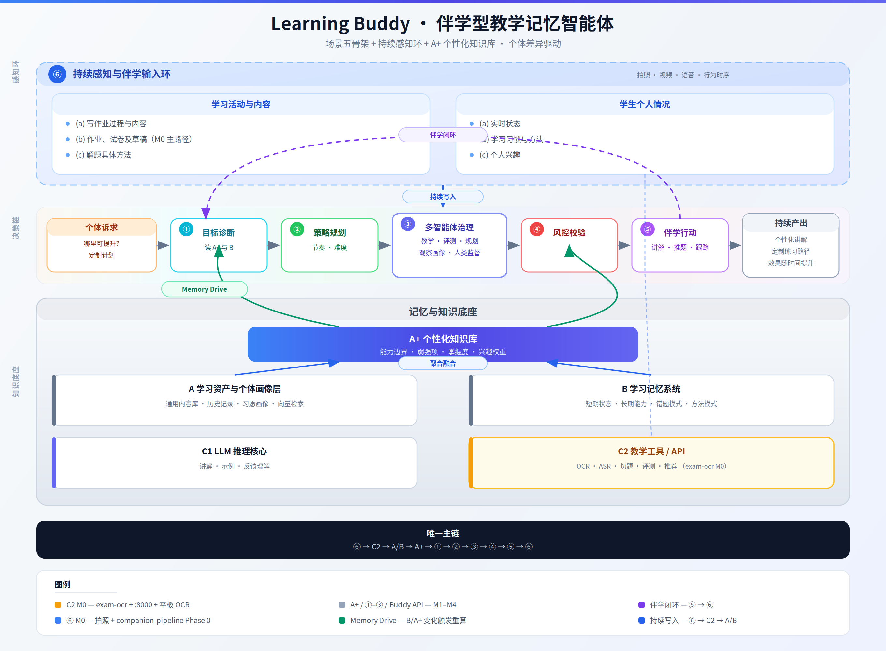
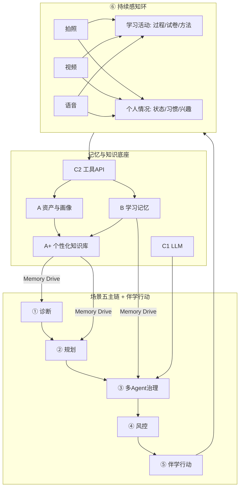
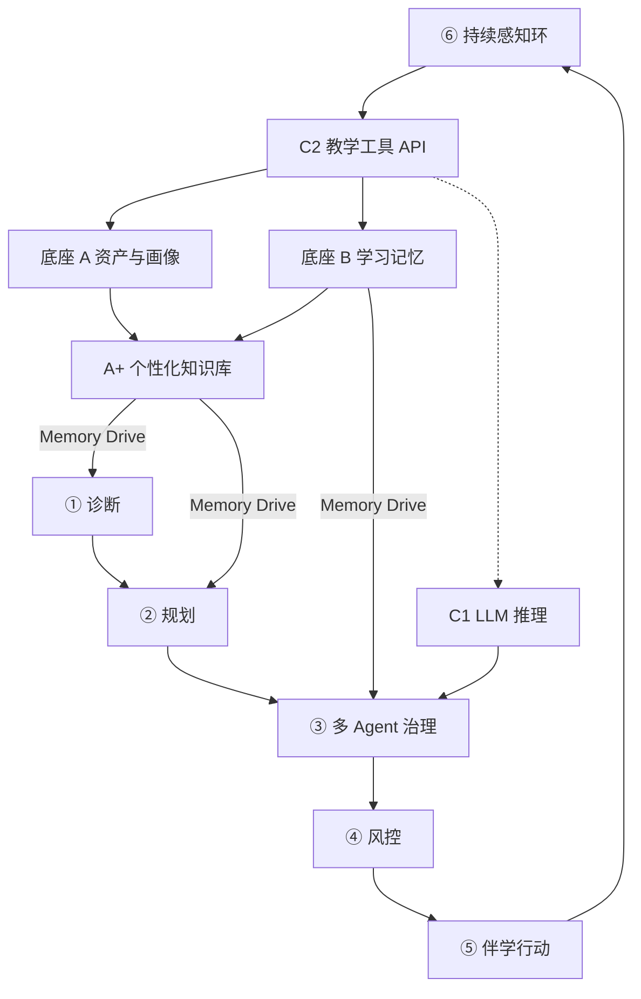

# Learning Buddy — 现状汇总与未来规划

> **Cursor 工作区（2026-06）**：本仓库根目录为 `~/workspace/`。Cursor 规则与 Skill 仍在用户级 `~/.cursor/`（非本 git 仓库内）。
>
> **Cursor 规则**：本规划已摘要为 [`.cursor/rules/learning-buddy.mdc`](../../.cursor/rules/learning-buddy.mdc)（`alwaysApply: true`）及 [`.cursor/skills/learning-buddy/`](../../.cursor/skills/learning-buddy/SKILL.md)。改本文须同步规则、Skill 及 WSL 源稿与其他副本。
>
> **副本位置**：WSL 权威源 `~/exam-ocr/docs/` · 本文件 `~/workspace/doc/` · `LearningStack/docs/` · `exam-ocr-server/docs/`（若已 rsync）。
>
> **读者**：产品、Android/Windows 后端、WSL OCR 运维、架构。
>
> **文档版本**：2026-06-05 · 伴学型总架构 v2（通篇统一修订）
>
> **关联项目**：Spark C2 双 Docker（`:8000` gateway + `:8088` vLLM）· `MyLearningBuddy`（Android）· WSL `~/exam-ocr`（**已废弃运行时**，仅开发参考）

---

## 0. 文档怎么用

| 章节 | 作用 |
|------|------|
| **§1** | **唯一总架构**（定义、分层、数据流、成熟度） |
| **§2** | 三大代码仓库在总架构中的**落位** |
| **§3** | 九大产品功能 → 架构层映射 |
| **§4** | **技术决策**（OCR / RAG / 多 Agent 归属与原则） |
| **§5** | **可执行路线图**（里程碑、依赖、验收） |
| **§6–8** | 技术债、附录、总结 |

**阅读顺序建议**：§1 总架构图 → §1.2 分层表 → §1.3 成熟度 → §5 路线图 → §2 代码落位。

---

## 1. 总架构：伴学型 · 教学记忆型智能体

### 1.1 定义与定位

| 项 | 内容 |
|----|------|
| **骨架来源** | 场景五 · 教学记忆型智能体（个体差异驱动的学习系统） |
| **Learning Buddy 定性** | **伴学型**（非伴读型）：持续观察学习活动与个人状态，多模态输入，记忆与个性化知识库融合，驱动诊断、规划与行动 |
| **权威总架构图** | [PNG](assets/learning-buddy-master-architecture.png) · [SVG](assets/learning-buddy-master-architecture.svg) |

### 总架构图（权威）

下图将 **场景五** 的主链（①–⑤）与底座（A/B/C）和 **伴学型** 增补（**⑥ 持续感知环**、**A⁺ 个性化知识库**、两大输入域、Memory Drive、M0 落位）合并为 **Learning Buddy 唯一总架构**。

> **显示说明**：使用标准 Markdown 图片引用（非内联 HTML），避免破坏后续表格与章节渲染。PNG 为主图；SVG 为可点击矢量链接；Mermaid 见下方「等效总架构图」小节。



矢量源稿（可缩放）：[learning-buddy-master-architecture.svg](assets/learning-buddy-master-architecture.svg)

| 资源 | 路径 | 用途 |
|------|------|------|
| PNG（文档嵌入） | `docs/assets/learning-buddy-master-architecture.png` | Markdown / PPT / 评审 |
| SVG（源稿） | `docs/assets/learning-buddy-master-architecture.svg` | 矢量编辑；改后重新导出 PNG |
| 场景五历史参考 | `docs/assets/teaching-memory-agent-architecture.png` | 仅骨架对照 |

**修改架构图后重新导出 PNG**（先改 SVG，再执行）：

```bash
cd ~/exam-ocr
```

```bash
.venv/bin/python3 scripts/embed-architecture-diagram.py
```

| 图元 | 含义 |
|------|------|
| 虚线外框 **⑥** | 持续感知环：拍照/视频/语音/时序；两大输入域六子项 |
| 横链 **①→⑤** | 场景五主流程：诊断→规划→治理→风控→伴学行动 |
| **A⁺** | 个性化知识库（能力边界、强弱点）；由 A+B 聚合，驱动 ①② |
| **Memory Drive** | 绿色反馈：B/A⁺ 变化触发 ②③ 重算 |
| 紫色虚线闭环 | ⑤ 行动后回到 ⑥，形成伴学闭环 |
| 底部黑条 | 全文唯一数据流主链 |

#### Mermaid 等效总架构图（备选）



#### 伴学 vs 伴读

| 维度 | 伴读（弃用口径） | **伴学（本文口径）** |
|------|------------------|----------------------|
| 边界 | 读/拍一页内容 | 写、做、想、练、错、改的**全过程** |
| 输入 | 以拍照 OCR 为主 | 拍照 + 视频 + 语音，**持续**而非单次 |
| 输出 | 作业 Markdown | 讲解、推题、方法建议、跟踪、个性化知识更新 |
| 知识 | 文档归档 | **A⁺** 能力边界、强弱点、掌握曲线 |

### 1.2 分层模型（全文唯一分层表）

下文所有章节只使用本表符号，**不再引入其他「四层/五层」划分**。

| 层 | 名称 | 职责 | 关键产出 |
|----|------|------|----------|
| **⑥** | 持续感知与伴学输入环 | 采集学习活动、个人状态；多模态接入 | 原始帧、音频、行为时序、过程事件 |
| **C2** | 教学工具 / API | 感知结构化、评测、推题、推荐；**不含** Agent 治理 | OCR 草稿、切题 JSON、搜题结果 |
| **C1** | LLM 推理核心 | 生成讲解、理解反馈、校正与推理 | 校正文本、讲解稿、规划候选 |
| **A** | 学习资产与个体画像层 | 通用内容库、历史记录、习惯/兴趣画像、检索 | 题目实体、作业档、画像字段 |
| **B** | 学习记忆系统 | 短长期状态、错题/方法模式、时序记忆 | Session、mastery 事件、error_patterns |
| **A⁺** | 个性化知识库 | **该学生**的能力边界、强弱点、掌握视图；与 A/B 融合 | 知识点掌握度、能力地图 |
| **①** | 学习目标理解与诊断 | 读 A⁺+B：薄弱点、能力边界、强项 | 诊断报告 |
| **②** | 教学策略规划 | 内容、节奏、难度；兴趣与习惯权重 | 学习计划、复习策略 |
| **③** | 多智能体协作与治理 | 教学 / 评测 / 规划 / 观察画像；人类监督 | 编排图执行结果 |
| **④** | 教学效果校验与风控 | 幻觉防控、一致性、理解检测 | 可发布 / 降级 / 人工复核 |
| **⑤** | 伴学行动模块 | 讲解、推题、跟踪、方法建议、人工介入；兼 **⑥** 触达入口 | 学生侧可感知行动 |

**⑥ 两大输入域**（后文用 `(a)(b)(c)` 指代，不重复展开）：

| 域 | 子项 | 典型模态 |
|----|------|----------|
| 学习活动与内容 | (a) 写作业过程 (b) 作业/试卷/草稿 (c) 解题方法 | 拍照、视频、语音 |
| 学生个人情况 | (a) 实时状态 (b) 习惯与方法 (c) 个人兴趣 | 视频/时序、长周期统计、语音/选择 |

**A / A⁺ / B 关系**（消除「两套知识库」歧义）：

| 概念 | 存什么 | 谁写 | 谁读 |
|------|--------|------|------|
| **A · 通用库** | 课程、题库、考纲 | 运营/同步 | C2 RAG、③ |
| **A · 历史记录** | 作业档、切题结果、事件流 | ⑥→C2→入库 | A⁺ 聚合、① |
| **B · 记忆** | 过程性、时序性状态 | ⑥、伴学流水线 | A⁺ 聚合、②③ |
| **A⁺** | 学生个体掌握视图 | **仅由 A+B 经规则/Agent 聚合写入** | ①②③ |

**Memory Drive**：B（及经 B 沉淀的 A⁺ 变更）触发 ②③ 重算；触发条件包括错题新增、掌握度跌破阈值、习惯异常（里程碑 M4 定义具体规则）。

#### 唯一数据流（全流程主链）

```text
⑥ 感知（拍照→视频→语音）
    → C2 结构化（OCR / 切题 / ASR / 搜题）
        → 写入 A（历史、题目）+ B（过程、模式）
            → 聚合更新 A⁺（能力边界、强弱点）
                → ① 诊断 → ② 规划 → ③ 多 Agent 治理
                    → ④ 风控 → ⑤ 伴学行动
                        → ⑥ 再次感知（闭环）
```



**边界裁决**（消除常见混用）：

| 问题 | 裁决 |
|------|------|
| 伴学流水线是 ③ 吗？ | **否**。属 **⑥** 采集 + **C2** 调用 + **B/A** 写入的**端侧轻编排**（`ExamCompanionOcrScheduler`），不走 LangGraph |
| exam-ocr 放哪？ | **仅 C2**；永不承载 ①–⑤、A⁺、③ |
| 业务后端放哪？ | `learning-buddy-api` 承载 A⁺ 聚合、①–④、Memory Drive；**不**替代 C2 推理侧车 |
| ⑤ 算「有了」吗？ | **部分**：有采集入口与作业库**展示**；讲解/推题/跟踪/审核为 **未建**（见 §1.3 状态图例） |

### 1.3 成熟度与状态图例

**图例**：✅ 可用 · 🟡 部分/萌芽 · ❌ 未建

| 层 | 成熟度 | 现状摘要 |
|----|--------|----------|
| **⑥** | 🟡 | 拍照 + 手动增量帧 ✅；(a) 连续过程 🟡；视频/语音/习惯/兴趣 ❌ |
| **C2** | 🟡 | 拍照 OCR ✅；refine/fusion/切题/ASR/推荐 ❌ |
| **C1** | 🟡 | WSL GLM 可推理；未接入伴学主链 ❌ |
| **A** | 🟡 | 整页作业历史 ✅；题目实体、通用库、习惯画像 ❌ |
| **B** | 🟡 | Session/页快照 ✅；mastery、错题/方法模式、Drive ❌ |
| **A⁺** | ❌ | 无知识点级掌握视图 |
| **①–④** | ❌ | 无主链、无 Agent 编排 |
| **⑤** | 🟡 | 采集触达 + 作业库只读 ✅；讲解/推题/跟踪/审核 ❌ |

**当前里程碑**：**M0**（见 §5.1）。  
已有 `companion-pipeline`、exam-ocr、作业库 = **为 ⑥→C2→A/B 喂数**的早期实现，**不是**伴学终局。

### 1.4 ③ 多智能体编制（落地约束）

| 角色 | 职责 | 硬约束 |
|------|------|--------|
| 教学智能体 | 讲解、答疑 | 不得自评掌握度 |
| 评测智能体 | 对错、错因、掌握度 | **与教学分离** |
| 学习规划智能体 | 路径、节奏、复习 | 必读 A⁺；输出带知识点 ID |
| 观察/画像智能体 | 从 ⑥ 更新 A⁺、B | 不生成面向学生的讲解 |
| 人类教师监督 | 推题、评价、敏感建议 | 审核闸门 |

**编排**：LangGraph 有向图（生产）；CrewAI 仅 M3 验证用。exam-ocr 仓库**禁止**实现 ③。

---

## 2. 现有系统在总架构中的落位

三个仓库是总架构的**实现切片**，不是三套并列架构。

```text
MyLearningBuddy ──⑥⑤──► 感知采集、触达展示、A/B 本地写入
Spark c2-gateway  ──C2───► 平板网关 :8000（Docker）
Spark vLLM        ──C1/C2► Qwen3.6-35B-NVFP4 :8088 内网（Docker）
learning-buddy-api（待建）──► A⁺、①–④、Memory Drive、C1 路由
```

**Spark 运行时拓扑（2026-06）**：弃 `:8765` 三引擎与 Windows/WSL C2；详见 [`learning-buddy-c2/README.md`](../learning-buddy-c2/README.md)（Cursor 工作区根目录下）。

### 2.1 仓库 ↔ 架构层对照

| 仓库 | 层 | 已交付 | 未做 |
|------|-----|--------|------|
| **exam-ocr** | C2 | Hub multipart OCR（**WSL 开发参考，Spark 已弃用**） | ocr_refine、ocr_fusion |
| **exam-ocr-server / c2-gateway** | C2 | Spark `:8000` 网关、companion 分节、vLLM vision | 切题 prompt 迭代 |
| **MyLearningBuddy** | ⑥⑤、A/B | 拍照 OCR、伴学流水线 M0、Room 作业库 | A⁺、视频/语音、伴学行动 |
| **learning-buddy-api** | A⁺、①–④ | — | 全部 |

### 2.2 已跑通链路（M0 子集，Spark C2 双 Docker）

```text
平板 → Spark c2-gateway :8000 → vLLM Qwen3.6-35B-NVFP4 :8088（Docker 内网）
         POST /api/v1/ocr/page → 按题输出（上印刷 / 下手写）
```

网关 health：`GET /api/v1/system/health`；整页识别：`POST /api/v1/ocr/page`（multipart 图片）。

**已废弃**：`平板 → :8000 → :8765 glm_ocr_sdk | pp_ocr | mineru_ocr`（Windows/WSL 运行时）。

### 2.3 伴学流水线（代码名 `companion-pipeline`）

| 环节 | 架构层 | 输入域 |
|------|--------|--------|
| 采帧/选图 | ⑥ | (a) 过程、(b) 草稿 |
| 增量 OCR | C2（端侧调度，非 ③） | (b) |
| 比较/合并 | B | (a) |
| `HomeworkEntry` 入库 | A | (b) |

**命名约定**：本文 **里程碑 M0–M7** = 产品路线图；**伴学流水线 Phase 0/C** = Android 工程阶段（`MyLearningBuddy/docs/architecture/companion-pipeline.md`），二者不混用。

| 工程阶段 | 对应里程碑 | 内容 |
|----------|------------|------|
| 流水线 Phase 0 | M0 | 手动帧、增量 OCR、合并入库 |
| 流水线 Phase C | M1+ | 相机连续采帧，扩展 ⑥(a) |

---

## 3. 九大产品功能 ↔ 架构层

| # | 功能 | 主层 | M0 状态 |
|---|------|------|---------|
| 1 | 学习活动监控 | ⑥ + B | 🟡 拍照/手动帧 |
| 2 | 作业识别与归档 | ⑥ + C2 + A | 🟡 |
| 3 | 做题状态监控 | ⑥(a) + ① | ❌ |
| 4 | 学生画像与知识体系 | A + A⁺ | ❌ |
| 5 | 错题本与题目存储 | A + B | 🟡 整页级 |
| 6 | 核心知识库 | A 通用库 + A⁺ | ❌ |
| 7 | 智能复习与推题 | ② + A⁺ + C2 | ❌ |
| 8 | 学习方法与提醒 | ② + ⑤ | ❌ |
| 9 | 语音交互与讲题 | ⑥ + ⑤ + ③ + C1 | ❌ |

**近期目标（M1 可验收）**：⑥(b) 稳定 + C2 切题 + A 题目实体 + B 错题 v0 + **A⁺ 初版（按知识点一条掌握记录）**。

---

## 4. 技术决策（按架构层归属）

### 4.1 多次 OCR / `ocr_fusion` → ⑥ + C2

- 共识融合可降随机错误，**不能**在无真值时逼近 100%。
- 高频采帧（如每 10s）= **⑥ 端侧调度** + C2 调用，**禁止**用 ③ Agent 会话承载。
- 融合结果写入 A/B，供 A⁺ 聚合；非替代 `ocr_refine`。

### 4.2 准确率主路线 → C2 → C1 → ③ → ④ → ⑤

**Typeless 式「感知草稿 + 认知校正」**，不是「拍十遍投票」：

```text
C2 OCR 草稿 → C2 ocr_refine（或 C1）→ A 通用库 RAG 对齐 → ③ 评测 → ④ → ⑤
```

`ocr_refine` 为 **C2 独立 capability**（旧 `parse_page_smart` completeness 已移除，不恢复单体臃肿接口）。

### 4.3 题库 RAG → A 通用库 + A⁺ + C2

- **A**：世界知识（题库、考纲）。
- **C2**：检索与切题 API。
- **A⁺**：检索结果 × 该生掌握边界 → 「对此生而言的题意与薄弱点」。

### 4.4 多智能体 → ③（+ ①②④ 节点）

| 诉求 | 层 | 手段 |
|------|-----|------|
| 任务分发汇总 | ③ | LangGraph + 四角色 |
| 定时触发 | ② 入口 | APScheduler / n8n → 满足条件再进 ③ |
| 结构化 | C2 ETL 为主 | Agent 仅补低置信度语义 |

| 工具 | 运行时角色 |
|------|------------|
| LangGraph | ③ 生产编排 |
| CrewAI | M3 原型 |
| Hermes / OpenClaw | 离线报告 / 家长通知（非教学主链） |
| Cursor / Claude Code | 工程开发 |

**C2 增量成本参考**（自托管 OCR 无按次费）：切题阿里约 0.009/次档；题库有道约 0.10/次；云 LLM 校对约 0.004 元/页。

---

## 5. 可执行路线图

### 5.1 里程碑总览

依赖顺序固定：**先 ⑥/C2/A/B/A⁺ 数据底座 → 再 ③ 编排 → 再 ①②④ 主链 → 最后 ⑤ 闭环与多模态扩展**。

```text
M0 当前     ███░░░░░░░░░  ⑥ 拍照 + C2 OCR + A/B 萌芽
M1 结构化   █████░░░░░░░  切题、错题、A+ 初版、流水线 Phase C
M2 认知工具 ███████░░░░░  ocr_refine、fusion、通用库 RAG → A+
M3 编排基础 ████████░░░░  learning-buddy-api、③ 骨架
M4 治理主链 █████████░░░  ①②③④、Memory Drive
M5 伴学行动 ██████████░░  ⑤ 讲解/推题/跟踪/家长审核
M6 语音方法 ███████████░  ⑥ 语音、(c) 解题方法
M7 视频习惯 ████████████  ⑥ 视频/行为、(b)(c) 画像（合规先行）
```

### 5.2 里程碑明细与验收

#### M0 — 当前基线 ✅/🟡

| 交付 | 层 | 验收 |
|------|-----|------|
| exam-ocr 三引擎 multipart | C2 | Spark `curl :8000/api/v1/system/health`；`acceptance-c2.sh` |
| Windows 网关 + 平板 Exam 轨道 | C2/⑥ | 平板 `:8000` 出 companion 分节 |
| 伴学流水线 Phase 0 | ⑥/B/A | 同页多帧合并为 1 条 `HomeworkEntry` |
| Room 作业库 | A/⑤ | 列表、详情、删除 |
| C2 文档仅描述 multipart 链路 | C2 文档 | 各仓 docs/.mdc 无 legacy 两步 OCR 表述 |

#### M1 — 结构化与 A⁺ 初版

| 交付 | 层 | 验收 |
|------|-----|------|
| 切题实体（题干/作答区） | C2→A | 作业详情可按题展示 |
| 错题本 v0 | A+B | 题目级标记错题 |
| **A⁺ 初版** | A⁺ | 每知识点至少 1 条掌握状态（会/不会/未知） |
| 流水线 Phase C（连续相机） | ⑥ | 定时采帧无需手动加序列 |

**M1 完成标准**：一次伴学会话结束 → A 有题目实体 → A⁺ 有对应知识点更新 → 仍可无 ①③。

#### M2 — 感知认知工具

| 交付 | 层 | 验收 |
|------|-----|------|
| `ocr_refine` | C2 | 同一页 OCR 草稿经校正后指标可测 |
| `ocr_fusion`（可选） | C2 | 固定机位多帧稳定度提升 |
| 通用题库 RAG | A+C2 | 检索命中写入切题校对上下文 |
| A⁺ 写入管线 | A⁺ | 每次作业入库自动更新掌握记录 |

#### M3 — 编排基础

| 交付 | 层 | 验收 |
|------|-----|------|
| `learning-buddy-api` | 后端 | FastAPI 独立进程，平板只调 Buddy + C2 |
| LangGraph 最小图 | ③ | `入库事件 → C2 OCR → 切题 → 更新 A⁺` 可追踪 |
| 观察/画像 Agent 草稿 | ③ | 只写 A⁺/B，不对学生说话 |

#### M4 — 治理主链

| 交付 | 层 | 验收 |
|------|-----|------|
| ① 诊断 + ② 规划 | ①② | 读 A⁺ 输出计划 JSON |
| 评测 / 教学 / 规划 Agent | ③ | 教学与评测分离可测 |
| ④ 风控 | ④ | 无依据答案降级 |
| Memory Drive | B→A⁺→②③ | 错题新增触发规划重算（可配置） |

#### M5 — 伴学行动闭环

| 交付 | 层 | 验收 |
|------|-----|------|
| 讲解、推题、方法建议 | ⑤ | 学生可从 App 触发并收到结果 |
| 家长审核队列 | ③/⑤ | 高风险建议需确认 |
| 学习跟踪看板 | ⑤+B | 会话级进度可见 |

#### M6 — 语音与解题方法

| 交付 | 层 | 验收 |
|------|-----|------|
| ASR / 语音讲题 | ⑥/C2/C1/⑤ | 语音进入 (c) 并更新 B 方法模式 |
| 思路链沉淀 | B→A⁺ | 同一题多轮语音后 A⁺ 更新 |

#### M7 — 视频、行为与习惯画像

| 交付 | 层 | 验收 |
|------|-----|------|
| 视频过程理解 | ⑥ | (a) 写作业过程连续捕获 |
| 习惯/兴趣画像 | A | (b)(c) 影响 ② 权重可观测 |
| 书桌监控（若做） | ⑥ | 隐私授权与家长开关；**合规前置** |

### 5.3 exam-ocr 仓库 backlog（仅 C2，属 M2）

| 项 | 优先级 |
|----|--------|
| `ocr_refine` | **高** |
| `ocr_fusion` MVP | 中 |
| 融合存储 `output/ocr-fusion-sessions/` | 中 |

③ 及 A⁺ 聚合 **禁止** 写入 exam-ocr 仓库。

### 5.4 主链与里程碑对齐（单表，消除 §6 旧版矛盾）

| 数据流步骤 | 最早里程碑 |
|------------|------------|
| ⑥ 拍照 | M0 ✅ |
| C2 OCR | M0 ✅ |
| C2 切题 | M1 |
| A/B 题目与错题 | M1 |
| A⁺ 掌握记录 | M1 初版 → M2 强化 |
| C2 refine + RAG | M2 |
| ③ 编排 | M3 |
| ①②④ + Drive | M4 |
| ⑤ 行动闭环 | M5 |
| ⑥ 语音 (c) | M6 |
| ⑥ 视频/习惯 | M7 |

---

## 6. 技术债

| 项 | 层 | 处理里程碑 |
|----|-----|------------|
| `learning-buddy-api` 缺失 | ③ 载体 | M3 |
| 教材 Tab 占位 | A | M1/M7 |
| Phase 0 验收 checklist 未填 | M0 | 随时 |

---

## 7. 附录

### 7.1 项目路径

| 项目 | Windows | WSL |
|------|---------|-----|
| exam-ocr | — | `~/exam-ocr` |
| exam-ocr-server | `D:\01_coding\LearningStack\exam-ocr-server` | `/mnt/d/01_coding/LearningStack/exam-ocr-server` |
| MyLearningBuddy | `D:\01_coding\LearningStack\MyLearningBuddy` | `/mnt/d/01_coding/LearningStack/MyLearningBuddy` |

### 7.2 文档索引

| 主题 | 路径 |
|------|------|
| **权威总架构图** | [PNG](assets/learning-buddy-master-architecture.png) · [SVG](assets/learning-buddy-master-architecture.svg) |
| 总架构图源稿（SVG） | [assets/learning-buddy-master-architecture.svg](assets/learning-buddy-master-architecture.svg) |
| 场景五历史参考 | [assets/teaching-memory-agent-architecture.png](assets/teaching-memory-agent-architecture.png) |
| WSL API | WSL `~/exam-ocr/docs/api-schema.md` |
| Windows 适配 | `exam-ocr-server/docs/windows-adaptation-2026-06.md`（同工作区，若已同步） |
| 伴学流水线（工程） | `companion-pipeline.md`（待同步至 `doc/` 或引用 Android 仓库） |
| 部署与演进（长期） | `learning-buddy-deployment-evolution.md`（待同步至 `doc/`） |
| Spark C2 部署计划 | [doc/plans/spark_c2_双_docker_8d0f0c24.plan.md](plans/spark_c2_双_docker_8d0f0c24.plan.md) |
| 伴学 Pipeline 计划 | [doc/plans/伴学_pipeline_前台_05e58a7a.plan.md](plans/伴学_pipeline_前台_05e58a7a.plan.md) |
| vLLM 显存优化计划 | [doc/plans/vllm_显存优化_351d642a.plan.md](plans/vllm_显存优化_351d642a.plan.md) |
| OCR 融合规划 | `~/.cursor/plans/多次ocr融合方案_d3a9c441.plan.md`（仅 Cursor 本地） |

### 7.3 M0 验收命令（Spark）

```bash
curl -s http://127.0.0.1:8088/v1/models
```

```bash
curl -s http://localhost:8000/api/v1/system/health
```

```bash
curl -s http://192.168.3.200:8000/api/v1/system/health
```

```bash
cd learning-buddy-c2
```

```bash
./scripts/smoke-c2.sh
```

**WSL 开发参考**（非 Spark 运行时）：

```bash
curl -s http://localhost:8765/health
```

```bash
cd ~/exam-ocr
```

```bash
.venv/bin/python scripts/smoke-pipeline.py --image tests/fixtures/exam_sample.jpg
```

---

## 8. 总结

| 维度 | 统一结论 |
|------|----------|
| **总架构** | 见 §1 [架构图 PNG](assets/learning-buddy-master-architecture.png)；伴学型非伴读型 |
| **数据流** | ⑥→C2→A/B→A⁺→①②③④→⑤→⑥；全文仅此一条主链 |
| **M0 现状** | ⑥ 拍照与流水线、C2 OCR、A/B 萌芽；A⁺ 与 ①–④ 未建；⑤ 仅触达/展示 |
| **近期执行** | **M1**：切题 + 错题 + **A⁺ 初版** + 流水线 Phase C |
| **仓库边界** | exam-ocr = C2 only；Buddy API = A⁺ + ①–④；平板 = ⑥ + ⑤ 入口 |

**一句话**：Learning Buddy 是持续感知驱动的伴学系统；现有 OCR 与流水线是 **M0 喂数管道**；按 **M1→M7** 点亮分层，使记忆与 **A⁺** 成为个体差异驱动的核心，而非孤立作业库。
