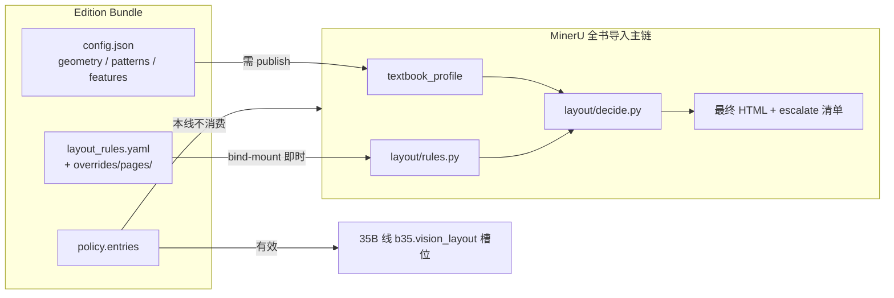
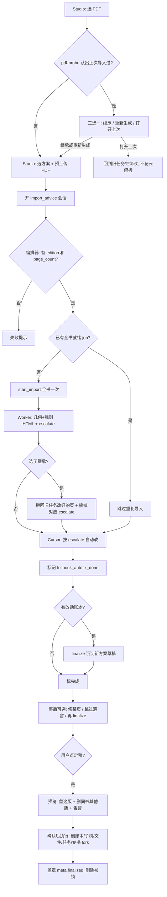

# MinerU 全书导入流程说明（清理后现行版）

> **文档目的**：存档当前「清理旧分段导入之后」的真实流程，作为后续优化的基线。  
> **适用范围**：Buddy Copilot 场景 `import_advice`（MinerU 全书导入 + 会话内聚焦改页）。页级分诊场景已删除。  

> **代码落点**：主要在 `buddy-copilot/`；真正跑页识别与排版的是 `learning-buddy-api` 的 worker。  
> **清理日期参考**：2026-07（去掉「每 20 页一批 + 批末等人确认再下一批」的旧门闸）。  
> **2026-08-03 更新**：补入 §2.2「方案的哪一部分真影响导入」与 §3.4 死路径清单——
> 此前文档只写了方案的字段结构、没写生效面，导致把 `policy.entries` 误当规则出口。

---

## 1. 一句话先说清

**现在的标准做法是：**

1. 把整本 PDF **一次**交给 MinerU 导入（不再按 20 页切段）；  
2. 机器先用「几何 + 规则」把绝大多数页排好，并把**没把握的页**列成清单；  
3. Copilot（Cursor Agent）**自动**按清单改页，**不再**停下来问「要不要改 / 要不要下一批」；  
4. 有改动就记进账本，最后**沉淀成新的排版方案草稿**；  
5. 用户事后还可以在对话里说「修第 X 页」「跳过遗留」继续微调。

旧流程里「20 页一批 → 质检 → 确认 → extend 下一批」已整条下线：`extend_import` 工具与 HTTP 均已删除，只保留全书一次 `start_import`。

---

## 2. 先搞懂几个角色与生效面（别混线）

### 2.1 角色表

| 名字 | 是什么 | 干什么 |
|------|--------|--------|
| **Studio** | 语料工作室前端（`exam-ocr-server` 的 `/studio/`） | 选 PDF、选方案、开 AI 会话、看中栏对比页 |
| **Buddy Copilot** | 伴学助手编排服务（本机约 `:8200`） | 开 Agent、调工具、驱动「全书导入 → 自动改 → 收尾」 |
| **buddy-api / buddy-worker** | Learning Buddy 后端 | 真正跑 MinerU 导入、重渲染、改块、写任务元数据 |
| **MinerU 线** | 本流程用的导入线 | PDF → 结构 + 几何规则排版 → HTML；**不用** 35B 大模型重识别 |
| **35B 线** | 另一条导入线（Import35B） | 视觉大模型蓝图；与 MinerU **隔离**，本场景禁止混用 |
| **教材方案（edition）** | 一套排版配置包 | 规则 YAML、页级覆盖等；导入前必须先选好 |
| **导入任务（import job）** | 一次导入的后台任务 | 有 `job_id`，状态在 buddy-api 里 |
| **escalate 清单** | 「需要人机再看一眼的页」 | 写在任务元数据 `layout_escalate_pages` 里 |

**分层符号（产品架构，便于对号入座）：**

- **C2**：OCR / 导入 / 切页等工具能力（gateway、导入 API）。  
- **A 层**：通用语料资产（导入结果、方案规则、页 HTML）。  
- **Copilot / Cursor**：本流程里充当「第二级成本」的智能修改者——不是再开一轮 35B 视觉识别。

### 2.2 教材方案里，哪一部分真的影响导入

这是最容易搞错、也最容易白干的地方。方案（Edition Bundle）有四段
（`meta` / `config` / `policy` / `assets`），但**只有两处**真正参与 MinerU 全书导入：

| 写到哪 | 影响本次导入吗 | 怎么改 | 何时生效 |
|--------|---------------|--------|----------|
| `<edition>/layout_rules.yaml`、`overrides/pages/NNNN.yaml` | ✅ 生效 | 直接改文件（Copilot 走 `fs.request_edit`） | 立即（bind-mount + mtime 缓存），`corpus.rebuild_ir` 验证，**不用发布** |
| `<edition>/config.json` 的 `geometry` / `patterns` / `features` | ✅ 生效 | `editions.save_draft` | **必须 publish** 才落盘 |
| `<edition>/assets.theme_css` | ✅ 影响渲染 | 直接改 CSS | 立即 |
| `<edition>/policy.json` 的 `policy.entries` | ❌ **对本线无效** | — | 只在拼装大模型提示词时注入，而本线永不调用大模型 refine |
| `config.refine_mode`、`config.refine_parallel` | ❌ **对本线无效** | — | 主链是**架构上绕开** refine，不是按这两个字段判断 |

`policy.entries` 并非全无用处——它仍对 **35B 线**的 `b35.vision_layout` 槽位有效。
但在 MinerU 线上，把版式规则写进 `policy.entries` 等于没写。

跨教材的**症状检测**是另一套生效面（不属于某本教材的方案），同样是挂载热更：

| 写到哪 | 是什么 | 怎么改 | 何时生效 |
|--------|--------|--------|----------|
| `configs/checks/*.yaml` | 跨书症状检测器（18 条） | 直接改文件 | 立即，`corpus.rebuild_ir` 验证 |
| `configs/checks/features.yaml` | 派生特征（现有名字的纯组合） | 直接改文件 | 立即 |
| `configs/checks/vocabulary.yaml` | **词表 L2 配置词**（名字 + 表达式 + 中文释义 + 正反例） | 直接改文件 | 立即，**免重建镜像** |
| `configs/checks/lexicons.yaml` | 中文例外词表（跨书守卫不许硬写在表达式里的那些词） | 直接改文件 | 立即，**免重建镜像** |
| `configs/checks/vocab_ext/*.py` | **词插件 L2b**（受限 Python，一条表达式写不出来时才用） | 走专属批准闸 `vocab.request_plugin_edit` | 立即，**免重建镜像** |
| `app/services/corpus_symptoms.py` 的 L0 字段 / L1 算子 | 原始事实字段与算子 | 改代码 | **要重建镜像**（几乎不该动） |

也就是说：**加一只「眼睛」（一个可被检出的现象）现在不再需要重建镜像**，
除非它连受限插件都表达不了、必须新开一个 L0 事实字段。
写法与规则见 `learning-buddy-api/configs/checks/README.md`。



**连带的两个坑：**

1. `edition.finalize_from_session` 把会话的 `effective_changes` 写进 fork 出的新方案的
   `policy.entries`——正好落在「无效」那一格。它的价值只是**账本与溯源**，
   不改变下次导入的行为。真要生效，必须另外落到 `layout_rules.yaml`。
2. `harness.run_golden`（`run_golden_lite`）只检查
   `mineru.content_correct` / `mineru.layout_rebuild` / `mineru.unit_judge` / `b35.vision_layout`
   四个提示词槽位能否装配出文本，而前三个在全书导入里**一个都不跑**。
   所以它**不构成本线的验收证据**——本线的硬证据是 `rebuild_ir` 之后的最终 HTML。

---

## 3. 旧流程 vs 新流程（为什么要清）

### 3.1 已经拿掉的（旧分段门闸）

以前 Agent 容易被带进这种节奏：

```text
导入 1–20 页 → 质检/建议 → 等人点「继续」→ extend 21–40 → …
```

问题：

- 和大书（上百页）极不匹配，轮次多、等人久；  
- 场景文案还写着「20 页批 / 不修下一批」，和代码里已实现的「全书一次」互相打架，Agent 行为会摇摆。

### 3.2 现在保留的主路径

```text
预上传 PDF → 选定教材方案
    → 编排器全书 start_import（不传页范围）
    → Worker 跑完整书（几何 + 规则 → 最终 HTML + escalate 清单）
    → Cursor 按 escalate 直接自动改（不问「按建议改吗」）
    → 记账 → finalize 沉淀方案草稿
    → （可选）用户事后逐页聊
```

### 3.3 刻意还留着、但默认不用的

| 东西 | 为什么还在 |
|------|------------|
| 会话里 `segment_*` 字段名 | 旧会话断点还靠这些字段读进度；改名会漂语义 |
| `_full_book_preview_execution` / `preview_batch` | 另一套「预览批」实验路径，与本次「门闸」无关，另开清理 |

> **`extend_import` 已删除**（全书一次 MinerU）：Copilot 工具、buddy-api `POST .../extend`、c2-gateway 代理、worker `extend_mode` 分支均已下线。`corpus_import.py` 中按 block id 排序打乱阅读序的那一行也随之消失（该故障的复盘见 `doc/reports/book2-import-retrospective.md` §10）。

### 3.4 死路径清单（代码还在，导入主链不走）

去掉 35B refine 链之后，下面这些代码没有被删，但**全书导入一条都不经过**。
读代码时容易把它们误当成现行流程——这正是历史文档把人带偏的地方。清单只作盘点，是否删除另议。

| 死路径 | 证据 | 现状 |
|--------|------|------|
| `corpus_reprocess_service.py` 的 35B 分支（`content_correct` / `layout_content` / `layout_rebuild` / `refine_35b`） | Copilot 工具层已硬拦截；Studio 无入口 | 不可达 |
| `mineru_page_refine.refine_all_pages` | 全仓**零调用方** | 完全死 |
| `mineru_page_refine.refine_page` / `refine_one_block` | 唯一调用方是上面那个已封禁的 35B 分支 | 间接不可达 |
| `data/prompts/` 六个 `mineru_page_*.md` 模板 | 只被 `load_refine_prompt` 与 `run_golden_lite` 读到 | 导入不消费 |
| `page_fusion`（`run_layout_rebuild`） | 唯一入口是 `layout_rebuild` mode | 间接不可达 |
| `policy.entries` 作为 MinerU 线规则出口 | 只注入大模型提示词；本线不跑大模型 | 对本线无效（对 35B 线有效） |
| `run_golden_lite` 的槽位选择 | 四个槽位里三个本线不跑 | 验收失真，见 §2.2 |
| Studio `import35b.ts` 的 `reprocessPage` / `refineBlock` | 前端**无调用方** | 死入口 |

---

## 4. 端到端主路径（按时间顺序）

下面按用户真实操作顺序写。每一步写清：**谁发起、写到哪、成功长什么样、失败怎么办**。

### 步骤 A：用户在 Studio 准备材料

1. 打开语料工作室，进入 MinerU 导入相关面板。  
2. **选择教材方案**（`edition_id`）。没有方案就不能开全书 AI 导入——编排器会直接失败并提示。  
3. 在「PDF 文件」里选文件。前端会：  
   - 预上传到对象存储 MinIO；  
   - 探测页数 `page_count`；  
   - 把 `minio_key`、页数等写进 Copilot 会话的 **payload**（会话随身携带的状态字典）；  
   - 常会给助手发一条「已预上传完成：minio_key=…」类消息。

**此时还没有**正式的导入任务 `job_id`（除非会话里绑过旧任务）。

### 步骤 B：创建 Copilot 会话（场景 `import_advice`）

- 场景名：`import_advice`（「新 PDF 导入方案建议」）。  
- Copilot 会拼一段**场景上下文**给 Agent，核心使命现在是：

  1. 编排器全书 `start_import`（不传 `page_ranges` / `page_limit`）；  
  2. Worker 写出最终 HTML + `layout_escalate_*`；  
  3. Agent **优先读 escalate，直接改**（不要问「按建议改吗」）；  
  4. 有效改动记账，收尾 `finalize`；  
  5. 事后可逐页聊；  
  6. **禁止**走 35B 重识别那几条路。

- **工具白名单**（Agent 在本场景「看得见」的工具）在 `buddy-copilot/agent-env/permissions.yaml` 的 `scenarios.import_advice.tools`：  
  - 有：`corpus.start_import`、`page_html`、`get_blocks`、`patch_block`、`replace_page_blocks`、`rerender_page`、`rebuild_ir`、`edition.record_effective_change`、`edition.finalize_from_session` 等；  
  - **没有**：`corpus.extend_import`（已下线删除）。

### 步骤 C：编排器启动「全书执行」

入口函数：`LoopEngine._mineru_fullbook_execution`（`buddy-copilot/app/loop.py`）。

触发方式常见有：

- 新开会话且判定应走 MinerU 全书；  
- 用户点「继续」，且会话仍处于未完成断点（见第 6 节）。

编排器会先做几件**硬检查**：

| 检查 | 不通过时 |
|------|----------|
| 有没有 `edition_id` | 提示必须先选教材方案，会话标失败 |
| 有没有 `page_count` | 提示重新选 PDF 探测页数 |
| 会话是否误绑了「别的书」的 `import_job_id` | 解除错误绑定，避免把结果写进别人任务 |

然后：

1. 若 **`fullbook_autofix_done` 已为真** 且已有 `job_id` → 跳过导入与自动改，直接去收尾（finalize/结束）。  
2. 若已有 `job_id` 且全书页都已就绪 → **不再二次 start_import**，直接进入 escalate 自动改。  
3. 否则 → 调用 buddy-api：**全书 `start_import`，不传页范围**。

等待超时大致按页数估算（有上下限），全书就绪后：

- 记进度字段（兼容旧名）：如 `segment_next_page = page_count + 1`、imported/qa through；  
- 推送 `import_event`（`import_started` / `import_done`，带 `fullbook: true`）；  
- 系统消息告知：全书已就绪，开始读 escalate 并自动改。

### 步骤 D：Worker 在后台实际做了什么（A 层）

（概念说明，细节在 buddy-api / MinerU 流水线文档。）

对每一页大致：

1. MinerU（或既有结构化结果）得到版面/块；  
2. **几何 + 规则**（方案里的 `layout_rules` 等）生成**最终可看的 HTML**；  
3. 每页跑一遍**命名症状检测器**（见 §4.1），把命中结果映射到已有模式；  
4. 对「规则把握不大」的页，写入任务元数据：  
   - `layout_escalate_pages`：页号列表；  
   - `layout_escalate_summary`：每页分数、低置信原因键等摘要；  
   - 目标指向 Cursor（成本阶梯第二级），**不是**默认再开 35B。

中栏对比视图此时已可浏览全书页。

### 步骤 D-1：命名症状检测与映射（跨书复用的入口）

**映射不依赖 Agent 在线。** 用户只点「开始解析」不开 AI 时，低置信页原本就只是界面上
一行灰字、没人消费。所以检测和映射都在 worker 里确定性完成，写进 job 元数据。

每页渲染出 HTML 后：

1. **跑检测器** —— 加载 `learning-buddy-api/configs/checks/*.yaml` 的全部声明，
   逐块求值 `when` 表达式（`services/corpus_symptoms.py`）。命中即产出一条
   finding，带 `suspect_type`、`page_no`、`block_id`、证据和**症状指纹**。
2. **映射到模式**（`enrich_findings`）——
   - 先按**指纹精确匹配**：命中模式的 `fingerprints_json` 就带出历史的
     「改前 → 改后」，`match=exact`；
   - 匹配不到再**按症状名退化匹配**，给手册与候选，`match=suspect_type`。
   - **这是唯一的映射入口**，不做摘要文本模糊匹配。
3. **误报降噪** —— 同指纹在误报库里有记录的，严重度降一档并标注「疑似历史误报」，
   但**绝不静默丢弃**。抑制是人的权力。
4. **写元数据** —— `symptom_findings`（明细）、`symptom_summary`（按症状汇总），
   并把 `layout_escalate_target` 从死值 `"cursor_sdk"` 改成实际覆盖情况：
   `none` / `known` / `unknown` / `mixed`，让下游知道这批疑点有没有成功路径。

命名症状与 `layout_escalate_pages` **并列，不混在一起**：一个是有名字、有处置办法的
问题，一个是数值兜底。

`rule` 档模式一旦落进规则文件，对应症状在下一本书里压根不会出现——它在第 2 步
（几何 + 规则）就被修掉了，检测器根本不会命中。检测器命中说明还没落地。

### 步骤 E：Cursor 自动分析 + 自动改（无用户门闸）

编排器拉取 escalate 与命名症状清单（`GET /jobs/{id}/symptoms`）后，拼指令
`fullbook_analyze_and_fix_instruction`，交给 Agent，要求：

0. **先修已知症状**：这些是别的书上已经修好过的问题。`rule` 档按 `landing_target`
   落规则，`playbook` 档照指令里的「手册步骤」块做（步骤由服务端从检测器 YAML 解析
   出全文，按症状名去重列一份；`playbook_ref` 只是出处），`candidates` 里的「历史修正」
   直接照抄。判定其实不是问题就调 `checks.report_false_positive`，别硬改；  
1. **再**处理 escalate 页：用 `page_html` 看最终画面，用 `get_blocks` 看区块与规则 id / 置信度；  
2. 再抽查其它明显坏页（乱栏、公式崩、明显缺漏）；  
3. 修复时**便宜通道优先**：  
   - 版式系统性错 → 改方案规则 YAML 或页覆盖 → `rebuild_ir`（只重跑排版）或 `rerender_page`；  
   - 单块错 → `patch_block` / `replace_page_blocks`；  
4. **禁止** 35B 相关：`layout.judge_35b`、triad/compare、以及 `reprocess_page` 的 content_correct / layout_content / layout_rebuild / refine_35b；  
5. **禁止**再 `start_import`；  
6. **不要**停下来问「按建议改吗」——改完用最终 HTML 验收；  
7. 有效改动 → `edition.record_effective_change`；有账本则走向 finalize。

结束后编排器会：

- **重跑检测**（`POST /jobs/{id}/symptoms/refresh`），用当前中间表示覆盖导入时的症状快照；  
- 活清单里还有「有手册可改」的症状 → **不**把 `fullbook_autofix_done` 置真，再开一轮（同一症状名一批，最多 8 轮）；  
- 连续两轮数量不降或跑满轮次 → 停靠，点「继续」按活清单再跑；  
- 活清单清空后才标记 **`fullbook_autofix_done = true`**，再进 `_mineru_fullbook_finalize_or_done`。

**收口条件：** Agent 交一份 JSON 报告 **不能**收口。有手册的症状必须在活检测里消失，或被 `checks.report_false_positive` 记账。没有手册的未知疑点不挡收口，可事后再聊。

### 步骤 F：沉淀方案（finalize）

若会话账本里已有改动记录（`layout_change_log` 或 `effective_changes`），且还没有 `result_edition_id`：

- 编排器再请 Agent 调用 `edition.finalize_from_session`；  
- 作用：把本会话有效改动 **fork（分叉）成新的排版方案草稿**，便于以后复用/发布。

若没有账本可沉淀，则直接标完成，并提示用户可继续在对话里微调。

界面上常见后续动作按钮（`next_steps`）：例如「生成新排版方案」、修遗留页相关入口等——**已没有「下一批」按钮语义**。

### 步骤 G：事后逐页优化（主路径完成后）

用户可以继续发消息，例如：

| 用户说法（意图） | 编排器行为 |
|------------------|------------|
| 「生成新排版方案」/ finalize | 若仍欠 finalize，再跑 finalize |
| 「不用改了 / 跳过遗留」 | 把 open issues 标为用户跳过，再走收尾 |
| 「按建议改」/「修第 12、15 页」 | 只修指定/全部遗留页，仍禁 35B 与再导入 |
| 普通提问「第 3 页怎么了」 | 偏问答：可看页，**不要擅自改**；明确要求改才改 |
| 「继续」且仍有断点 | 从全书断点续跑（见下节） |

### 步骤 H：书籍定稿（finalize book）——同一本书只留一版

**先分清两个 finalize**（同名不同事）：

| 名字 | 对象 | 做什么 |
|---|---|---|
| 步骤 F 的「沉淀方案」`edition.finalize_from_session` | 教材方案（Edition Bundle） | 把会话改动 fork 成**新的排版方案草稿**，不删任何书 |
| 步骤 H 的「书籍定稿」finalize book | 这一册书的导入版本 | 把这一版定为**该教材唯一版本**，其余同书导入连数据删除 |

入口：导入预览页顶栏的 **「定稿」** 按钮（红色，`import-open-textbook-bar`）。
按钮先拉预览（只读），把「留哪一版 / 删哪些版 / 告警」写进确认框，用户点确认才执行。

同一本书怎么认定（复用导入前的身份判定，见 §2.1 与 `book_identity`）：

1. 书指纹（IR 派生特征）一致；
2. 源 PDF 的 SHA1 完全一致（`same_file`）；
3. 抽样正文页哈希完全一致（`same_body_pages`）；
4. 抽样正文页高度相似（`similar_body_pages`）—— 这一档会**额外报告告警**，因为它可能是同套书的另一册。

执行时按这个顺序删（每步单独提交，一处卡住不会回滚已删的）：

```text
死书账本（改进点 IP + 页补丁 + 书指纹 + 方案绑定）
  → 教材子树与向量（delete_node cascade）
  → 页反馈 corpus_import_feedback
  → 对象存储该任务前缀（与保留版共用 staging 目录时自动跳过）
  → 导入任务行 corpus_import_jobs
  → 只被死书用的专书方案 fork（Edition / 草稿 / 版本 / 待审队列）
  → 给保留版盖章 meta.finalized
```

盖章之后 **删除被锁**：`delete_import_job` 与 `delete_node` 遇到已定稿的书直接报 409，
必须先 `unfinalize-book` 解锁（解锁只解锁，删掉的版本不会回来）。

接口（管理端，`/api/v1/admin/corpus/`）：

| 方法 | 路径 | 作用 |
|---|---|---|
| GET | `import/jobs/{id}/finalize-book` | 预览：留/删清单 + 告警，只读 |
| POST | `import/jobs/{id}/finalize-book` | 执行（`dry_run=false` + `ack_warnings=true`）|
| POST | `import/jobs/{id}/unfinalize-book` | 解锁定稿 |

有告警且未确认时 POST 直接 409，不会删任何东西。典型告警：

- 要删的那版**改进点比保留的这版多**（选错了保留对象）；
- 命中档位只是「正文相似」，可能其实是另一册；
- 要删的那版自己也定稿过；
- 保留的这版状态还没解析出页面。

**留在磁盘上的东西**：被删方案的目录 `configs/editions/<id>/` 不会动
（bind-mount 配置面，预览里以 `config_dir` 报告，需要时手工清理）。

### 步骤 H-1：删任务时对象存储怎么清

单独删一个导入任务（Studio 的「删除」按钮 / `DELETE import/jobs/{id}`）也会顺手删掉
它在对象存储 MinIO 上那份目录：源 PDF、切好的图片、调试转储。范围由
`owned_minio_prefix` 算出来，只到「单次导入自己的目录」这一层
（`corpus/imports/<任务>/` 或 `corpus/imports/staging/<上传>/`），再往上是共享层级，不碰。

两次导入共用同一份上传目录时（同一份 PDF 重导），`prefix_still_in_use` 会发现还有别的
任务认领这个前缀，于是**跳过删除**，避免把还在用的 PDF 删掉。返回体里的
`objects_removed` 就是这次实际删掉的对象数。

历史遗留的孤儿对象（这条清理逻辑上线之前删掉的任务、以及上传了但从没建成任务的 PDF）
用维护脚本清，默认只报告不删：

```bash
docker exec -w /app buddy-api python scripts/purge_orphan_import_objects.py
```

```bash
docker exec -w /app buddy-api python scripts/purge_orphan_import_objects.py --apply
```

脚本两条线各算各的：MinerU 线只看 `corpus/imports/`，35B 线只看 `import35b/`，
在用前缀分别由各自的任务表推出，互不读写对方的资源。`--min-age-hours`（默认 6）
保护正在进行的上传。首次运行清掉了 12192 个对象、约 1.16 GB。

---

## 5. 「成本阶梯」是什么意思（通俗版）

目标是：**便宜办法能搞定就别上贵的。**

```text
第 1 级（便宜、批量）：导入时 Worker 的几何 + 规则 → 覆盖大多数页
第 2 级（中等）：escalate 清单 → Cursor 用规则/改块/重渲染修
第 3 级（贵，本场景禁用）：35B 视觉重识别 / refine —— 不走 Copilot；必要时走独立 35B 导入线或人工
```

验收标准始终是：**最终 HTML / 中栏渲染效果**，不是中间某一段结构化草稿好看就完事。

---

## 6. 断点与「继续」：会话怎么知道还没做完

函数：`_unfinished_pipeline`。  
只对 `import_advice` 且已有 `minio_key` 判断。

| 返回标签（内部名） | 含义（人话） | 典型 payload 状态 |
|--------------------|--------------|-------------------|
| `segment_issues` | 还有阻塞性遗留问题页 | `open_issues` 里有 open |
| `segment` | 全书导入或自动改还没做完 | 没有 `fullbook_autofix_done` |
| `finalize_edition` | 自动改完了，但账本还没沉淀成新方案 | 有 job、有账本、无 `result_edition_id` |
| `None` | 没有编排器级断点 | 例如已 autofix 完成且无需 finalize |

> 标签里仍有 `segment` 字样，是历史命名兼容；**语义已是全书路径断点**，不是「下一批 20 页」。

用户点「继续」时：有断点 → 再进 `_mineru_fullbook_execution`（或 finalize 分支）。

---

## 7. 会话 payload 里常见字段（读懂存档状态）

这些是会话随身状态，不是 Postgres 主库表名。

| 字段 | 含义 |
|------|------|
| `minio_key` | PDF 在 MinIO 上的对象键 |
| `page_count` | 总页数 |
| `edition_id` / `source_edition_id` | 选用的教材方案 |
| `import_job_id` / `job_id` | 导入任务 id |
| `segment_next_page` 等 | **兼容旧名**的进度指针；全书完成后常为 `page_count+1` |
| `fullbook_autofix_done` | 全书自动改阶段是否结束 |
| `open_issues` | 遗留问题列表（页号、类型、状态） |
| `layout_change_log` | 排版改动账本（写中间表示/改页时记） |
| `effective_changes` | 确认有效的改动账本 |
| `result_edition_id` | finalize 后新方案草稿 id |
| `result_edition_forked` | 是否已成功 fork |

---

## 8. Agent 允许做什么 / 禁止做什么

这一节只谈 **MinerU 导入场景**（场景名：`import_advice`）。  
事后改页也在同一会话完成（Studio 中栏聚焦），不再另开分诊场景。

读完本节，你应能回答三件事：

1. 助手**默认可自动做**哪些事；  
2. 哪些事**必须先经你批准**，或干脆**做不了**；  
3. 卡死时它该**停手记问题**，而不是死循环硬改。

---

### 8.0 先建立一张心智图

可以把助手想成一个**带权限工牌的排版修理工**：

| 角色感 | 含义 |
|--------|------|
| 工牌写着「MinerU 线」 | 只修这条导入线的结果，不去开 35B 重识别流水线 |
| 验收看「成品页」 | 以中栏最终 HTML / 渲染效果为准，不是中间草稿好看就算完 |
| 便宜办法优先 | 先改规则、改块、重渲染；最后才申请改文件 |
| 有事记在账上 | 有效改动要记账，方便最后沉淀成新方案 |

权限从哪来？三道闸叠在一起：

1. **场景工具面**：本场景「看得见」哪些工具（看不见 ≈ 默认调不到）；  
2. **权限档位**：只读 / 运行 / 草稿 / 需批准（见下表）；  
3. **业务硬规则**：即使工具看得见，某些用法（例如 35B 的 reprocess 模式）仍会被代码拦下。

| 档位 | 人话 | 典型行为 |
|------|------|----------|
| **只读** | 看看、问问，不改数据 | 查任务、看页面 HTML、读块、对照 golden |
| **运行** | 自动干活，但不改仓库源码 | 导入、改块、重渲染、layout-only 重跑 |
| **草稿** | 改可回滚的方案/账本数据 | 记有效改动、finalize 出新方案草稿、存 edition 草稿 |
| **需批准（gated）** | 弹出批准卡，你点头才执行 | 申请改工作区文件、发布正式方案 |

配置出处：`buddy-copilot/agent-env/permissions.yaml`。

---

### 8.1 允许做什么（按「你在 Studio 里会看到的动作」分组）

下面每组先写**人话**，再写工具名，方便对照日志。

#### （1）弄清现状——只看不动

助手应先看清再动手，这些一般会自动执行：

| 它在做什么 | 工具（点号名） | 说明 |
|------------|----------------|------|
| 查教材方案总览 / 配置包 / 草稿 | `editions.overview` / `bundle` / `draft` | 知道当前规则长什么样 |
| 校准试算（不算落盘） | `editions.calibrate` | 试算，不直接改正式数据 |
| 列导入任务、看任务详情 | `corpus.list_jobs` / `corpus.job` | 读 `job_id`、escalate 清单等 |
| 看某一页上下文 / 最终 HTML | `corpus.page_context` / `page_html` | **验收主依据** |
| 读页内块（含规则 id、置信度） | `corpus.get_blocks` | 判断该改规则还是改单块 |
| 导入前确认 PDF 已在对象存储 | `minio.stat` | 预检，避免空 key |
| 页差异对比 | `harness.page_diff` | 验证改完有没有变好 |
| 方案 slot 装配自检 | `harness.run_golden` | ⚠️ 只查提示词槽位能否装配，**不构成本线证据**（见 §2.2） |
| 查资源地图 | `env.resource_map` | 知道文件/服务在哪，禁止乱猜路径 |
| 更新会话待办条 | `session.update_todos` | 只更新 UI 清单，不改语料 |

#### （2）把书导进来——全书一次

| 它在做什么 | 工具 | 说明 |
|------------|------|------|
| 发起 PDF 导入 | `corpus.start_import` | **标准动线**：不传页范围 = 全书一次。多数时候由编排器直接调 buddy-api；工具面仍保留给 Agent |

导入完成后，Worker 已写好最终 HTML，并可能给出 escalate（低置信页）清单。助手下一步应**优先处理清单里的页**，而不是整书盲扫。

#### （3）修坏页——本场景的「正经修理箱」

成本从低到高，优先走上面的：

| 优先级 | 它在做什么 | 工具 | 适用直觉 |
|--------|------------|------|----------|
| 高 | 改一个块的内容/属性 | `corpus.patch_block` | 「就这一块公式/文字错了」 |
| 高 | 整页块重排 | `corpus.replace_page_blocks` | 「这一页栏乱了，要重摆块」 |
| 高 | 只重渲 HTML（不重跑识别） | `corpus.rerender_page` | 「数据对，画面/CSS 不对」 |
| 高 | 写页级覆盖再重算排版 | `overrides/pages/NNNN.yaml` + `corpus.rebuild_ir(pages=[N])` | 「这一页归属判错了」 |
| 中 | 写教材规则再重算排版 | `<edition>/layout_rules.yaml` + `corpus.rebuild_ir` | 「多页同一个症状」 |
| 中 | 出 PDF 页预览图 | `corpus.render_preview` | 需要对照原书页面时 |
| 低 | 从 MinerU 基线拉回再适配 | `reprocess_page` 且 mode=`restore_mineru` 或 `from_cloud` | 「越修越糟，先退回基线」——回退用途，不是日常修页 |

**`reprocess_page` 在本场景只允许三种 mode：**

| 允许的 mode | 人话 |
|-------------|------|
| `rerender` | 用现有中间表示重画 HTML |
| `restore_mineru` | 回到 MinerU 基线 |
| `from_cloud` | 从云端/已存 MinerU 结果重新适配 |

> 写中间表示（IR, Intermediate Representation）或改页成功时，系统往往会自动记入 `layout_change_log`（排版改动账本），不必全靠模型「自觉」。

#### （4）改「教材方案」——让同类问题以后少犯

多页同一类毛病时，应改方案，而不是每一页手搓：

| 它在做什么 | 工具 | 说明 |
|------------|------|------|
| 申请改规则/覆盖文件（**首选**） | `fs.request_edit` | **需你批准**；白名单内才允许。改完 `rebuild_ir` 即生效，不用发布 |
| 保存方案草稿（几何/正则/features） | `editions.save_draft` | 存 Postgres 草稿，**必须 publish 才生效** |
| 分叉一份方案 | `editions.fork` | 基于现有方案开分支 |

典型文件：方案下的 `layout_rules.yaml`、某页的 `overrides/pages/NNNN.yaml`。
批准后改完，对问题页做 `rebuild_ir`，用最终 HTML 验收。

⚠️ 两条通道生效方式不同，别混（详见 §2.2）：规则 YAML 改完立即生效；
`config.geometry/patterns/features` 的草稿**不发布就不生效**，别把未发布的草稿说成已生效。

#### （5）收尾——记账与沉淀新方案

| 它在做什么 | 工具 | 说明 |
|------------|------|------|
| 记下「确认有效」的改动 | `edition.record_effective_change` | 进 `effective_changes` 账本 |
| 按本会话账本 fork 新方案草稿 | `edition.finalize_from_session` | 导入主路径的收尾动作；写的是 `policy.entries`，属**账本**而非生效面（见 §8.6 沉淀层） |
| 发布正式方案 | `editions.publish` | **需你批准**；使 `config.*` 草稿落盘生效 |

主路径期望：自动改完 →（有账本则）finalize → 给你一个可继续编辑/发布的新草稿。
若这一轮的经验想真正作用于**下次导入**，还得把对应规则落进 `layout_rules.yaml`。

#### （6）事后你让它「再修几页」时

全书主路径结束后，你仍可说「修第 12 页」「按建议改」。此时仍只用上面的修理箱，**仍然禁止**再全书导入、再走 35B。

---

### 8.2 禁止做什么（以及「为什么」）

禁止不是刁难助手，而是避免三条事故：

1. **串线**：MinerU 线跑去烧 35B，贵且难回归；  
2. **分段倒退**：又变回 20 页门闸式导入；  
3. **越权改核心**：没批准就动服务端代码或重建容器。

#### （1）禁止碰 35B / 视觉重识别那一套

本场景工具面里**根本没有**这些工具；即使在别的场景存在，这里也不该用：

| 禁止项 | 人话 |
|--------|------|
| `layout.judge_35b` | 用 35B 做版式判定 |
| `layout.triad` / `layout.compare` | 35B 相关对照/三联流程 |
| `reprocess_page` 的 `content_correct` | 35B 只改文字/公式 |
| 同上 `layout_content` / `refine_35b` | 35B 版式+内容一起重认 |
| 同上 `layout_rebuild` | 35B 整页骨架重建 |

**正确替代：** 用 `patch_block` / `replace_page_blocks` / 规则 YAML + `rebuild_ir` / `rerender`。  
Copilot **不提供** 35B 单页重认；顽固页继续用改块/规则，或走独立 35B 导入线（与 MinerU 隔离）。

#### （2）禁止再开导入 / 分段续导

| 禁止项 | 说明 |
|--------|------|
| `corpus.extend_import` | **已删除**；不得恢复分段续导 |
| 自动改阶段再 `start_import` | 书已在任务里时，禁止为「再导一段」重新开范围 |

#### （3）禁止擅自改核心代码与重建服务

| 禁止项 | 说明 |
|--------|------|
| 直接改 `learning-buddy-api/app/**` 等核心源码 | 本场景**没有**把 `docker.rebuild` 放进工具面；重建由**人工**执行 |
| 绕过批准改白名单外文件 | 唯一合法改文件入口是 `fs.request_edit`（需批准） |
| 把 MinerU 任务写到 35B 的队列/对象前缀/面板 | 双线隔离：Redis 队列、MinIO 前缀、前端面板都不得串 |

判断「这是方案数据问题还是流水线代码问题」时：

- **authority=edition**（可只靠方案/规则/页数据吸收）→ 优先改方案草稿或页覆盖；  
- **authority=pipeline**（必须改服务端逻辑）→ 记入 issues 或走申请编辑，**不要**在导入会话里偷偷改完并假装没事。

#### （4）行为上也不该做的事（即使没触发工具报错）

| 不该做 | 更好的做法 |
|--------|------------|
| 停下来反复问「要不要按建议改」 | 主路径要求**直接改完**；遗留再事后聊 |
| 整书盲扫、忽略 escalate 清单 | **优先**处理 `layout_escalate_pages` |
| 同一处连改两次 HTML 仍无变化还继续砸 | 停手，写入 `issues` |
| 用户只是在问「这页怎么了」却擅自大改 | 先解释、展示；**明确要求修改**再改 |
| 编造不存在的 `minio_key` / `job_id` | 等预上传完成消息，或让用户在面板重选文件 |

---

### 8.3 「改不动」时的硬规则（防死循环、护体验）

这些规则既保护系统，也保护你的耐心——避免助手空转半小时。

| 情况 | 助手应怎么做 | 你这边会看到什么 |
|------|--------------|------------------|
| 同一处改 **两次**，最终 HTML 仍无变化（`html_changed=false` 一类信号） | **立即停手**，把页记入 `issues`，说明已尝试手段 | 遗留问题列表多一页；可事后指定再修或跳过 |
| 判断是渲染器 / 服务端缺陷，而不是某一页数据错 | 走 `fs.request_edit` 申请，或只写 issues；**绝不**直接改 `app/` | 批准卡，或简报里写明「需人工改代码」 |
| 需要重建 Docker 镜像/容器才能生效 | **本场景无自动 rebuild**；说明需人工执行 | 不会在导入会话里默默重启 buddy-api |
| 请求明显越权（改架构、硬开 35B、动别人的书） | 拒绝并说明原则 | 提示换一种合理说法，或点下一步按钮 |

另外两条体验向约定：

- **遗留问题不挡住主流程结束**——书可以先「导入+自动改完成」，坏页留到事后「修第 X 页」。  
- **跳过遗留**（例如你说「不用改了」）→ 编排器把对应 issues 标为用户跳过，再走收尾，而不是卡死在门闸上。

---

### 8.4 一张对照表：允许 vs 禁止（速查）

| 意图 | 允许？ | 怎么做 / 为何不行 |
|------|--------|-------------------|
| 看某页最终效果 | ✅ | `page_html` / 中栏 |
| 全书一次导入 | ✅ | `start_import`（不传范围） |
| 按 20 页分段续导 | ❌ | `extend_import` 已下线删除 |
| 改一个错块 | ✅ | `patch_block` |
| 用 35B 重认整页 | ❌ | 用规则/改块通道；Copilot 不开放 35B reprocess |
| 只重画 HTML | ✅ | `rerender` |
| 改 layout 规则让多页变好 | ✅ | 方案草稿 / `fs.request_edit`（后者需批准） |
| 自动重建 buddy-api 容器 | ❌ | 人工操作；本场景无该工具 |
| 沉淀本会话改动为新方案 | ✅ | `finalize_from_session` |
| 发布正式方案 | ⚠️ 需批准 | `editions.publish` |
| 改两次仍无效还继续 | ❌ | 停手记 `issues` |

---

### 8.5 事后改页怎么走（原「页级分诊」已删除）

| 做法 | 说明 |
|------|------|
| 入口 | Studio 中栏聚焦页/块 → 同一 `import_advice` 会话 |
| 手段 | `patch_block` / `replace_page_blocks` / `rerender` / 规则 YAML |
| 35B | 禁止 |
| 已删除 | 场景 `page_assist` 及专用工具面（实测第二册从未使用） |

**导入任务 ↔ AI 对话 1:1：** 点击/打开某个导入任务时，右栏必须挂到该任务绑定的会话。若该任务从未开过 AI，系统会**自动新建一条空对话并绑定**（`auto_start=false`，不重跑全书导入），以便后续聚焦改页。

---

### 8.6 页级改动如何管理（账本 + 改进点 IP）

改页不只是「把 HTML 改好看」：试错只记过程；**对准意图且页面真改对、有成功路径**的事项才进**改进点（IP）**（唯一真相源）。  
字段、来源闭集、硬删、与「下次导入」关系：权威见 `doc/improvement-point-management.md`（勿用旧「状态机 / 应用层 / 多来源码」说法）。

**日常场**（Studio Buddy Copilot）主链：

```text
① 任务页上的事实改动（写盘）
    → 自动记 layout_change_log（attempt 流，含 tool / args_summary）
② 某事项最终成功且值得留下
    → edition.record_effective_change → IP confirm
    → 进表即有效（status=accepted 仅兼容；Studio 不展示状态）
    → origin = ai_auto | user_ask；summary 直奔主题
    → 派生 L3 corpus_corrections（必带 ip_id；after 应为成功后块快照）
    → pattern_status 默认 none（不自动建模式、不预判应用层）
③ 同书再导入
    → 指纹命中 → apply_matched_corrections（仅非空 after）
④ （可选）以后抽象
    → 从干净 IP 建模式 → 才定 landing_target → 另写盘到 L1/L0
```

**迁移场**（历史债）：仅在 Cursor IDE Coding Agent 对话中一次性用 admin HTTP；**不**经 Copilot，**不**做系统内迁移模块。见权威文 §0。

#### （1）写盘层：attempt（还不等于改进点）

| 谁 | 做什么 |
|----|--------|
| Agent | `patch_block` / `replace_page_blocks` / `rerender` / `rebuild_ir` 等 |
| buddy-api | 改该 job 的中间表示（IR）与最终 HTML |
| Copilot | 工具成功后**自动**往会话 payload 追加 `layout_change_log` |
| Studio | 中栏刷新该页；推送 `import_event` |

中间失败路径**不**进改进点、**不**进回放。同页可有多条成功事项；覆盖只按「同一事项」（近义摘要），不按粗位点整页碾压。

#### （2）确认层：procedure + 实例轨（默认）

写盘成功后，前端可弹 **「记入？」**（或 Agent 调 `edition.record_effective_change`）：

- `improvement-points/confirm`：须有成功实现路径（procedure 或非空 after）；否则拒绝  
- **实例轨（默认）**：`corpus_corrections` + `ip_id` → 同指纹重导回放  
- **模式轨**：默认不走；仅显式抽象时挂 `pattern_id`  
- `authority=pipeline`：工具层跳过进表（改流水线，不进 IP）  
- 列表可硬删：`DELETE /improvement-points/{id}`  

#### （3）下次导入 vs finalize / policy

- **同书下次变好的主路径 = L3 回放**（非空 `after`），不是「必须先落到 layout_rules」。  
- `finalize_from_session` 把有效改动投影进新方案 `policy.entries`：**只记账**，**不影响** MinerU 导入（见 §2.2）。  
- 要升级成跨页/跨书确定性规则：抽象后写 `layout_rules.yaml` / `config`（需 publish）/ normalize，**另走写盘**；`patterns.land` 不写文件。

#### （4）两张入口对照

| 入口 | 会话怎么来 | 改动管理 |
|------|------------|----------|
| 「AI 全书导入」选新 PDF | 新建 + 跑全书 | 自动改 → 成功事项记 IP；指纹命中则先回放 L3 |
| 点开已有导入任务 | 恢复或**建空会话**绑定 | 聚焦改页 → confirm IP → Studio「改进点」台账 |

#### （5）同一本书再导入：身份、认亲、页级继承（2026-08-10 补）

选同一本 PDF 时，**中栏导入表单会先弹出三选一**（2026-08-10 起）；选完才决定要不要花一次云解析。
详见下方「导入前识别 + 三选一」。

**书身份（fingerprint / 指纹）**由 `科目|学段|页数|目录哈希|首页哈希` 算出，**不含书名标签**。

| 坑 | 现象 | 现状 |
|----|------|------|
| 页数取自过期元数据 | 旧任务 `meta.total_pages` 停在早期分段值（如 20），实际 178 页 → 同一本被拆成两个身份，永不匹配 | 已修：页数以中间表示（IR）实际页跨度为准 |
| 软匹配要求页数**完全相等** | 重解析裁掉几页就整条回放跳过 | 已修：页数容差 `max(8, 5%)`，仍需目录或首页哈希命中 |
| 证据全取自 IR | 目录哈希/首页哈希都来自 IR，而 IR 正是规则与 Agent 改写的对象 → 改得越多越认不出 | 已加最后一档 `soft_pdf_*`：拿两个任务的**源 PDF** 比（见下方两条硬原则） |
| 匹配失败无痕 | 任务元数据里只有 `registered`，看不出「没命中」 | 命中才写 `match` / `corrections_applied`；`registered` 仅表示身份已登记 |

**认亲（adopt）** —— 自动匹配救不回来时显式指定旧账本：

```bash
curl -s -X POST "http://127.0.0.1:8100/api/v1/admin/corpus/import/jobs/<新任务>/adopt-fingerprint" \
  -H 'Content-Type: application/json' -H 'Authorization: Bearer $ADMIN_TOKEN' \
  -d '{"fingerprint_hash":"<旧书指纹>","note":"第二册重导","replay":true}'
```

写进 `meta.book_fingerprint_override`，之后本任务的回放一律按它走。
候选列表（带账本健康度）：`GET /api/v1/admin/corpus/books/fingerprints`。

**页级结果继承（inherit-pages）** —— 比回放补丁更强的一条路：
旧任务的最终 IR **就是**上次全部成功改动的结果快照，按页整页搬过来，不依赖模型复现。

```bash
curl -s -X POST "http://127.0.0.1:8100/api/v1/admin/corpus/import/jobs/<新任务>/inherit-pages" \
  -H 'Content-Type: application/json' -H 'Authorization: Bearer $ADMIN_TOKEN' \
  -d '{"from_job_id":"<旧任务>","only_improved":true,"dry_run":true}'
```

- 默认只取旧任务**被改过的页**（有改进点或页补丁的页）
- 页码会漂，所以按页文本相似度在窗口内对齐，再用全书主偏移量兜底
- `dry_run` 先出报告：`matched` / `skipped` / `low_confidence` / `unmatched`
- **别默认信旧任务更好**：`low_confidence`（如封面这类无文字页）和 `skipped`（搬过去会把页面变空）都要人看过再 `include_low_confidence` 或显式指定 `pages`

**回放护栏**：页级补丁是整页替换，旧补丁常只存了改动的那一个块。
现在块数落差过大（不足当页 40% 且当页 ≥4 块）会**跳过并记进 `skipped`**，不再把整页削掉。

**补丁自带块快照**：`improvement-points/confirm` 时若 `concrete.after` 不是块列表，
后端会**从当前任务 IR 现取该页**作为 `after`（`refine_result.after_source=page_snapshot`），
不再依赖模型自觉回传 —— 这是「274 条补丁 after 为空、不可回放」的根因修复。

#### （6）导入前识别 + 三选一（2026-08-10）

指纹要等云解析完才算得出来，太晚了。所以另外做了一层**只看原始 PDF 的识别**：
选完文件时 `pdf-probe` 把新文件跟历史任务的**源 PDF**（仍在对象存储里，首次比对算一次并
缓存到 `meta.source_pdf`，读不到则记 `unavailable` 不再重试）对一遍。

**两条硬原则**（2026-08-10 修正，原来只比首页，效果很差）：

1. **证据只取原始 PDF 的文本层**，绝不取中间表示（IR）。IR 是版式规则和 Agent 改写的对象，
   同一本书两次导入在 IR 上**本来就不同** —— 比 IR 等于在量我们自己的改动，不是在认书。
2. **跳过前 3 页，取样多页正文**。第 1 页通常是封面图，几乎没有文字，且同一套教材封面雷同。
   实测第二册封面只抽出 **25 个字**，凭它判不了任何东西。

取样方式：正文页（页码 > 3、去空白后 ≥60 字）各算一个页文本哈希，取**哈希最小的 8 页**。
这是「按内容选页」而不是「按位置选页」——重解析裁掉几页时，两边仍会选中同一批页。

| 判定 | 依据 | 含义 |
|----|----|----|
| `same_file` | sha1 完全相同 | 同一份文件重导 |
| `same_body_pages` | 取样页里 ≥3 页文本**完全一致** | 同一本书（不看页数：别的书不可能有这些正文页） |
| `similar_body_pages` | 页数在 `max(6, 5%)` 容差内，且 ≥3 页文本相似度 ≥0.82 | 同一本书的另一份导出/扫描件 |

真书验收（第二册 178 页，用 PyMuPDF 重写结构并砍掉前 2 页当作另一份导出件）：

| | 新逻辑 | 旧逻辑（仅首页） |
|---|---|---|
| 重导出件 vs 原件 | `same_body_pages`，8/8 取样页命中 | 首页哈希完全不同 → **判为不同书** |
| 第一册 vs 第二册 | 不命中（正确） | 两者首页都只有 25 字，全靠运气 |

同一套判定也当作**指纹匹配的最后一档**（`soft_pdf_same_file` / `soft_pdf_same_body_pages` …）：
IR 派生的目录/首页哈希都没命中时，比两个任务的源 PDF，命中就沿用旧书的账本。
改了取样策略要把 `SIGNATURE_VERSION` 加一，旧缓存会自动重算。

命中就在导入表单里给三个选项（默认第一个，候选按「证据强度 → 已改好页数」排序）：

| 选项 | 行为 | 花不花云解析额度 |
|----|----|----|
| 继承上次结果（推荐） | 重跑 MinerU 拿新解析，解析完自动把旧任务改好的页整页搬过来，并把这些页从 `layout_escalate_pages` 里摘掉 | 花 |
| 重新生成 | 完全按新解析走，忽略上次修订 | 花 |
| 打开上次的导入任务 | 不建新任务，直接回到旧任务继续改 | 不花 |

「继承」的落地链路（用户点一次，后面全自动）：

```text
导入面板选择 → 会话/表单带 inherit_from_job_id
  → POST /admin/corpus/import/pdf 存进 job.meta.inherit_from_job_id
  → buddy-worker 解析完成后 _inherit_previous_pages()（dry_run=false）
  → 结果写 job.meta.inherit_result（继承页清单 / skipped / unmatched）
  → 再跑结构合并
```

- Copilot 的 `corpus.start_import` **自己从会话 payload 里取**这个字段，不依赖模型记得传参
- Agent 侧提示会明确：只处理**剩下的** escalate 页，别重做已继承的页
- 前置识别失败（比如换了扫描件、首页被改过）不阻塞导入，只是不出现三选一 —— 这时用上面的**认亲**兜底

### 8.7 目标蓝图：四步导入（设计态）

现行主链仍是 §8.6（MinerU → 改页 → IP → L3 回放）。**目标产品编排**见权威文：

- [`doc/improvement-point-management.md`](improvement-point-management.md) **§12 四步导入蓝本**  
- 同文 **§11 整理状态**、**§13 经验库检索**、**§14 L0 双提案/末段确认**  
- Canvas：`ip-rag-four-step-blueprint`

摘要（避免与「必须先手选/手写 L1」旧说法冲突）：

```text
① 全书底稿（MinerU IR）
② AI 分析底稿 → 自动选已固化积木模块（蓝本；选中后确定性执行）
③ 初渲 HTML → AI+向量二次施工
④ 对话挑错：先检索全部完成体 IP，未命中再自创；末段集中确认 L0 补丁包
```

同书再导仍只跑 L3 非空 `after`，不重跑 ②③④。落盘灵活性与升层闸以权威文为准，**不是**「经验必须先写进 layout_rules 才算闭环」。

---

## 9. 和 Studio 前端的关系（用户眼中看到什么）

1. **左栏任务树 / 右栏助手**：任务与 AI 会话 1:1；消息流、系统提示、快捷下一步。  
2. **中栏**：导入任务页对比（原稿图 vs 最终 HTML）；导入完成后即可翻页检查。  
3. **导入事件**：`import_started` / `import_done` / 改页刷新事件等推到会话。  
4. **命名症状两栏**（导入完成后出现在预览区顶部）：左「已知症状（有成功路径）」、
   右「未知疑点（需诊断）」。已知症状每条带「按手册修」（把手册与历史修正预填进
   AI 对话）和「这不是问题」（记一条误报，降权但不屏蔽）。**不开 AI 也看得见**，
   因为检测和映射都在 worker 里做完了。  

部署注意：

- 改 `buddy-copilot` → **重启宿主机 uvicorn `:8200`**；  
- 改 Studio → rebuild `c2-gateway`；改 buddy-api 业务代码 → rebuild api/worker。

---

## 10. 关键代码与配置索引（优化时从这里改）

| 主题 | 路径 |
|------|------|
| **方案生效面：教材版式规则** | `learning-buddy-api/configs/editions/<id>/layout_rules.yaml` |
| **方案生效面：页级覆盖** | `learning-buddy-api/configs/editions/<id>/overrides/pages/NNNN.yaml` |
| **方案生效面：几何/正则/features** | `learning-buddy-api/configs/editions/<id>/config.json`（改后需 publish） |
| 共享硬不变量规则 | `learning-buddy-api/configs/layout/base_rules.yaml` |
| 规则层叠与求值 | `learning-buddy-api/app/services/ir/layout/rules.py` |
| zone 判定 + escalate | `learning-buddy-api/app/services/ir/layout/decide.py` |
| `when` 表达式可用变量 | `learning-buddy-api/app/services/ir/layout/features.py` |
| 全书导入主链 | `learning-buddy-api/app/services/import_ir_pipeline.py` |
| **跨书症状检测器声明** | `learning-buddy-api/configs/checks/*.yaml`（bind-mount，改完 `rebuild_ir` 即时生效） |
| **词表生效面：L2 配置词** | `learning-buddy-api/configs/checks/vocabulary.yaml`（bind-mount，**免重建镜像**） |
| **词表生效面：中文例外词表** | `learning-buddy-api/configs/checks/lexicons.yaml`（同上） |
| **词表生效面：L2b 词插件** | `learning-buddy-api/configs/checks/vocab_ext/*.py`（受限 Python，走专属批准闸） |
| 词插件沙箱 · 自检 CLI | `learning-buddy-api/app/services/vocab_plugins.py` · `vocab_plugin_check.py` |
| 检测器解释器 · 词表（L0/L1）· 映射富化 | `learning-buddy-api/app/services/corpus_symptoms.py` |
| 检测器试跑 / 正反例 / 误报 / 晋级门 | `learning-buddy-api/app/services/corpus_symptom_ops.py` |
| Studio 症状两栏 | `exam-ocr-server/studio-ui/src/components/import/SymptomsBar.ts` |
| 抽象分批推进 | `buddy-copilot/app/pattern_batch.py` → `loop.py::_pattern_abstract_execution` |
| 抽象技能（五步闭环） | `buddy-copilot/agent-env/skills/pattern-abstract.md` |
| 导入前书身份识别（三选一数据源） | `learning-buddy-api/app/services/book_identity.py` |
| 页级结果继承 | `learning-buddy-api/app/services/corpus_page_inherit.py` |
| 继承挂钩（解析后、结构合并前） | `learning-buddy-api/app/services/corpus_import.py` → `_inherit_previous_pages` |
| Studio 三选一 | `exam-ocr-server/studio-ui/src/components/import/knownBookChoice.ts` |
| 书籍定稿（同书只留一版） | `learning-buddy-api/app/services/corpus_finalize.py` |
| 删任务连带清对象存储 | `corpus_admin.py::delete_import_job` + `corpus_finalize.py::owned_minio_prefix` / `prefix_still_in_use` |
| 孤儿对象维护脚本 | `learning-buddy-api/scripts/purge_orphan_import_objects.py` |
| Studio 定稿按钮与确认框 | `exam-ocr-server/studio-ui/src/components/import/finalizeBook.ts` |
| 场景使命文案 | `buddy-copilot/app/scenarios/__init__.py` |
| 场景工具白名单 | `buddy-copilot/agent-env/permissions.yaml` → `scenarios.import_advice` |
| 工具钉选说明 | `buddy-copilot/agent-env/pinning.yaml` |
| 全书编排主函数 | `buddy-copilot/app/loop.py` → `_mineru_fullbook_execution` / `_mineru_fullbook_finalize_or_done` |
| 断点判断 | `loop.py` → `_unfinished_pipeline` |
| escalate 指令 / 定点修指令 / 账本 helpers | `buddy-copilot/app/segment_state.py` |
| 快捷按钮与意图 | `buddy-copilot/app/next_steps.py` |
| 工具实现 | `buddy-copilot/app/tools/plugins/corpus_tools.py` |
| 核心规则（给人与 Agent） | `buddy-copilot/agent-env/rules/00-copilot-core.md`、`40-layout-rules-first.md` |
| 页诊断与验收技能 | `buddy-copilot/agent-env/skills/page-diagnosis.md` |
| 方案调优技能 | `buddy-copilot/agent-env/skills/edition-tuning.md` |
| 回归测试入口 | `buddy-copilot/tests/test_segment_state.py`、`test_continue_intent.py`、`test_basics.py`、`test_qa_report_only.py` 等 |

---

## 11. 流程图（现行）



---

## 12. 后续优化时可关注的点（基线之上）

以下不是现状承诺，而是「有了这份基线后」常见优化方向：

1. **性能 / 预算**：全书自动改阶段工具轮次与超时（`run_timeout_s` 等）是否按页数分级；  
2. **escalate 质量**：清单是否过宽/过窄，直接影响 Cursor 耗时；  
3. **字段命名清理**：在确认无旧会话依赖后，再考虑把 `segment_*` / 断点标签 `segment` 重命名为 `fullbook_*`（需迁移策略）；  
4. **预览批路径**：`_full_book_preview_execution` / `preview_batch` 是否删除或与全书路径合并；  
5. **事后体验**：遗留 issues 的 UI 展示与「修第 X 页」一键性。

---

## 13. 验收时怎么确认「跑的是新流程」

- 工具注册与 HTTP **均无** `extend_import` / `.../extend`；  
- 系统消息出现「MinerU **全书**导入」而非「下一批 20 页」；  
- `start_import` 请求 **不带** `page_ranges` / `page_limit`（可用 `test_fullbook_start_import_omits_page_ranges` 类测试守护）；  
- 导入完成后直接进入自动改，而不是等人点「按建议改」才能动页；  
- 有账本时会走向 `finalize`；遗留页不挡结束。

本地快速回归（Copilot）：

```bash
cd buddy-copilot
```

```bash
./.venv/bin/python -m pytest tests/test_segment_state.py tests/test_qa_report_only.py tests/test_next_steps.py tests/test_continue_intent.py tests/test_job_ownership_guard.py tests/test_basics.py -q
```

---

## 14. 相关文档

- 产品总览与分层：`doc/learning-buddy-status-and-roadmap.md`  
- 改进点（IP）权威设计与字段字典：`doc/improvement-point-management.md`（含 §11–§14 目标蓝图；本文件 §8.7）  
- 语料三层运维：`doc/corpus-three-layer-ops.md`  
- MinerU 踩坑（改导入前必读，含 A–N 坏页模式）：`doc/mineru-corpus-pipeline-lessons.md`  
- 第二册导入复盘（改动点 × 来源归因，2026-07-30 快照）：`doc/reports/book2-import-retrospective.md`  
- Studio 计划：`doc/plans/corpus-studio.plan.md`  
- Copilot 核心契约：`buddy-copilot/agent-env/rules/00-copilot-core.md`  
- 版式规则优先（含三层级联与已封禁通道表）：`buddy-copilot/agent-env/rules/40-layout-rules-first.md`  
- 坏页处理与验收技能：`buddy-copilot/agent-env/skills/page-diagnosis.md`  
- 方案生效面对照表：`buddy-copilot/agent-env/context/editions.md`

---

