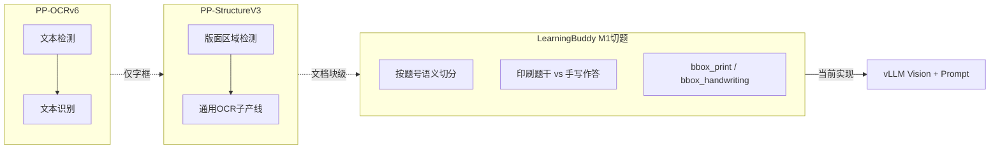

# PaddleOCR v6 能力说明（切题 / 印刷手写分离）

> **读者**：C2 / OCR 选型、M1 切题架构。  
> **结论摘要**：PP-OCRv6 是通用检测+识别升级，**不含**按题切分与印刷/手写语义分离；M1 切题继续以 **vLLM page_analyze** 为主，Paddle 可作草稿 OCR 补强。

---

## 版本对应关系

- **PaddleOCR v6** 在生态里主要指 **PP-OCRv6** 模型族，随 **PaddleOCR v3.7.0**（2026-06-11）发布。
- 与 **PaddleOCR 3.0**（2025-05）整包升级不同：3.0 还包含 PP-StructureV3、PP-ChatOCRv4 等**文档理解产线**；v6 是其中 **通用 OCR 检测+识别** 的新一代 backbone。

参考：[PaddleOCR v3.7.0 Release](https://github.com/PaddlePaddle/PaddleOCR/releases/tag/v3.7.0) · [PP-OCRv6 简介](https://www.paddleocr.ai/latest/version3.x/algorithm/PP-OCRv6/PP-OCRv6.html)

---

## PP-OCRv6 主要新功能

| 维度 | 内容 |
|------|------|
| 架构 | 统一骨干 **PPLCNetV4**；检测用 **RepLKFPN**（7×7 感受野、更轻）；识别用 **EncoderWithLightSVTR** + CTC/NRTR 多头 |
| 模型档位 | **tiny**（1.5M）/ **small**（7.7M）/ **medium**（34.5M），端侧→服务端 |
| 精度 | medium 相对 PP-OCRv5_server：**检测 +4.6%**、**识别 +5.1%**（官方多场景评测集） |
| 多语言 | 单模型 **50 种语言**（中/英/日 + 46 种拉丁语系；tiny 不含日文） |
| 场景增强 | 数码屏、点阵字、轮胎印字、工业字符等 |
| 速度 | 官方称 medium CPU OpenVINO **5.2×**、A100 **~0.13s** 等 |

**PP-OCRv6 本质仍是：文本检测 →（可选方向分类）→ 文本识别。** 不负责版面语义、题目级切分、像素级去手写。

---

## 有没有「切题」？

### 结论：**PP-OCRv6 本身没有「按题号切题」能力**

- 它输出的是**文本框 + 识别文本**，没有 `question_id`、`题干区/作答区` 等试卷语义字段。
- 官方更接近「切题」的是 **PP-StructureV3 + PP-DocLayout** 文档版面产线（PaddleOCR 3.0 / PaddleX）：
  - 训练数据含**试卷、课本**等文档类型（如 PP-DocLayout_plus-L）。
  - 版面类别是 **23 类文档元素**（`paragraph_title`、`text`、`table`、`formula`、`header`…），见 [PP-DocLayout 论文](https://arxiv.org/html/2503.17213v1) Table 5。
  - 能把试卷页切成「标题块 / 正文块 / 表格 / 公式」等区域，**不是** Learning Buddy M1 所需的「第 N 题 + 印刷题干 bbox + 手写作答 bbox」。



### 与 Learning Buddy 现状

当前 C2 网关 [`exam-ocr-server/app/vllm_client.py`](../exam-ocr-server/app/vllm_client.py) 已通过 **vLLM 视觉模型 + `PAGE_ANALYZE_PROMPT`** 产出 `print` / `handwriting` / `bbox_print` / `bbox_handwriting`，这是**语义切题**，不是 PaddleOCR 路线。路线图 M1 切题仍标为 C2 待完成（[`learning-buddy-status-and-roadmap.md`](learning-buddy-status-and-roadmap.md)）。

**若用 Paddle 生态做切题**，现实路径是：

1. **PP-DocLayout** 做粗版面 → 再自训/规则按题号聚合；或
2. **专题目标检测**（每题一个框）微调 RT-DETR 等；或
3. 继续 **VLM 结构化**（已在用），Paddle 仅作 OCR 字识别补强。

---

## 有没有「手写体 / 印刷体分离」？

### 结论：**没有一键「分离模块」；有「混合识别」+ 官方推荐的自建分流方案**

| 能力 | PP-OCRv6 是否内置 | 说明 |
|------|-------------------|------|
| 同一识别模型同时认印刷+手写 | **是（混合识别）** | PP-OCRv5/v6 识别模型训练数据含文档+手写场景；**不区分**每条是印还是写 |
| 检测后自动标印刷/手写并分流 | **否** | 需额外分类器 |
| 像素级「去掉手写只留印刷」 | **否** | 社区讨论多为检测+分类+选择性识别，或 mask 固定区域 |
| 每题分别给印刷区/手写区 bbox | **否** | 属版面/语义任务，非 OCR 管线默认输出 |

官方 FAQ（[PaddleOCR FAQ](https://github.com/PaddlePaddle/PaddleOCR/blob/main/docs/FAQ.md)）对「单图印刷+手写并存」的推荐架构：

> **1 个检测模型 + 1 个 N 分类模型 + N 个识别模型**

典型落地（[GitHub Discussion #13310](https://github.com/PaddlePaddle/PaddleOCR/discussions/13310)）：

- 检测裁切文本行后，用 **PaddleClas PULC** 等训练**印刷/手写二分类**；
- 印刷框 → 通用 rec；手写框 → 手写专用 rec（或跳过不识别）。

这与 Learning Buddy 的 **`print` + `handwriting` 字段分离** 目标一致，但需**自研编排**，不是 `paddleocr --version 6` 自带。

---

## PaddleOCR 3.x 生态里与「文档/切题」更相关的（非 v6 专属）

若评估「能不能替代/补充 C2 切题」，应一起看：

- **[PP-StructureV3](https://paddlepaddle.github.io/PaddleX/latest/pipeline_usage/tutorials/ocr_pipelines/PP-StructureV3.html)**：版面 + OCR + 表格/公式/印章子产线 → Markdown/JSON
- **PP-DocLayout / PP-DocBlockLayout**：试卷在训练分布内，但是**文档块级**
- **PaddleOCR-VL-1.6**（v3.7.0 同步发布）：轻量文档解析 VLM，偏整页结构化，非传统 PP-OCRv6
- **PP-ChatOCRv4**：OCR + 大模型信息抽取

---

## 对 Learning Buddy M1 的简要建议

| 需求 | PP-OCRv6 直接满足？ | 更匹配方案 |
|------|---------------------|------------|
| 高精度中英文字识别（含部分手写） | 部分满足 | PP-OCRv6 作 C2 **字识别层**；复杂手写数字可再训 rec |
| 按题切分 + 印/写 bbox | **不满足** | 继续 **VLM page_analyze** 或 **自训题目检测 + OCR** |
| 印刷/手写文本分流识别 | **需自建** | 检测 + PULC 二分类 + 双 rec；或 VLM 先分字段再 OCR |
| 低成本批量 OCR 草稿 | 满足 | v6 medium/small 适合替代部分云 OCR 草稿环节 |

**准确率主链不变**（产品规则）：

```text
C2 OCR 草稿 → ocr_refine → A RAG → ③ 评测
```

Paddle 更适合放在 **草稿 OCR / 局部 rec**，不宜指望 v6 单独完成 M1 切题语义。

---

## 参考链接

- [PP-OCRv6 简介](https://www.paddleocr.ai/latest/version3.x/algorithm/PP-OCRv6/PP-OCRv6.html)
- [PaddleOCR v3.7.0 Release Notes](https://github.com/PaddlePaddle/PaddleOCR/releases/tag/v3.7.0)
- [通用 OCR 产线（含 PP-OCRv6）](https://paddlepaddle.github.io/PaddleX/latest/pipeline_usage/tutorials/ocr_pipelines/OCR.html)
- [PP-StructureV3 版面解析](https://paddlepaddle.github.io/PaddleX/latest/pipeline_usage/tutorials/ocr_pipelines/PP-StructureV3.html)
- [印刷/手写分流 FAQ](https://github.com/PaddlePaddle/PaddleOCR/blob/main/docs/FAQ.md)
