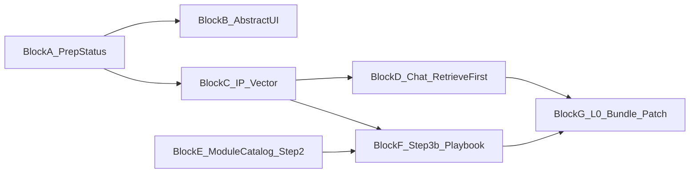

# 四步导入与经验库 · 分块执行计划

> 日期：2026-08-04  
> 状态：实现分块总览（设计已齐，按块开码）  
> **权威设计**：[doc/improvement-point-management.md](../improvement-point-management.md) §11–§15  
> **导入短链**：[doc/mineru-fullbook-import-flow.md](../mineru-fullbook-import-flow.md) §8.7  
> **Canvas**：`ip-rag-four-step-blueprint`  
> **Block A 详规**：[doc/plans/ip-block-a-prep-status.md](ip-block-a-prep-status.md)

下文只谈**实现分块**，不改设计权威文口径。原则：每块相对独立、单独可上线；最终拼成完整蓝图。

## 拼合关系

- **可单独上线、立刻有用**：A、C、E（模块目录可先只读）、G 的「建议草稿+汇总卡」可先不做自动打补丁。  
- **硬依赖**：B 依赖 A 的 `ready`；D 依赖 C 的检索 API；F 依赖 C（及可选 E）；G 完整补丁链可独立，但「末段弹出」宜接在 D/F 会话末尾。

---

## Block A — 整理状态 + 拆分/矛盾（推荐最先）

**状态：已实现**（2026-08-04）。**独立价值**：台账可卫生，抽象不被脏数据污染；不改导入主链。

| 项 | 内容 |
|----|------|
| 范围 | `prep_status` 列（`needs_split` / `needs_conflict_resolve` / `ready`）；与现有 `needs_split` 对齐；拆分提案 API；矛盾对列表 + 人裁决（硬删） |
| 仓库 | `learning-buddy-api`（models / migrate / improvement_points / corpus_admin）；Studio `ImprovementsPanel` / Inspector |
| 不做 | 抽象三层 UI、向量、导入四步 |
| 验收 | 列表可筛整理状态；复合 IP 不能标 ready；矛盾未决不能 ready；重建 buddy-api/worker + c2-gateway |
| 存量 | 一次性回填：`needs_split=1` → `needs_split`；其余 → `ready` |
| 详规 | [ip-block-a-prep-status.md](ip-block-a-prep-status.md) |

---

## Block B — 「抽象」按钮 + 三层呈现

**独立价值**：在 ready 集合上看到生效面 → 手册 → IP；仍可不改导入。

| 项 | 内容 |
|----|------|
| 依赖 | Block A |
| 范围 | Studio 对 ready 多选 → 抽象；后端组装三层树（默认可先全归 `L3.book_patch`）；闸：非 ready 403 |
| 仓库 | buddy-api patterns/IP 组装；Studio 改进点；技能 `buddy-copilot/agent-env/skills/pattern-abstract.md` |
| 不做 | 自动写 layout_rules；向量索引手册 |
| 验收 | 非 ready 无按钮；ready 出三层；旧 137 空桶不自动当成员 |

---

## Block C — IP 全集向量索引 + 检索 API

**独立价值**：任意客户端可「按症状搜成功 procedure」；导入/对话未接也能用 HTTP/工具验。

| 项 | 内容 |
|----|------|
| 依赖 | 建议 A 完成后只索引 `ready`（若 A 未上，临时索引全部 accepted + 成功路径） |
| 范围 | 新 collection（或隔离前缀）；upsert on confirm/prep→ready；`POST .../improvement-points/search` |
| 仓库 | `learning-buddy-api/app/rag/` 复用 embedder/Milvus；**不**新建向量引擎 |
| 不做 | Copilot 强制检索顺序（属 D） |
| 验收 | 已知摘要能召回对应 IP；删除 IP 后索引同步 |

---

## Block D — Step4 对话「先检索再施工」

**独立价值**：挑错复用历史经验，降低胡改。

| 项 | 内容 |
|----|------|
| 依赖 | Block C |
| 范围 | Copilot：`import_advice`（或改页场景）系统规则 + MCP 工具硬顺序——用户改页意图 → 必调 IP search → 再 patch |
| 仓库 | `buddy-copilot/agent-env/`、tools 插件；重启宿主机 `:8200` |
| 不做 | 四步里的 Step2/3b、L0 汇总 |
| 验收 | 对话轨迹可见先 search 后改页；用户「勿用旧经验」可跳过 |

---

## Block E — 模块目录 + Step2 AI 自动选积木

**独立价值**：新书导入可自动叠确定性规则，不必手写 YAML。

| 项 | 内容 |
|----|------|
| 依赖 | 无硬依赖；有手册向量更好，首期可用「模块卡片 JSON + 底稿特征」 |
| 范围 | 从 editions `layout_rules` / 已 publish config 导出模块卡片；job 级 Blueprint；AI 选模块；worker 叠层后渲染 |
| 仓库 | buddy-api configs + import；Copilot 选模块工具；Studio 展示蓝本（只读+轻量改选） |
| 不做 | Step3b；L0 |
| 验收 | 蓝本稳定可解释；未选中 = edition 默认；同书重导仍只 L3 |

---

## Block F — Step3b 初渲后手册/IP 二次施工

**独立价值**：初渲差页自动用经验库施工，减少纯人工翻页。

| 项 | 内容 |
|----|------|
| 依赖 | C（检索）；E（有蓝本更佳，无 E 也可对默认渲结果跑） |
| 范围 | escalate/启发式差页：检索 → 施工 → confirm；L0 提案 B 只写草稿（确认在 G） |
| 仓库 | buddy-worker / Copilot；与 35B 线隔离 |
| 不做 | 用户确认 L0 执行 |
| 验收 | 差页有检索轨迹；新 IP 入库；不静默改 L0 源码 |

---

## Block G — L0 双阶段提案 + 末段汇总 + 补丁回退

**独立价值**：流水线级修复可批可回退，且不打断渲中流程。

| 项 | 内容 |
|----|------|
| 依赖 | 提案写入可先于 D/F；**确认弹窗**挂在会话末段（接 D/F） |
| 范围 | L0 建议草稿表；提案 A/B 只记账；对话末段汇总卡；执行 = 仓库补丁 + pytest + rebuild 镜像 + 一键回退；**禁止** worker 内 exec 生成码 |
| 仓库 | buddy-api；Copilot 对话卡；补丁目录与回退脚本 |
| 验收 | 渲中不弹确认；末段一次汇总；diff 留痕；可回退 |

---

## 推荐推进顺序

1. **A** → 立刻改善台账（详规见 [ip-block-a-prep-status.md](ip-block-a-prep-status.md)）  
2. **C** → 立刻可搜经验  
3. **D** → 对话「检索优先」  
4. **B** → 抽象可视化  
5. **E** → 导入侧自动选积木  
6. **F** → 初渲后二次施工  
7. **G** → L0 闭环（草稿表可与 E/F 并行，确认卡最后接）

每块合并前：该块自测 + 重建相关镜像（api/worker/gateway）+ 权威文若有 API 落成则补「已实现」标记（不重写设计）。

## 明确不在本执行计划内

- 设计-only 文档/Canvas 再扩写（已完成）  
- 导入时 LLM 热执行 L0  
- 用检索替代 L3 同书回放  
- 与 MinerU 并行的第二条 OCR 引擎  

## 每块完成时的「拼合检查」

- 进表即有效、`origin` 两值、同书 L3、`land` 不写盘  
- 全隔离（不动 import35b 线）  
- 全部块完成后对齐权威文 §15 六条目标验收  
