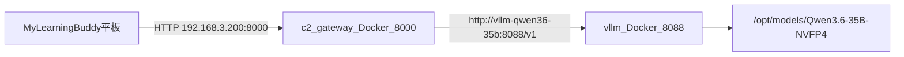

# Spark C2 双 Docker 执行计划

## 目标架构



| 组件 | 容器名 | 端口 | 职责 |
|------|--------|------|------|
| 推理 | `vllm-qwen36-35b` | 8088（仅 `127.0.0.1` 或 Docker 内网） | NVFP4 + Marlin；OCR / 切题 / 手写印刷分离 / 后续 C1 |
| 网关 | `c2-gateway` | 8000（`0.0.0.0`） | 原 exam-ocr-server API + companion；调 vLLM |

**明确废弃**：`:8765`、`glm_ocr_sdk` / `pp_ocr` / `mineru_ocr`、Albond 122B、Windows/WSL C2 运行时。

**层边界**：两容器均属 C2/C1 推理侧；不实现 ③、A⁺（见 [learning-buddy.mdc](../../.cursor/rules/learning-buddy.mdc)）。

---

## 阶段 0 — Spark 环境与国内加速（约 30 分钟）

在 Spark 执行（已有脚本见 [tools/setup-china-mirrors.sh](tools/setup-china-mirrors.sh)、[tools/setup-china-mirrors-system.sh](tools/setup-china-mirrors-system.sh)）：

1. `tools/setup-china-mirrors.sh` → HF / pip / npm / GitHub gitclone
2. `tools/setup-china-mirrors-system.sh` → apt ubuntu-ports + [tools/configs/docker-daemon.json](tools/configs/docker-daemon.json) registry-mirrors
3. `source ~/.bashrc` + `tools/check-dgx-health.sh`
4. 确认：`nvidia-smi`、`docker ps`、磁盘 ≥80GB 可用（35B NVFP4 ~20GB + 镜像缓存）

持久化变量（宿主机 + 写入 compose）：

- `HF_ENDPOINT=https://hf-mirror.com`
- `PIP_INDEX_URL=https://pypi.tuna.tsinghua.edu.cn/simple`

---

## 阶段 1 — 预下载模型（约 1–2 小时，国内）

宿主机预下载，避免容器内拉 HF：

```bash
sudo mkdir -p /opt/models
sudo chown -R $USER:$USER /opt/models
cd /opt/models
wget -O hfd.sh https://hf-mirror.com/hfd/hfd.sh
chmod +x hfd.sh
./hfd.sh nvidia/Qwen3.6-35B-A3B-NVFP4 \
  --local-dir /opt/models/Qwen3.6-35B-A3B-NVFP4
```

备用：`hf download` + `HF_HUB_ENABLE_HF_TRANSFER=1`；仍失败试 ModelScope。

验收：`du -sh /opt/models/Qwen3.6-35B-A3B-NVFP4` 约 15–25GB。

---

## 阶段 2 — 同步 exam-ocr-server 源码（WSL → Spark）

**源**：WSL `/mnt/d/01_coding/LearningStack/exam-ocr-server`  
**目标**：Spark `~/workspace/exam-ocr-server`

在 **WSL** 执行（排除 build 产物）：

```bash
rsync -avz --exclude '.gradle' --exclude 'build' --exclude 'node_modules' \
  /mnt/d/01_coding/LearningStack/exam-ocr-server/ \
  mylearningbuddy@192.168.3.200:~/workspace/exam-ocr-server/
```

同步后在 Spark 盘点（Agent 第一步只读）：

- 技术栈（Gradle/Spring Boot 等）、JDK 版本、`application.yml` / `.env`
- 当前 Hub 地址配置（`:8765` 相关变量名）
- 平板 API 路径：`/api/v1/system/health`、multipart OCR、companion 分节
- [windows-adaptation-2026-06.md](doc/learning-buddy-status-and-roadmap.md) 中 Windows 专用逻辑

---

## 阶段 3 — 改造 exam-ocr-server → C2 Gateway（代码）

在 `~/workspace/exam-ocr-server` 内改造（**不新建 exam-ocr Hub 仓库**）：

### 3.1 删除 / 禁用

- 所有对 `http://127.0.0.1:8765` 及三引擎的路由、客户端、配置
- Fleet / 多引擎选择逻辑

### 3.2 新增 VLLM Vision 客户端

- 配置：`VLLM_BASE_URL=http://vllm-qwen36-35b:8088/v1`、`VLLM_MODEL=qwen36-35b-nvfp4`
- 统一调用 OpenAI 兼容 `chat/completions`（多模态：image + 结构化 prompt）
- 三个 C2 capability（可先复用/扩展现有 OCR 端点，内部分 task 路由）：

| Task | 说明 |
|------|------|
| `page_ocr` | 整页结构化 OCR |
| `segment_questions` | 切题（题干 / 作答区） |
| `split_handwriting_print` | 手写 vs 印刷分离 |

输出：JSON schema 固定，便于 Android companion-pipeline 消费。

### 3.3 保留

- 原 `:8000` 平板入口、health、companion multipart 外层协议（减少 App 改动）
- mDNS 可选：优先平板固定 `http://192.168.3.200:8000`

### 3.4 新增 Dockerfile

路径建议：`~/workspace/exam-ocr-server/Dockerfile`（或 `deploy/Dockerfile`）

- 基础镜像优先 `nvcr.io` 或 slim + 国内 apt/pip 源
- `ENV PIP_INDEX_URL=...`（若含 Python 脚本）
- **无 GPU**；暴露 8000
- 健康检查：`GET /api/v1/system/health`

---

## 阶段 4 — 部署目录与 docker-compose（Spark 本机）

新建部署编排（建议放在 Spark 工作区，与产品文档并列）：

`~/workspace/learning-buddy-c2/docker-compose.yml`  
`~/workspace/learning-buddy-c2/.env.example`

```yaml
# 结构要点（实施时补全 command / build context）
networks:
  learning_buddy_c2:
    name: learning-buddy-c2

services:
  vllm:
    container_name: vllm-qwen36-35b
    image: vllm/vllm-openai:cu130-nightly   # pull 走 daemon registry-mirrors
    networks: [learning_buddy_c2]
    gpus: all
    ipc: host
    shm_size: "16gb"
    ports: ["127.0.0.1:8088:8088"]
    volumes:
      - /opt/models:/models
      - ~/.cache/huggingface:/root/.cache/huggingface
    environment: { HF_ENDPOINT, Marlin 五变量见下 }

  c2-gateway:
    container_name: c2-gateway
    build: ~/workspace/exam-ocr-server
    networks: [learning_buddy_c2]
    depends_on: [vllm]
    ports: ["8000:8000"]
    environment:
      VLLM_BASE_URL: http://vllm-qwen36-35b:8088/v1
      VLLM_MODEL: qwen36-35b-nvfp4
```

**vLLM Marlin 环境变量（GB10 必设）**：

- `VLLM_USE_FLASHINFER_MOE_FP4=0`
- `VLLM_NVFP4_GEMM_BACKEND=marlin`
- `VLLM_TEST_FORCE_FP8_MARLIN=1`
- `FLASHINFER_DISABLE_VERSION_CHECK=1`
- `CUTE_DSL_ARCH=sm_121a`

**vLLM 启动参数要点**：`serve /models/Qwen3.6-35B-A3B-NVFP4`、`--quantization modelopt`、`--moe-backend marlin`、`--kv-cache-dtype fp8`、`--max-model-len 65536`、`--gpu-memory-utilization 0.85`、MTP speculative config。

**镜像拉取**：`docker pull vllm/vllm-openai:cu130-nightly`（失败查 mirrors；最后手段局域网代理仅 Docker）。

---

## 阶段 5 — 启动与验收

### 启动顺序

1. `docker network create learning-buddy-c2`（compose 可自动）
2. `docker compose up -d vllm` → 等冷启动（数分钟）
3. `curl -s http://127.0.0.1:8088/v1/models`
4. `docker compose up -d c2-gateway`
5. `curl -s http://127.0.0.1:8000/api/v1/system/health`

### 功能验收

- 样张 multipart → page_ocr JSON 可读
- 同页 → 切题 ≥1 题块
- 同页 → 手写/印刷分离合理
- 局域网：`curl http://192.168.3.200:8000/api/v1/system/health`
- 平板 companion 拍照 → Room 入库（M0 链路）
- Spark 上 **无** `:8765` 监听

### 切流

1. 平板 App 指向 `http://192.168.3.200:8000`
2. 停 Windows `:8000`、WSL `:8765`
3. 保留 WSL rsync 通道供后续开发同步

---

## 阶段 6 — 文档与配置同步

更新（与运行时一致）：

- [doc/learning-buddy-status-and-roadmap.md](doc/learning-buddy-status-and-roadmap.md) §2 拓扑：C2 运行在 Spark；单 Gateway + vLLM；弃 8765/三引擎
- [learning-buddy SKILL](../../.cursor/skills/learning-buddy/SKILL.md) 路径与验收命令
- 可选：在 [`learning-buddy-c2/README.md`](../../learning-buddy-c2/README.md) 写运维命令（start/stop/logs）

**对接变量**：

```text
C2_BASE_URL=http://192.168.3.200:8000
VLLM_BASE_URL=http://192.168.3.200:8088/v1   # 仅本机/SSH 隧道调试
VLLM_MODEL=qwen36-35b-nvfp4
```

---

## 风险与回滚

| 风险 | 缓解 |
|------|------|
| vLLM nightly 拉取慢 | registry-mirrors；预 pull；备用社区 Spark 镜像 |
| NVFP4 SM121 CUTLASS 失败 | 必须 Marlin 三变量 |
| Gateway 改造破坏平板协议 | 保留原 HTTP 路径；仅替换后端推理 |
| OCR 质量不达标 | 调 prompt/schema；M2 加 ocr_refine；不换回三引擎除非产品决策 |
| GPU 争用 | 35B 体量小；`gpu-memory-utilization 0.85`；可独立 restart 任一容器 |

**回滚**：恢复 Windows `:8000` + WSL `:8765`，平板改回旧地址。

---

## 预估工期

| 阶段 | 时间 |
|------|------|
| 0 镜像加速 | 0.5h |
| 1 模型下载 | 1–2h |
| 2 rsync + 盘点 | 0.5h |
| 3 Gateway 改造 + Dockerfile | 1–2d |
| 4 compose + vLLM 调通 | 0.5–1d |
| 5 验收 + 切流 | 0.5d |
| 6 文档 | 0.5h |

**合计约 3–4 个工作日**（含 vLLM 冷启动与 OCR prompt 迭代）。
