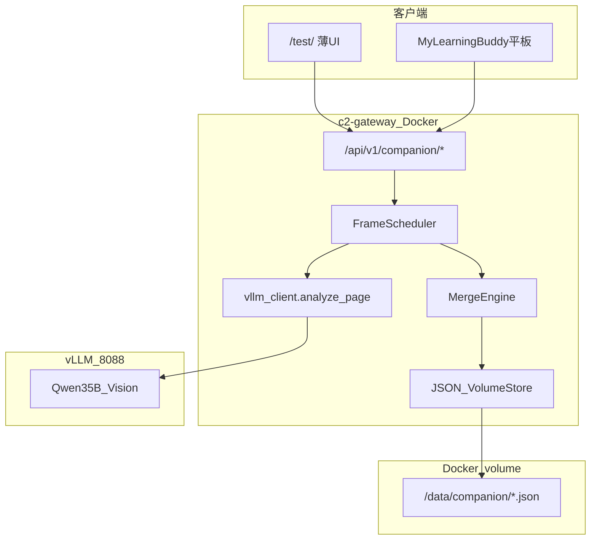

# 伴学 Pipeline 实施计划（网关核心 + 薄前台）

## 架构裁决（相对原「前台全量」方案的变更）

**你的判断是对的**：伴学流水线的**核心**（调度、合并、会话状态、定稿逻辑）应放在 **c2-gateway Docker** 内，平板、`/test/`、后续客户端**共用同一 API**，避免 JS/Kotlin 各写一套规则。

| 放网关（本期） | 放前台（本期） | 放 learning-buddy-api（后续） |
|----------------|----------------|-------------------------------|
| 调度 + 合并引擎 | Timeline / 原图预览 / overlay | A⁺ 生产聚合、Memory Drive |
| B 会话态 + 事件日志 | 调用 API、展示 JSON | ①–④ 主链 |
| A HomeworkEntry 定稿 | 作业库 / A⁺ 列表 UI | 多租户、鉴权、同步 |
| A⁺ **简版桩**（规则写入） | 手动「标为掌握」按钮 → 调 API | 观察 Agent、知识点映射 |

**层边界说明**（与 [learning-buddy.mdc](../../.cursor/rules/learning-buddy.mdc) 对齐）：

- 网关新增的是 **伴学编排 + C2 OCR 编排**（`⑥→C2→B→A` 的 M0 子链），**不是** ③ LangGraph、**不是** 生产级 A⁺。
- Android 原设计 `ExamCompanionOcrScheduler` 在 M0 可退化为 **薄客户端**，调网关 companion API；合并规则以网关 Python 为**唯一参考实现**。
- 生产 A⁺ / Memory Drive 仍在 **learning-buddy-api（M3+）**；本期网关 A⁺ 桩需标明 `demo: true`。



---

## 目标与边界

| 项 | 裁决 |
|----|------|
| **产品里程碑** | M0 伴学 Phase 0：手动加帧 → 单帧 OCR → 规则合并 → 定稿 |
| **伴学模块** | **做全**（在网关）：会话、调度、合并、事件、换页/结束 |
| **A / B / A⁺** | **简版跑通**（在网关 volume JSON），字段对齐 roadmap |
| **持久化** | Docker volume 挂载 `/data/companion/`（用户选择） |
| **前台** | 仅 UI：Timeline、预览、列表；**无**合并/存储业务逻辑 |
| **禁止** | ③、LangGraph、生产 Memory Drive、通用题库 RAG |

---

## 现状

- 单帧 OCR：[routes.py](exam-ocr-server/app/routes.py) `POST /api/v1/ocr/page` → [vllm_client.analyze_page](exam-ocr-server/app/vllm_client.py)
- 测试台：[static/app.js](exam-ocr-server/static/app.js) 仅调 `ocr/page`
- 无 companion 路由（历史 `companion/ocr` 已移除）

---

## 一、网关 API 设计（`/api/v1/companion`）

### 1.1 端点一览

| 方法 | 路径 | 作用 |
|------|------|------|
| `POST` | `/sessions` | 创建 `CompanionSession` |
| `GET` | `/sessions/{id}` | 会话全貌：当前页、frames、events、merged_parts |
| `POST` | `/sessions/{id}/frames` | multipart 加帧 → 调度 → OCR → 合并 → 返回本帧结果 |
| `POST` | `/sessions/{id}/finalize-page` | 当前页定稿 → 写 A `HomeworkEntry` + 触发 A⁺ 桩 |
| `POST` | `/sessions/{id}/end` | 结束会话（定稿当前页 + `SESSION_END`） |
| `GET` | `/homework` | 列表 HomeworkEntry |
| `GET` | `/homework/{id}` | 单条详情 |
| `GET` | `/mastery` | A⁺ 简版列表 |
| `PATCH` | `/mastery/{kp_id}` | 手动改掌握度（`mastered` 等） |
| `GET` | `/sessions/{id}/export` | 导出整包 JSON（调试用） |

`POST .../frames` 为**主入口**：内部调用现有 `analyze_page`，不暴露「先 ocr/page 再自己合并」给客户端。

### 1.2 加帧响应（示例字段）

```json
{
  "frame_id": "...",
  "scheduler_action": "merge|skip|new_page",
  "merge_diff": { "new_question_ids": [], "handwriting_growth": {"1": 12} },
  "same_page_score": 0.92,
  "ocr_parts": [...],
  "merged_parts": [...],
  "duration_ms": 12340,
  "homework_finalized": null
}
```

`new_page` 时 `homework_finalized` 含刚落库的上一页 `HomeworkEntry`。

### 1.3 与 `POST /api/v1/ocr/page` 关系

- **保留** `ocr/page`：单帧调试、无会话场景。
- **伴学路径**不要求客户端再调 `ocr/page`；合并逻辑**仅**在 companion 服务内。

---

## 二、网关模块拆分（Python）

| 路径 | 职责 |
|------|------|
| [app/companion/scheduler.py](exam-ocr-server/app/companion/scheduler.py) | 加帧决策：skip / ocr+merge / new_page |
| [app/companion/merge.py](exam-ocr-server/app/companion/merge.py) | `is_same_page`、`merge_parts`、`diff_parts` |
| [app/companion/store.py](exam-ocr-server/app/companion/store.py) | volume JSON 读写、内存缓存 |
| [app/companion/service.py](exam-ocr-server/app/companion/service.py) | 编排：session 生命周期、调 vllm、写事件 |
| [app/companion/routes.py](exam-ocr-server/app/companion/routes.py) | FastAPI 路由 |
| [app/schemas.py](exam-ocr-server/app/schemas.py) | 扩展 companion 相关模型 |

### 2.1 合并规则（与先前裁决一致）

| 规则 | 行为 |
|------|------|
| `header` / `section` | 首帧或更长 `print` |
| `question.print` | 保留首帧 |
| `question.handwriting` | 同 `id` 取更长 |
| 新 `question.id` | 追加 |
| 同页判定 | header/section 相似 + 题干 print 集合一致 |

主路径：**单张 OCR + 规则**；不做双图模型比较。

### 2.2 B 层（网关 store）

```text
/data/companion/
  sessions/{session_id}.json    # Session + PageCaptureState + frames + events
  homework/index.json           # HomeworkEntry 索引
  homework/{entry_id}.json
  mastery/index.json            # A⁺ 桩
```

重启容器后数据仍在 volume 内。

### 2.3 A 层（简版）

`HomeworkEntry`：仅在 `finalize-page` / `end` / `new_page` 时写入；每页一条。

### 2.4 A⁺ 层（简版桩）

定稿时：有手写 → `learning`；仅印刷 → `unknown`；`PATCH` 可改 `mastered`。响应中带 `"demo": true`。

---

## 三、薄前台（`/test/`）

| 文件 | 职责 |
|------|------|
| [static/index.html](exam-ocr-server/static/index.html) | 伴学会话栏 + Timeline + 三栏布局 |
| [static/companion-ui.js](exam-ocr-server/static/companion-ui.js) | Timeline 渲染、事件面板、列表 |
| [static/app.js](exam-ocr-server/static/app.js) | `fetch` companion API；复用 `renderPartCard` / `drawOverlay` |

**删除**原方案中的 `companion-merge.js`、`companion-store.js`（逻辑在网关）。

前台仍保留「单帧 OCR 实验室」入口（可选折叠区调 `ocr/page`）。

---

## 四、Docker 与部署

### 4.1 [learning-buddy-c2/docker-compose.yml](learning-buddy-c2/docker-compose.yml)

为 `c2-gateway` 增加：

```yaml
volumes:
  - companion-data:/data/companion
environment:
  - COMPANION_DATA_DIR=/data/companion
```

### 4.2 构建与启动

```bash
cd ~/workspace/learning-buddy-c2
```

```bash
docker compose build c2-gateway
```

```bash
docker compose up -d c2-gateway
```

---

## 五、实施顺序

### Step 1 — Schema + store

- Pydantic 模型；`store.py` 读写 volume JSON；空会话 CRUD

### Step 2 — merge + scheduler

- 纯函数 + 单元测试（同页 3 帧、换页、skip）

### Step 3 — service + routes

- `POST /frames` 串起 vllm + merge；事件日志

### Step 4 — A / A⁺ 定稿

- `finalize-page` / `end`；`GET homework` / `GET mastery`

### Step 5 — 薄前台

- Timeline 调 API；展示 `scheduler_action` / `merge_diff`

### Step 6 — compose volume + 验收

- `acceptance-companion.sh`；重启容器后数据仍在

---

## 六、验收标准

| # | 场景 | 预期 |
|---|------|------|
| 1 | 同页 3 帧（手写递增） | API 返回 merge；**1 条** homework；volume 有文件 |
| 2 | 第 3 帧换页 | **2 条** homework；`scheduler_action=new_page` |
| 3 | 无手写变化 | `skip`；merged 不变 |
| 4 | `end` 会话 | 当前页定稿 + `SESSION_END` |
| 5 | A⁺ | 有手写题 → `learning`；`PATCH` → `mastered` |
| 6 | 重启容器 | volume 内 session/homework 仍可 `GET` |
| 7 | 边界 | 无 ③；`ocr/page` 仍可用；A⁺ 标 `demo` |

---

## 七、后续优化（本期不做）

- 鉴权 / `student_id` 多租户
- 帧图持久化（现仅客户端 objectUrl 预览；可选 volume 存缩略图）
- 迁移 store → `learning-buddy-api` + Room 同步协议
- phash 跳过、连续相机 Phase C
- Kotlin 薄客户端对接文档

---

## 八、关键依赖

- vLLM：`vllm_reachable: true`
- 加帧延迟 ~10–30s：API 同步返回；前台 Timeline 显示 `ocr` 态
